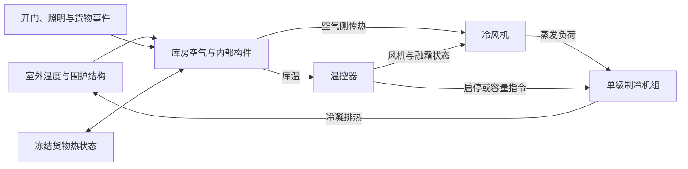
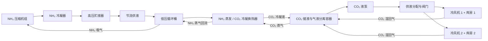

# 冷库案例开发计划：单库房 → NH₃/CO₂ 系统

制定日期：2026-10-18。代码基线：FluidNet Prototype Engine v0.4.10。

2026-10-19 在本案例目录开始实施。当前任务及实测记录见 [TASKS.md](TASKS.md)，入口与目录说明见 [README.md](README.md)。

用户已确定首个案例为 **−18°C 冻结物储藏库**。本计划作为下一阶段的新功能主线；既有试用交付任务见 [ROADMAP.md](../../docs/ROADMAP.md)，两份计划的估算不叠加解释为已经承诺的日历排期。

## 1. 目标与交付顺序

先交付一个在 Studio 中能打开、运行、调参、比较、保存和复算的单库房工程示范案例，再以同一套库房、冷风机、控制与运行记录扩展到 NH₃ 制冷、CO₂ 液泵载冷系统。

首个案例要回答四个问题：库温怎样降到 −18°C；负荷变化后能否恢复；控制策略怎样改变温度波动与耗电；结果依据哪些物理模型和参数。

| 交付版本 | 用户能完成的工作 | 完成边界 |
| --- | --- | --- |
| A：单库房案例 | 演示降温、保温、开门、冻结货物入库、室外升温、融霜与控制对照 | 单级准稳态制冷循环 + 库房动态热平衡；在产品工作流内完成 |
| B：NH₃/CO₂ 案例 | 演示两间库、NH₃ 机组、CO₂ 供液、容器压力/液位、分层控制和融霜 | 分阶段交付；先完成液泵载冷主回路，再增加双级压缩与热气融霜 |
| C：工程校核与策略研究 | 用厂家/现场数据校核，进行压力设定与机组调度比较 | 在 B 的物理与基础控制通过验收后开展；策略研究单独估算 |

“工程示范案例”使用可追溯的假设参数与物理验证。“工程校核案例”需要厂家或现场数据及约定误差。缺少现场数据时可以完成 A 和 B 的示范交付，文档应保留数据来源等级。

## 2. 为什么采用这条路线

当前已有 CoolProp/REFPROP 物性、Python 设备模块、Python 项目控制、PID、动态会话、变量接口、工况对照、模块快照与 SQLite 保存，可以复用大部分产品基础。

仍需新增冷库物理模型和运行耦合机制：

| 对象 | 当前实际能力 | 本计划的工作 |
| --- | --- | --- |
| 库房、货物 | 尚无库房热状态模型 | 新增集中热容量、围护漏热与入库事件 |
| 冷风机 | 尚无空气侧冷却模型 | 新增换热能力、风机热量及运行状态 |
| 制冷机组 | 可以查 PT/PH/PS/PQ 物性；有强制质量流量关系 | 新增完整循环计算、运行范围与电功率模型 |
| 两相过程 | 模块内能查询两相状态；现有流体网络拒绝沿回路相态变化 | A 在制冷机组内部计算两相状态；B 增加明确限定的制冷设备与支路求解 |
| 动态状态 | 内置隐式状态为水箱和管道热容；Python 有提交状态 | 新增库房热状态的试算、耦合、接受与回退机制 |
| 独立验证与发布 | 现有验证台要求至少一条启用流体通路，所有端口绑定通路 | 新增热模型/制冷机组的验证入口与发布校验 |
| 控制 | 采样脚本、PID、运行时参数写入已接通 | 为新模型接入变量、目标与事件；控制状态保持既有提交规则 |

库房需要独立的热状态合同和方程；热模型通过对应验证入口执行，保持设备图形、连接和计算语义一致。

参考资料需要正确解读：[倍思鹿 NH₃/CO₂ 冷库介绍](https://www.baselu.cn/article?id=moqzu05zdi27)描述的是 **NH₃ 制冷 + CO₂ 载冷/液泵供液**，并有融霜循环、单级及双级 NH₃ 压缩设备。正常载冷主回路的 CO₂ 蒸气由 NH₃ 换热器冷凝；CO₂ 主回路不必配置常规压缩机。资料另描述融霜循环含压缩机。

因此 B 不预设为“NH₃/R744 双压缩机复叠系统”。若后续选择 CO₂ 压缩制冷或跨临界系统，应另定拓扑与模型。公开文章和截图不提供完整设备参数，也不能用作整套系统的数值真值。

## 3. A 版案例范围

### 3.1 设备与界面

工作台先提供三个实际参与计算的设备：

1. **库房**：空气及内部构件等效热节点、冻结货物热节点、围护结构漏热、负荷事件。
2. **冷风机**：空气侧 UA、风机功耗、冷却/融霜/滴水等待状态。
3. **单级制冷机组**：压缩、冷凝、节流、蒸发的集中循环模型，提供四个状态点与功率。

温控器作为项目控制对象，负荷日程作为项目事件数据。制冷机组展开视图显示压缩机、冷凝器、节流元件和蒸发器内部状态；这些内部图形在 A 版属于机组模型的组成部分，不宣称已经具备可任意连接的制冷剂管网求解。



### 3.2 首个可复现参数集

下列为开发起点，属于**示范假设**，A0 完成后写入版本化参数文件。涉及物性和设备工作点的数值须经 A2 验证后冻结。

| 参数 | 起始值/规则 | 说明 |
| --- | --- | --- |
| 库房尺寸 | 10 m × 8 m × 4 m，320 m³ | 规则矩形，便于人工核对面积 |
| 目标库温 | −18°C | 冻结物储藏，不模拟从常温冻结食品 |
| 初始库温/货温 | −10°C / −15°C | 货物已冻结；不跨越冻结区间 |
| 室外/地面边界 | 32°C / 10°C | 地面采用独立温度边界 |
| 墙、顶、地板 U 值 | 0.22 / 0.18 / 0.25 W/(m²·K) | 面积分别 144 / 80 / 80 m²；门面积在墙面积中处理 |
| 空气及内部构件等效热容 | 1.2 MJ/K | 明确为等效热容，不能解释为纯空气热容 |
| 初始冻结货物 | 2000 kg，cp = 1.8 kJ/(kg·K) | 货物热容 3.6 MJ/K；示范冻结物显热模型 |
| 货物与库内换热 UA | 0.5 kW/K | 可调；货温响应应慢于库温 |
| 制冷剂 | 默认纯质 R290 | 用 CoolProp HEOS 完成示范；NH₃ 留到 B；不依赖 REFPROP 才能运行首例 |
| 额定机组制冷量 | 10 kW | 在额定蒸发 −28°C、冷凝 40°C、过热 5 K、过冷 3 K 工作点定义 |
| 压缩机等熵/容积/电机效率 | 0.65 / 0.75 / 0.90 | 常数效率示范；实际型号曲线后续替换 |
| 冷风机 UA | 起始 1.0 kW/K | 在库温 −18°C、蒸发 −28°C 时与 10 kW 设计量级一致，最终需耦合核对 |
| 风机功率 | 库内 0.30 kW；冷凝器 0.20 kW | 库内风机功率计入库内热负荷；分别记录耗电 |
| 照明 | 开启时 0.10 kW | 由日程决定开启时段 |
| 可调容量 | 关机，或 35%–100% | 作为理想化变容量能力；运行包络待验证，不等同具体厂家变频机组 |
| 控制采样/最小启停时间 | 5 s；最小开机 120 s、停机 180 s | 仿真时间；具体调节方向与符号须有测试 |

该几何与 U 值在 −18°C 下的示范围护漏热为：墙 1584 W、顶 720 W、地板 560 W，共 **2864 W**，尚未包含开门、照明、风机及货物负荷。此值是参数算术校核，不是完成的冷库选型结果。

货物在 A 版只计算冻结状态下的显热；跨冻结温区、潜热、呼吸热、空间温度分布与空气湿度/结霜机理在 A 的边界之外。开门使用声明来源与时长的等效附加热负荷，能包括估算的潜热部分，但不输出未经计算的湿度或霜量。

### 3.3 核心物理方程

**库房与货物**至少有两个温度状态：

```text
C_room · dT_room/dt = Σ U_i A_i (T_boundary,i − T_room)
                       + Q_door + Q_lighting + P_fan,in + Q_defrost
                       + UA_goods (T_goods − T_room) − Q_evap
C_goods · dT_goods/dt = −UA_goods (T_goods − T_room)
```

风机、融霜加热器、照明按实际状态计热与计电。商品入库改变质量、热容与能量；以固定能量参考温度记录加入/带走的能量，温度通过能量守恒更新。加入不同货物批次时先实现同类冻结物的完全混合温度近似；货物换热 UA 的质量缩放规则在 A0 固定并随参数保存。

**制冷循环**使用压力、焓与熵计算：

```text
1：蒸发压力下的吸气状态（过热发生在蒸发器内的首版假设）
2s：排气压力下与 1 等熵的状态
h2 = h1 + (h2s − h1) / eta_is
3：冷凝压力下的过冷液体
h4 = h3                         节流等焓
Q_evap = m_dot (h1 − h4)
P_shaft = m_dot (h2 − h1)
Q_cond = m_dot (h2 − h3) = Q_evap + P_shaft
P_comp,electric = P_shaft / eta_motor
```

电机损耗在 A 的默认模型中排向机组外部环境，不额外加入制冷剂冷凝负荷；若修改此假设，需要同步修改能量账本。压缩机停机时制冷量与压缩功为零，辅助设备按各自状态计算，COP 显示为空。

分别定义机组 COP（制冷量/压缩机电功率）和系统瞬时 COP（制冷量/当时全部设备电功率）；融霜及待机电量进入周期总耗电。累计制冷量/累计系统电量作为周期性能指标，计算时说明积分区间。

质量流量由吸气密度、排量、容积效率和容量指令决定。排量可由明确声明的额定 10 kW 工况反算一次并保存；不得每个时间步重新缩放以强行得到目标制冷量。常数效率和部分负荷曲线均须标明为假设，厂家曲线采用运行包络内插并记录来源。

**冷风机与冷凝器耦合**分两步完成：A2 先在给定蒸发/冷凝温度下验证循环；A3 解蒸发器负荷匹配与冷凝器排热匹配：

```text
Q_evap,cycle = UA_evap,effective (T_room − T_evap)
Q_cond,cycle = UA_cond,effective (T_cond − T_ambient)
```

未知蒸发/冷凝温度在运行包络内求解，与库房隐式时间步联立或外迭代至收敛。冷凝器 UA 在额定工作点按排热量定义，环境温度变化必须影响循环能力；不能在高温工况下继续硬编码同样的制冷量和 COP。

关机与融霜状态直接采用对应热源/辅助功率和库房热平衡，不调用要求正质量流量的制冷工作点方程。开机请求满足状态机条件后重新求工作点；无可行工作点时报告能力或运行范围诊断。

A 默认忽略制冷剂管路压降、制冷剂库存与容器动态；在四个状态点内部处理相变。物性查询、压缩比、排气温度、换热方向、效率、质量流量及换热能力都要校验。超出模型运行范围返回可定位诊断；不能把负值夹成零后继续宣称正常制冷。

### 3.4 控制和可复现演示工况

温控启停采用滞环，示范初值为库温高于 −17.5°C 时请求开机，低于 −18.5°C 时请求停机，满足最小启停时间后生效。变容量方案采用 PI/PID 或分段容量控制，输出为容量请求，经过最小运行容量和启停状态机；物理模型据此计算制冷量并推进库温。

| 工况 ID | 演示内容 | 输入与观察 |
| --- | --- | --- |
| A-S01 | 基础降温与保温，6 h | 初始库温/货温按默认值；观察到达目标的时间、货温滞后和启停 |
| A-S02 | 开门扰动，6 h | t=2 h 附加 5 kW、持续 10 min；观察峰值库温和恢复时间；参数为演示热负荷 |
| A-S03 | 冻结货物入库，8 h | t=2 h 加入 500 kg、−12°C 的同类冻结物；核对质量、混合能量和后续恢复 |
| A-S04 | 高环境温度，8 h | t=2 h 室外从 32°C 变为 38°C；观察冷凝温度、排气温度、制冷能力与耗电 |
| A-S05 | 控制策略对照，24 h 仿真 | 完全相同的初值、开门/货物/环境日程，对照启停与变容量 |
| A-S06 | 定时电融霜，24 h 仿真 | 示范日程 t=8 h、16 h，各加热 15 min、1.5 kW；默认风机停止、滴水等待后恢复制冷 |
| A-S07 | 能力不足与越界诊断 | 降低容量/UA 或提高负荷；如实显示持续温度超限、不能恢复或运行范围错误 |

S06 是预定日程的简化电融霜，用于展示控制状态与热量/电量账本；加热传入库房的比例单独声明。A 不计算霜量和融霜完成程度，不据此优化融霜周期。B 再增加与霜状态、热气和供回液过程耦合的模型。

结果至少输出：库温、货温、设定值、蒸发/冷凝温度及压力、吸排气温度、四个循环状态点、质量流量、制冷量、压缩机与各辅助设备功率、累计电量、开机次数、运行时长、控制模式、事件和能量残差。

## 4. 接入当前项目的实现方案

### 4.1 编译与运行入口

采用**限定范围的热系统编译与执行分支**。保留既有流体网络默认行为，为库房、冷风机和制冷机组增加明确的模型标识与热连接合同，由编译器判断执行类型。热连接的温度/热流语义与普通流体压力/质量流量连接分开校验。

建议增加 `thermal` 端口域及热系统连接绑定；只为本案例所需的节点和设备定义合同。控制信号使用声明的变量绑定，不开展通用电力、机械或空气流场求解。A0 固定字段名、可写参数、连接方向和迁移规则；实现时从当前 `schema_version=1` 增加必要的版本兼容与迁移测试。

运行层提取有范围限制的会话协议（初始化、推进、取帧、写参数、结束），通过会话工厂选择既有 `SimulationSession` 或新增冷库会话。`jobs.py` 与同步运行入口均接入，不能只让浏览器调用一个独立演示脚本。A 不要求任意混合物理系统耦合；B 根据明确的 NH₃/CO₂ 拓扑扩展组合执行。

### 4.2 状态、数值时序与事件

- 库房热状态采用隐式 Euler；发布帧与内部积分子步分开。默认发布间隔 30 s，内部最大步长初值 10 s，控制采样 5 s，最终值由步长收敛确定。
- 每子步：读取最近接受状态 → 应用到期事件/控制提案 → 试算热状态与循环工作点 → 校核质量、能量与运行范围 → 接受并提交状态、电量和计数。
- 子步按开门开始/结束、货物入库、环境变化、控制采样、最小启停期限和融霜状态转换时间截断；事件在仿真时刻发生，与浏览器刷新和墙钟速度无关。
- 试算失败允许有边界的缩步重试，恢复状态、参数提案和累计指标。事件与累计电量不能在重复迭代中重复执行。成功子步后统一发布对应结果。
- A 需要的是暂停、单步和继续保持状态；跨服务重启仍读取历史并新建运行，不把已有归档误当作完整续算检查点。
- 24 h 仿真使用后台 fast 会话和有界历史；同步接口原有 2001 帧限制保持。30 s 发布的 24 h 仿真有 2881 帧，应明确走后台入口。

### 4.3 数据、工况、验证台与前端

| 工作 | 具体要求 |
| --- | --- |
| 契约 | 严格定义库房、货物、机组、冷风机、事件、状态及连接；规范单位为 K、Pa、W、J、kg、s |
| 参数与日程 | 环境温度、启用/容量、风机状态等可按规则运行时修改；几何、工质、结构参数停止后修改；带时间的事件有稳定 ID、类型和单位 |
| 工况 | 现有工况覆盖用于静态参数；新增事件日程的工况支持，在标准化、保存、导入导出和请求快照中完整保留 |
| 状态与记录 | 所有新变量进入同一 RunFrame；事件、能量累计、模型/参数版本、物性后端与数据来源随运行归档 |
| 模块验证 | 热模型验证台用温度/热负荷边界与热状态；制冷机组验证台使用工作点；原有流体验证台保持原行为 |
| 发布与复用 | 首版可先内置经过测试的模型；发布逻辑按执行类型验证。后续 Python 热模块需要专门的试算/状态合同，A 不声称现有 Worker 可直接执行任意热模型 |
| 前端 | 案例卡片、一键创建副本、实际设备画布、参数草稿/应用、负荷日程、控制设置、预设曲线与运行对照 |
| 曲线与指标 | 使用稳定实例变量绑定，不能继续硬编码示例 P1/V1；显示 °C、kPa、kW、kWh，底层保留规范单位 |
| 报告 | 首版导出 HTML 报告与 CSV 数据：输入、公式/假设、事件、图表、指标、版本和验证等级；PDF 产品化导出可后续增加 |
| 旧数据兼容 | 旧流体项目、模块升级、工况、浏览器旧存档迁移和已有备份恢复均能继续完成 |

当前 PID/脚本目标主要沿运行时数值参数校验；A0 明确容量和启用请求的类型及接入方法。若新增布尔或枚举型运行目标，需同步扩展命令、控制写入和原子校验，不能只在界面增加一个开关。

### 4.4 建议代码落点

以下是实施落点建议，带“新增”的路径尚不存在，A0 后按依赖关系确认最终拆分。

| 位置 | 计划修改 |
| --- | --- |
| `backend/fn_engine/models.py` | 模型/端口域、热连接、事件与参数来源的严格合同和兼容策略 |
| `backend/fn_engine/catalog.py`、`bridge.py`、`compiler.py` | 新模型目录、原型归一化、热系统校验与编译分支 |
| 新增 `backend/fn_engine/refrigeration/` | `cycle.py` 循环物理；`room.py` 热平衡；`air_cooler.py` 换热与状态；`compile.py` 限定拓扑编译；`session.py` 耦合时间推进 |
| `simulation.py`、`jobs.py`、`api.py` | 会话工厂与公共运行协议；参数写入、事件、后台/同步运行和统一帧 |
| `bench.py`、`module_validation.py`、`packages.py` | 按模型执行类型分配验证条件与发布校验 |
| `properties.py` | 复用物性；补明确缺失的制冷状态查询/相态诊断，避免每轮水力求值查全部物性 |
| `projects.py`、`storage.py`、`backup.py` | 日程与新合同保存、修订、迁移、运行归档和备份完整性 |
| 新增 `frontend/cold-storage.js` | 案例创建、负荷日程、机组状态视图和指标；通过现有服务适配层运行 |
| `frontend/studio.js`、`engine-client.js`、`modeling-workflows.js` | 热设备画布、单位映射、控制目标、预设曲线与工况对照 |
| `cases/cold-storage/` | 案例计划、任务记录、参数、日程、项目快照、参考工作点与数据来源清单 |
| 新增 `tests/test_refrigeration_*.py`、`tests/browser-cold-storage.mjs` | 物理与状态验证、真实浏览器工作流；接入 CI |
| `cases/cold-storage/tools/verify_reference.py`；后续 `scripts/verify_cold_storage.py` | 当前独立工作点参考；后续批量运行产品工况，生成指标、验证结果与案例包 |

### 4.5 A1 实际落点（2026-10-20）

A1 按 4.4 落地了首批代码；A2 及以后在同一分支上继续，不改变既有流体项目路径。

| 位置 | 实际内容 |
| --- | --- |
| `backend/fn_engine/refrigeration/compile.py` | 限定拓扑编译：只允许 `cold_room` + `ideal_cold_source`、一对一热连接；拒绝未连接端口、混合模型、参数/端口合同偏差 |
| `backend/fn_engine/refrigeration/session.py` | `ThermalSession`：库房温度隐式 Euler、PID/脚本时钟复用公共协议、能量账本与稳态参考 |
| `backend/fn_engine/refrigeration/examples.py` | 案例种子项目（`cold-room-ideal-v1`，2 h / 30 s 发布 / 10 s 内部步长） |
| `backend/fn_engine/sessions.py` | 会话工厂：按 `execution_domain` 选择 `ThermalSession` 或既有 `SimulationSession` |
| `backend/fn_engine/catalog.py` | `thermal_catalog()`：两设备定义与 `param.*` 变量；builtin 目录按 thermal 端口域触发编译分支 |
| `backend/fn_engine/bridge.py` | 原型参数绑定、`required`/`circuit` 端口透传、`THERMAL_SCOPE` 诊断、热项目步长上限 10 s |
| `backend/fn_engine/api.py`、`jobs.py`、`solver.py` | `/examples/cold-storage`、health 能力位、后台运行/同步运行/控制预览统一经会话工厂 |
| `frontend/cold-storage.js`、`frontend/engine-client.js`、`studio.js` | 案例创建、指标面板、三条曲线绑定、thermal 模块注入与传热域显示 |
| `tests/test_refrigeration_a1.py`、`tests/browser-cold-storage.mjs` | A1 物理/接口 16 项 Python 验收与页面链路浏览器验收 |
| `cases/cold-storage/` | A0 输入、独立参考、任务记录；A1 验收证据记录在 [TASKS.md](TASKS.md) |

A1 范围外内容（货物热节点、冷风机、真实循环、融霜、七组工况、报告与录像）按 5.1–5.4 在 A3–A6 实现；A2 只补真实循环与独立验证台。

## 5. A 版阶段排期与验收门槛

估算前提：1 名熟悉本项目的全职开发，每周约半天制冷专业复核，有现成物性环境；按 5 个工作日/周，不把 AI 调用次数当作工期。A 共 **34–47 工作日**，另预留 **6–8 日**，计划 **8–11 周**。A0/A1 结束后根据实测重估后续阶段。

| 阶段 | 投入 | 交付与完成条件 |
| --- | --- | --- |
| A0：固定模型与基准 | 3–4 日 | 固定参数/日程、接口设计、方程与边界，独立循环参考工作点；逐项确认输入来源 |
| A1：完成最小产品链路 | 5–7 日 | 库房热节点 + 理想恒容量冷源贯通真实页面、会话、曲线、保存和重启读取；理想冷源明确标注并仅作中间开发基准 |
| A2：真实循环模型 | 6–8 日 | 四状态点、质量流量、制冷量、压缩功、COP、包络和设计工作点；独立验证台可运行 |
| A3：库房/货物/冷风机耦合 | 6–8 日 | 两热节点、漏热、蒸发与冷凝能力匹配、隐式推进、负荷与状态能量账本；替换 A1 的理想冷源 |
| A4：控制与日程 | 5–7 日 | 滞环启停、变容量、最小启停时间、七组工况、货物事件与简化电融霜；试算回退不重复计数 |
| A5：完整展示与结果交付 | 5–7 日 | 一键载入、预设曲线、关键指标、两策略对照、HTML/CSV 导出、案例操作说明与演示录像 |
| A6：独立验证与收尾 | 4–6 日 | 物理/数值/浏览器验收、源码案例包、全新工作区复算；记录已知边界与实测性能 |
| 预留 | 6–8 日 | 耦合收敛、迁移、事件与界面问题；使用时记录原因 |

依赖：`A0 → A1 → A2 → A3 → A4 → A5 → A6`。A1 是约第二周结束的中间成果；A6 才能把“完整单库房案例”标为完成。可独立编写公式参考和设计前端，但不提前实现尚未固定的跨模型接口。

职责按同一名开发依次承担：模型/后端、前端工作流、验证与案例交付。制冷专业复核安排在 A0 参数与方程、A2 工作点、A3 耦合及 A6 报告四处；缺少专业复核时记录假设并保持工程示范定位，工程校核结论待有依据后形成。

### 5.1 物理与数值验证

验收阈值是开发目标，尚未实测；实施时先固定合理量级的绝对下限与相对容差，不用调参数掩盖失败。

| 验证 | 方法与目标 |
| --- | --- |
| 围护漏热 | 人工面积/U 值计算与程序逐项一致；默认稳态值 2864 W |
| 库房解析解 | 恒定边界与理想恒容量冷源下，对照线性 ODE 解析解；隐式 Euler 随步长减半呈一阶收敛 |
| 货物与库房 | 关闭外界热源后两个节点总能量守恒，最后趋向热容加权平衡温度 |
| 循环状态 | 独立参考计算直接调用物性、按热力方程手工组装；不调用被测循环函数生成期望值 |
| 循环能量 | `Q_cond − Q_evap − P_shaft` 小于 `max(1 W, 1e-6 × 功率规模)`；状态焓差与物性一致 |
| 综合动态能量 | 累计输入/输出与状态能量变化差小于 `max(100 J, 0.1% × 能量交换规模)`；含风机、入库、融霜与事件瞬间 |
| 累计电量 | 恒功率与分段功率解析积分一致；暂停、重试、单步、倍速不多计或漏计 |
| 步长敏感性 | 默认、1/2、1/4 内部步长对照；后两者关键库温差 ≤0.1 K、累计电量差 ≤1%；转换时刻按事件定位检查 |
| 控制方向 | 库温升高增加冷却请求；达到下限减少；最小启停时间不被穿透，手自动切换与参数写入有明确时刻 |
| 失效工况 | 高负荷导致温度超限可被识别；无换热方向、非法物性、包络外工作点有模型/字段/时刻诊断 |
| 正常示范 | S01 进入控制带后，在无扰动时持续满足约定温度带；S02/S03 能恢复，时间用实测结果记录，不预先伪造 |

没有厂家/现场参考前，不把“与另一套同物性实现一致”解释为实际机组选型精度。效率、排量和 UA 的校准只能使用训练/标定工况，验收使用另留工况。

### 5.2 控制对照的公平性

两策略固定同一模型版本、初态、总货物量、负荷日程、天气、仿真时长与采样设置。共同报告：总耗电及组成、库温最大偏差、温度超限时间/度时、货温达标时间、启停次数、末态库温/货温和储能差。

只有在温度/货物约束满足且末态储能可比时，才计算具有明确分母的节电率。若一个方案少降温、晚完成任务或末态更热，报告约束和储能差；不直接把少耗电称为节能。A-S05 的结果允许“无优势”，不预设节能百分比。

### 5.3 产品与运行验收

- 在隔离工作区完成“打开案例 → 运行 → 改参数并应用 → 暂停/单步/继续 → 观察曲线 → 对照 → 导出 → 保存 → 服务重启读取并复算”，没有手工改数据库的步骤。
- 关闭浏览器后后台继续；页面重连显示同一运行。快算与实时/倍速模式按相同仿真时刻给出一致物理结果。
- 所有七组工况有输入、模型版本、输出、诊断和验收结果；正常、受限与失败工况分开说明。
- 24 h **仿真时间**的 fast 案例完成；另进行至少 2 h **有效墙钟时间**的会话稳定性验证，停止后该测试启动的 Worker 为 0，归档可重读。
- 记录硬件、物性后端、内部步长、发布间隔、仿真/墙钟时长与内存。目标 24 h 示范 fast 运行 ≤5 min；这是性能目标，A3 后复核，不以放宽精度取得。
- 当前仓库曾有 24 h 墙钟测试失败，原因包括 Worker 残留及采样空洞。A 的短时验证不覆盖这条遗留结论；对长期服务作交付承诺前须单独修复并重验连续 24 h。
- 新增物理/接口/浏览器验证和契约生成检查通过；现有 Python/浏览器回归、ruff、覆盖率门禁继续通过。

### 5.4 A 版完成清单

- [ ] 三个可计算设备、温控对象与事件日程。
- [ ] 一个可直接创建副本的 −18°C 案例项目。
- [ ] 七组复现工况与固定参数版本。
- [ ] 温度、功率、累计耗电、循环状态与控制事件的预设视图。
- [ ] 同一负荷下两种控制策略的对照。
- [ ] HTML 报告、CSV 数据、模型说明、参数来源和验收记录。
- [ ] 五分钟以内的演示录像，覆盖降温、扰动、控制与结果对照。
- [ ] 干净工作区复算、保存/备份/重启历史读取与已有项目兼容。

A6 默认交付当前源码运行方式的案例包。若交付对象需要“无 Python、离线双击运行”，接续现有 M3 便携包任务，另计原估 5–7 工作日并在干净 Windows 实测；该发行包不作为 A 已经完成的能力。

## 6. B 版：向倍思鹿 NH₃/CO₂ 冷库系统扩展

B 版的范围、拓扑、控制架构与证据边界见 [倍思鹿案例拆解](nh3-co2/BASELU_CASE.md)；技术方案、模块合同、WBS、验证矩阵、数据计划与排期见 [B 版详细执行计划](nh3-co2/EXECUTION_PLAN.md)。本章保留阶段、工期与验收门槛的总纲；执行以详细计划为准，冲突时以本章范围边界为准。

### 6.1 目标拓扑



NH₃ 与 CO₂ 回路只交换热量，工质不混合。先完成正常制冷；双级 NH₃ 压缩、中间冷却、乙二醇辅助回路和具体融霜支路依次加入。原图中的油冷却、虹吸罐、回气再冷凝等细节在拓扑复核时标明是否进入目标版本，不以示意图自动宣称已经支持。

### 6.2 新模型与算法的实际工作量

| 模型/能力 | 需要解决的物理或产品问题 |
| --- | --- |
| NH₃ 压缩机与并联机组 | 工况相关质量流量、等熵/容积效率、排气温度、功率、容量调节与运行包络；采用厂家曲线时做边界内插 |
| 单级→双级压缩 | 高低压机匹配、中间压力、中间冷却与补气质量/能量平衡；先理想中间压力验证，再解实际设备匹配 |
| 高压贮液器、低压循环桶 | 给定容积下的质量 M、内能 U 状态，求压力、液位、气液比例；与供回流共同演化 |
| NH₃/CO₂ 换热器 | NH₃ 蒸发与 CO₂ 冷凝的两相换热、温差约束、排热/吸热等值反号和压降 |
| CO₂ 液泵供液 | 液态支路密度/黏度、泵曲线与功率、供液阀、并联分配、循环倍率和泵入口液态余量 |
| 冷风机与湿回气 | CO₂ 吸热产生蒸气，出口焓/干度随负荷与供液变化；湿回气返回分离容器 |
| 制冷支路 | 液体/蒸气/湿支路分类与设备相态边界；有明确适用区间的压降关系、必要的高差和反流处理 |
| 供液阀与止回阀 | 可计算的通断/开度关系、阀位变化事件、止逆切换及避免反复切换的数值规则 |
| 霜与融霜 | 初期经验霜量/换热衰减；后续热气侧质量、能量与排液，滴水/风机延时和恢复制冷状态 |
| 系统控制 | 库温、蒸发/冷凝压力、液位、供液压差/流量、机组启停与负荷分配；约束和控制权可追溯 |

闭式容器的首个平衡模型以 `M、U、V` 为基础，不能把开式水箱的定液面压力方程直接扩展成制冷罐。两相平衡时：

```text
M = M_liquid + M_vapor
V = M_liquid / rho_liquid(p) + M_vapor / rho_vapor(p)
U = M_liquid u_liquid(p) + M_vapor u_vapor(p)
dM/dt = Σ m_in − Σ m_out
dU/dt = Σ m_in h_in − Σ m_out h_out + Q − W
```

由饱和物性反求压力和相分配，并通过容器几何换算液位。储能使用内能，流入/流出使用焓。饱和两相区外的单相、空罐/满罐和相态转换，需要独立合同与事件处理。B1 先在明确的两相适用区间验收；B2/B5 涉及转换前必须补齐必要单相模型，不能将干度夹到 0–1 维持假平衡。

两相支路压降可先选择具有明确适用区间的均相平衡近似或经验模型。需记录选择依据、相间滑移/干涸等未建模效应并做敏感性分析。B 的目标是限定冷库拓扑内的可信计算，完成 B 不代表已经具有任意两相网络、水锤或完整可压缩瞬态求解器。

NH₃ 蒸发压力、CO₂ 饱和压力、冷凝压力与循环倍率等默认值要由设计负荷、温差、设备包络和物性共同确定；公开教程中的个别压力不直接复制为本项目设计点。

### 6.3 B 的阶段与交付门槛

任务级拆分、模块合同、验证矩阵、数据计划与排期见 [B 版详细执行计划](nh3-co2/EXECUTION_PLAN.md)；控制结构、设备与证据边界见 [倍思鹿案例拆解](nh3-co2/BASELU_CASE.md)。

在 A 完成后估算，继续按 1 名全职开发 + 定期制冷复核：**61–89 工作日**，预留 **12–18 日**，约 **15–22 周**。B1/B2 的容器与两相耦合是主要不确定项；每阶段结束重估。A+B 合计约 **23–33 周**，不含另行发行包与现场数据等待。

| 阶段 | 投入 | 可演示交付 | 完成条件 |
| --- | --- | --- | --- |
| B0：两库房与公共冷源 | 6–8 日 | 两库不同负荷、多个机组启停/分配 | 从 A 复用库房、事件和指标；负荷分配守恒，实例状态独立，组合模型版本固定 |
| B1：NH₃ 单级与闭式容器 | 12–16 日 | NH₃ 压缩、冷凝、贮液、供液、低压桶与压力/液位动态 | 容器质量/内能/容积校核、定工况循环、压力/液位响应与相态边界通过 |
| B2：CO₂ 液泵载冷主回路 | 12–18 日 | 两间库真实供液分配、湿回气及 NH₃/CO₂ 换热 | 双工质各自守恒；换热等值反号；供液/回流/库存一致，压降模型适用范围明确 |
| B3：分层基础控制 | 7–10 日 | 库温、蒸发压力、冷凝压力、液位、CO₂ 供液及机组调度联动 | 控制目标与执行器先确认可控性；负荷切换不发生无解释持续振荡、控制冲突或库存漂移 |
| B4：NH₃ 双级与中间冷却 | 8–12 日 | 单级/双级配置及适用工况对照 | 高低压级、中冷补气质量/能量平衡；机组工作点在包络内，结果用独立参考校核 |
| B5：融霜与恢复制冷 | 10–15 日 | 单库融霜、另一库继续制冷，显示供回流与温度恢复 | 先固定一种实际热气融霜拓扑；如按参考加入 CO₂ 融霜压缩机，单独建模；状态与质量/能量闭合 |
| B6：完整案例与校核交付 | 6–10 日 | 一套与参考案例层次接近的系统展示和报告 | 固定拓扑、参数/版本、脚本、验证工况、运行证据和来源等级；有数据时补工程校核 |
| 预留 | 12–18 日 | 处理相态转换、非线性耦合与物性范围问题 | 记录使用原因和更新工期 |

核心依赖：`A6 → B0 → B1 → B2 → B3 → B4 → B5 → B6`。B3 完成即可形成第一套正常运行的 NH₃/CO₂ 展示；B4/B5 为设备与操作深度扩展。为更早展示可暂交付 B3，必须明确没有完成双级与热气融霜。

乙二醇辅助回路只在目标案例确实需要时加入，优先复用现有 INCOMP 单相管网，与 NH₃/CO₂ 换热界面单独校验，不纳入上述必做工期。

### 6.4 分层控制的实现顺序

1. **设备约束与状态机**：运行包络、最小启停时间、容量变化率、容器液位边界与正常停机次序。
2. **基本闭环**：库温→冷风机/供液请求；NH₃ 蒸发压力→压缩机容量；冷凝压力→冷凝器能力；液位→供液阀；CO₂ 供液压差→液泵转速。
3. **冲突处理**：先在单闭环工况确认执行器控制方向与可控范围，再逐个接入；液位/运行约束对普通调节请求有定义明确的优先级和事件记录。
4. **机组调度**：根据需求和设备可用能力决定机组数量与载荷，记录切换原因与最小运行时间。先规则策略，再做确定性的参数扫描。
5. **上层策略**：在基础闭环稳定后比较浮动蒸发/冷凝设定值与机组分配，接受目标的同时保留约束和回退行为。

上述顺序的任务级拆分、控制写入合同与测试见 [B 版详细执行计划](nh3-co2/EXECUTION_PLAN.md) 第 3.5、4.4 节；案例中“通过贮液器库存调压力”的执行器语义以 B0 冻结为准。

参考文章中的控制方式作为研究输入，尤其“通过贮液器库存调压力”需要结合容器模型和实际执行器可控性验证。不能仅照搬文字或 Lua 控制截图；本项目脚本仍统一使用 Python。

### 6.5 B 的工况与验证矩阵

| 工况 | 主要验证 |
| --- | --- |
| 两库稳定负荷 | 各库温度达标；NH₃/CO₂ 各自库存无无解释漂移；换热与机组功率账本闭合 |
| 单库开门/入货 | 相邻库受共享冷源影响可解释；控制恢复与执行器饱和被记录 |
| 两库同时负荷上升 | 压缩机与液泵调节、供液分配、机组增开逻辑与能力不足诊断 |
| 环境温度变化 | 冷凝条件、压缩功、排气温度和供液能力变化；保持模型运行范围 |
| 机组退出/容量降低 | 剩余能力与库温约束、调度切换与温度超限；不伪造自动恢复 |
| 单级与双级 | 同负荷、同储能目标、同温度约束下，对照工作点与能耗 |
| 单库融霜 | 供液切换、热气/排液与库存守恒；另一库继续运行；融霜后恢复 |
| 容器边界与相态转换 | 接近空/满、气液比例变化、无流量和反流；需要明确事件或受限诊断 |
| 控制设定变化 | 参数原子应用、控制权、手自动/机组切换、无重复事件和状态推进 |

B 延续 A 的物理账本和步长敏感性验证；增加容器体积残差、各工质质量残差、库存随日程变化的累计核对。目标每种工质累计质量账本误差 ≤0.1%，动态能量账本误差 ≤0.1%；具体绝对下限在组件验收时冻结。

组件采用公开可核查公式、厂家选型/性能数据、独立计算或实际测量分别校核。现场综合误差在数据采集前按传感器精度与模型用途约定，不能事后把偏差都归入容差。

## 7. 数据来源、工程校核与后续策略研究

### 7.1 开发数据清单

| 数据 | A 的无现场启动方式 | B/工程校核需要 |
| --- | --- | --- |
| 库房尺寸与围护结构 | 本计划矩形参数与声明 U 值 | 实际尺寸、分区、构造/U 值、门及地面边界 |
| 货物与操作日程 | 同类已冻结货物、显热、显式入库/开门事件 | 品类、质量、温度、货物热性质、作业/融霜时段 |
| 压缩机 | 纯质工况与声明效率、额定点反算排量 | 型号、性能图/表、容量控制、功率口径和运行范围 |
| 冷凝器/冷风机 | 声明 UA 与风机功率 | 换热/压降特性、风机状态、环境与霜影响 |
| NH₃/CO₂ 容器 | A 不需要 | 容积、几何、接口高差、初始压力/液位/温度、充注量 |
| 泵阀管路 | A 忽略制冷剂管路 | 泵曲线、阀特性、管径/长度/局部阻力、高差与保温 |
| 校核测量 | 解析与独立循环计算 | 同步时间轴上的库温、货温、压力、液位、设备状态与分项电量 |

每个参数记录数值、单位、来源类型、出处、适用工况和版本。假设、公开参考、厂家数据与现场测量可以共存，但要在报告中逐项识别。

### 7.2 工程校核路线

先校核单组件，再校核稳态系统，最后用未参与标定的动态工况验证。现场数据缺项时列出无法识别的参数与影响；不通过多参数同时拟合一个总电量曲线来证明全系统正确。

案例报告包含输入及源文件哈希、软件/模型版本、物性后端、初态、事件、数值配置、误差、图表与适用边界。与倍思鹿进行数值对照前，需要取得双方同一拓扑和参数、初态、控制及输出；此前只作能力/工作流层面的对照。

### 7.3 策略研究的启动条件

B 的正常控制、变负荷、融霜、守恒与数值验证通过后，才增加以下能力，工作量另估：

- 批量工况与设定值扫描，形成温度约束、库存约束、能耗与机组切换的结果表。
- 规则策略与参数优化，对比固定/浮动蒸发和冷凝压力以及机组组合。
- 在独立的负荷/天气序列上验证策略，报告约束违反和泛化结果。
- 如确有研究需求，再增加学习策略的数据集与评估接口。

现有 REST/WebSocket 可先用于离线模拟数据读写；真实 PLC/串口连接和控制部署单独定范围，不构成完成冷库示范案例的前置条件。

## 8. 风险、范围控制与已有任务的关系

| 风险 | 处理与阶段门槛 |
| --- | --- |
| 首例同时增加太多设备 | A 聚焦三个模型和既定七工况；通用组合编辑、任意两相管网、复杂融霜与学习策略按后续阶段进入 |
| 耦合收敛或效率模型失真 | A2 先固定边界验证循环，再做 A3 耦合；保留独立参考、包络校验、缩步与步长收敛 |
| 冷库状态藏在控制脚本里 | 物理模型负责热状态与能量，控制脚本只提出合法执行参数；每个状态有可检查的计算来源 |
| 不公平的节能结论 | 固定负荷与初态，报告温度/货物约束和末态储能，允许策略没有优势 |
| NH₃/CO₂ 架构选错 | B0 前固定参考拓扑与流向，正常液泵载冷、热气融霜与压缩复叠分开定义 |
| 容器/两相状态越界 | B1 先限定两相范围，B2/B5 前补所需转换与事件，验收空/满/无流量 |
| 公开资料缺参数 | 先完成假设示范与独立物理验证，收到数据再升级验证等级；不把截图当作数值真值 |
| 新端口/状态破坏旧项目 | A0 定迁移，A1 从保存/导入/备份开始验证；旧流体项目走原执行分支 |
| 快算只是降低精度 | 记录内部步长、事件定位与数值收敛，性能与误差同时验收 |
| 长期运行已有遗留问题 | 追踪 Worker 残留/采样空洞；短时与长时分别出报告，连续 24 h 服务承诺前重验 |

本计划把“案例可演示、计算可核查”作为新功能优先级。原 ROADMAP 的数据保护和回归要求继续有效；离线发行包、长期运行和现场验收按各自完成条件处理，不在此文档中自动改为已完成。

## 9. 开始实施时的前五个任务

1. 固定 `single-room-minus18-v1` 参数、七组日程、数据来源与模型边界，评审本计划的 A0 合同。
2. 编写独立循环工作点参考，确认 R290 额定与高环境工况在可计算范围内，冻结排量/UA/效率的定义。
3. 定义热连接、冷库状态、事件和执行分支，核对 `bridge.py`、验证台、保存与旧存档迁移链路。
4. 完成库房 + 理想恒容量冷源的最小真实产品流程，以解析热平衡和保存复算验收 A1。
5. 实现并验证单级循环，用 A2/A3 的真实机组与换热耦合替换理想冷源，再进入控制和完整案例交付。

每阶段交付实际可运行的项目、验证证据、剩余问题与更新工期；没有满足阶段完成条件的内容维持未完成状态。

## 10. 依据

- [当前能力与启动说明](../../README.md)：v0.4.10 已有能力与明确边界。
- [现有交付计划](../../docs/ROADMAP.md)、[算法文档](../../docs/ALGORITHM.md)：已有状态、控制、保存与验证要求。
- [倍思鹿对照](../../docs/BASELU_COMPARISON.md)：参考来源及能力对照的证据边界。
- [倍思鹿案例拆解](nh3-co2/BASELU_CASE.md)：B0 参考的拓扑、设备、控制架构、模型简化与证据分级。
- [B 版详细执行计划](nh3-co2/EXECUTION_PLAN.md)：技术方案、WBS、验证矩阵、数据计划、排期与风险。
- [倍思鹿 NH₃/CO₂ 冷库介绍](https://www.baselu.cn/article?id=moqzu05zdi27)：本地已有 2026-10-09/10-15 缓存，本计划使用其文字核对拓扑；未取得完整项目参数或运行参考结果。
- 当前源码：`models.py`、`compiler.py`、`simulation.py`、`runtime.py`、`control.py`、`bench.py`、`module_validation.py`；A1 已接通 thermal 执行域，任意热模块状态合同与 B 的制冷执行域尚待实现。
