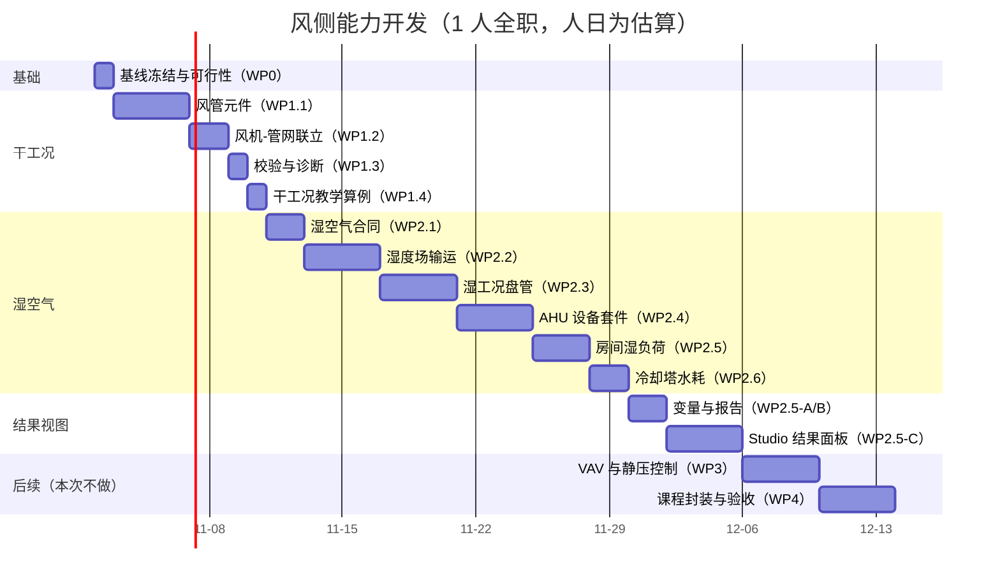

# 风侧管网与湿空气能力开发计划

后续字段、架构、算法、接口、时序、示例与逐包验收的完整设计见 [详细实施计划](air-side-detailed-plan/README.md)（2026-10-28，参考 Phase 2a 提交 `b6bca53`；方案文档，不代表已经实施）。本文件保留阶段计划与历史验收记录。

日期：2026-10-28。基线：`codex/development-consistency` 分支 `4b0acc4`（1080p 基线、批量工况与方案比较已提交并定向验收）；工作区已收口，可与并行会话的成果分开提交。

2026-10-28 范围确认：**本次做到 Phase 2**（湿空气、湿工况、AHU 设备套件、房间湿负荷、冷却塔水耗），并包含**风侧结果视图**；Phase 3（VAV/静压控制）与 Phase 4（课程封装）本次不做，但保留在工作包中供后续评估。教学拓扑确认包含 AHU/新风机组，因此湿工况盘管与 AHU 套件优先于通用房间湿负荷。

**2026-10-28 实施状态：Phase 0、Phase 1 与 Phase 2a 已完成**（可行性见第 9 节，干工况风管见第 10 节，湿空气/湿工况见第 11 节）；Phase 2b（房间湿负荷、冷却塔水耗、结果视图）尚未实施。

## 1. 目标与非目标

**目标：** 让平台能求解暖通的空气侧——风管网络、风机工作点、湿空气热湿过程（除湿/凝水/潜热）与末端风量控制，形成「冷源 → 水系统 → 空气处理 → 房间负荷」的完整教学闭环。所有能力以可复现的教学算例与手算对照为验收，不承诺工业选型精度。

**非目标（明确不做）：** 风管噪声、气流组织/CFD、洁净室、防排烟、复杂 VAV 策略（多区联动/需求响应）、风管漏风率标定、现场数据校核。

**范围边界：** 单相干空气管网先做；湿空气在第二阶段引入，作为**第三个输运标量（含湿量）**，不改水力/热力求解器。

## 2. 现状依据

| 事实 | 依据 |
| --- | --- |
| `Air` 气相单相网络可算，风机工作点落在曲线上、轴功进入流体焓 | `tests/test_bsl_integration.py::test_fan_air_single_phase_network_operating_point` |
| 风机模块有风压-风量曲线、转速相似律、效率/电功率、空气密度与黏度 | `modules/fan/manifest.json` |
| 湿空气物性可查（含湿量、露点、湿球、比焓），但**不进入网络求解** | `backend/fn_engine/properties.py:449` `humid_air()` 注释 |
| 空气侧换热只在设备内部（干工况 ε–NTU / UA×ΔT），无风管网络 | `modules/fan_coil_unit`、`modules/cooling_tower`、制冷站 `air_cooler` |
| 房间只有热节点，没有含湿量/新风/渗透风 | `catalog.py` `storage_room` / `cold_room` |
| 无风管专用元件、无风阀/VAV、无风量平衡校验 | 现行 catalog 与模块库 |

## 3. 工作包与验收

### Phase 0：基线冻结与可行性验证（1 人日）

| 工作包 | 交付 | 验收 |
| --- | --- | --- |
| WP0-Air-0 | 用官方 `fan` 模块 + 内置管道组成一个支状风管算例，跑通水力+热力；测量单支路阻力与风机工作点 | 压降与手算 Darcy/K 差 ≤5%；能量残差 ≤1e-6 相对；结论写入计划附注 |

Phase 0 同时确认：风管工况下用 `reference` 还是 `node` 物性耦合、空气密度取值口径、静压参考的放置规则。

### Phase 1：干工况风管网络（5–8 人日）

| 工作包 | 交付 | 验收 |
| --- | --- | --- |
| WP1.1 风管元件 | 圆形/矩形风管（尺寸、粗糙度、保温 UA）、弯头/三通/变径（K 表与当量长度）、风阀（线性/等百分比/快开开度特性）、送/回风口（定风量阻力） | 各元件单器件算例与手算对照；参数/端口/变量遵守现有合同与单位体系 |
| WP1.2 风机-管网联立 | 风机曲线与管网阻力联立求工作点；风量/静压/轴功输出；转速变化 | 两支路并联算例：风量分配与手算一致；工作点在曲线上 |
| WP1.3 校验与诊断 | 风量平衡检查、静压参考缺失/多头、风管尺寸提示；错误码可定位到设备与端口 | 错误路径有专项测试；与现有诊断风格一致 |
| WP1.4 教学算例 | 2 个课程算例：支状风管 + 并联支路；含手算对账表 | 学生可自行判定对错；保存/重载/复算一致 |

### Phase 2：湿空气与湿工况（15–23 人日）

| 工作包 | 交付 | 验收 |
| --- | --- | --- |
| WP2.1 湿空气状态与合同 | 含湿量 d、相对湿度 φ、湿空气比焓、露点；由 T/d/p 定状态；变量与单位进合同 | 与焓湿图/`HAPropsSI` 对照；边界校验 |
| WP2.2 湿度场输运 | 含湿量作为标量随流量迎风混合；边界值、新风/回风混合、源项（加湿/凝水） | 与温度场同样迭代收敛；水分质量守恒账；关闭时行为与现状一致 |
| WP2.3 湿工况盘管 | 干/湿分区或 ε–NTU+析湿系数；输出显热、潜热、凝水量、SHR、出风状态 | 与手算 SHR/凝水量对照；干工况退化后与原结果一致 |
| WP2.4 AHU 设备套件 | 新风/回风混合箱（两进一出，按质量与含湿量混合）、过滤器（阻力）、湿表冷器（复用 WP2.3）、加湿器（等温/等焓，增加含湿量）、再热器（复用加热器）、送/回风机（复用 `fan`） | 混合点温湿度与手算一致；加湿/再热后状态点落在焓湿图上；AHU 组合算例可通过 |
| WP2.5 房间湿负荷 | 房间含湿量状态；渗透风/新风/人员/货物散湿；凝水与再热 | 房间湿度动态与手算一致；水分+能量双账 |
| WP2.6 冷却塔水耗 | 湿空气焓差与补水/水耗；逼近度 | 与湿球近似结果在适用域内一致，并明确差异来源 |

### Phase 2.5：风侧结果视图（6–10 人日）

原则：**算法层先出变量与导出，界面按需要叠加**；Unity 侧只消费 REST/WS，不参与求解。分三层，按顺序落地：

| 层 | 交付 | 工作量 | 验收 |
| --- | --- | --- | --- |
| A 变量与数据（必做） | 风侧变量统一命名与单位；`/variables`、`/history`、WS `/stream` 直接可读；提供《风侧变量清单》给 Unity | 1–2 人日 | 任一风管/AHU 算例能逐变量读出风量、静压、温湿度、凝水量、SHR |
| B 运行报告（Phase 1 后） | `report.csv` / `report.html` 增加风量分配表、风机工作点、湿空气状态、凝水与 SHR | 1–2 人日 | 报告数字与帧变量逐项一致 |
| C Studio 结果面板（Phase 2 后） | 项目页新增“风系统结果”面板：风量分配表、风机工作点图、湿空气状态点、含湿量/温度曲线、凝水与 SHR 指标 | 3–5 人日 | 面板按实际拓扑生成；关系/参数变化后旧结果标记过期；历史运行保留原绑定 |

变量命名约定（示例，实施时以合同为准）：

| 变量 | 含义 | 单位 |
| --- | --- | --- |
| `<duct>.mass_flow_kg_s` / `.pressure_drop_pa` | 风管风量与阻力 | kg/s、Pa |
| `<fan>.mass_flow_kg_s` / `.pressure_rise_pa` / `.shaft_power_w` | 风机工作点 | kg/s、Pa、W |
| `<coil>.sensible_heat_w` / `.latent_heat_w` / `.condensate_kg_s` / `.shr` | 表冷器显热、潜热、凝水、显热比 | W、W、kg/s、1 |
| `<node>.temperature_k` / `.humidity_ratio_kg_kg` / `.relative_humidity` | 空气状态 | K、kg/kg、1 |
| `<room>.temperature_k` / `.humidity_ratio_kg_kg` / `.moisture_load_kg_s` | 房间热湿状态 | K、kg/kg、kg/s |

结果绑定与过期规则复用热耦合的既有模式：按关系/端点生成指标与曲线，拓扑或参数变化后当前结果标记过期，历史运行保留当时绑定。Studio 面板复用现有指标行、曲线组件与项目绑定持久化，不新建前端框架。

### Phase 3：末端与控制（本次不做，后续）

| 工作包 | 交付 | 验收 |
| --- | --- | --- |
| WP3.1 VAV 末端 | 变风量末端（阀位—风量特性）、房间温度/静压反馈 | 阀位变化引起风量按特性变化 |
| WP3.2 静压控制 | 复用现有 PID 框架控制风机转速/风阀，维持静压 | 设定值阶跃后稳定；能耗对比可导出 |
| WP3.3 教学算例 | 1 个 VAV/静压控制算例 | 与手算/稳态对照 |

### Phase 4：教学封装（3–5 人日）

| 工作包 | 交付 | 验收 |
| --- | --- | --- |
| WP4.1 课程算例库 | 风管阻力、风机工作点、AHU 除湿、VAV 共 4–5 个预置项目 | 导入即可运行；每例附手算参考与判定标准 |
| WP4.2 文档与验收 | 能力说明、参数与单位、适用边界；专项验收记录进入 `docs/` | 与 README/ROADMAP 同步；不把未实现登记为完成 |

## 4. 里程碑与工期



| 阶段 | 人日 | 折合（5 人日/周） | 可交付的教学能力 |
| --- | --- | --- | --- |
| Phase 0 | 1（已完成） | 0.2 周 | 可行性结论与物性口径（第 9 节） |
| Phase 1 | 5–8（已完成） | 1–1.6 周 | 风管阻力、风量分配、风机工作点、风阀/风口（第 10 节） |
| Phase 2 | 15–23 | 3–4.6 周 | 除湿、凝水、SHR、AHU、房间湿度、冷却塔水耗 |
| Phase 2.5 | 6–10 | 1.2–2 周 | 风侧结果可读、可导出、可在 Studio 查看 |
| **合计（到 Phase 2.5）** | **27–42** | **5.4–8.4 周** | 完整风侧教学闭环 |
| Phase 3 + Phase 4（本次不做） | 8–13 | 1.6–2.6 周 | VAV/静压控制与课程封装 |

估算口径：1 名熟悉代码的开发者，含专项测试与文档，不含等待外部数据、前端大改和硬件联调。**Phase 1 结束是决策点**：若干工况已满足课程需求，可先不开湿空气。

## 5. 依赖与顺序

1. Phase 0 必须先做：确认风管工况下物性口径与静压参考，避免后续返工。
2. Phase 1 独立可交付，不依赖湿度场；Phase 2 依赖 Phase 1 的风管网络与状态合同。
3. Phase 2.5 依赖 Phase 1（风机/风管变量）与 Phase 2（湿空气变量）；A/B 层（变量与报告）可在 Phase 1 后先做，C 层（Studio 面板）在 Phase 2 后做。
4. Phase 3/Phase 4 本次不做；如后续启动，Phase 3 依赖 Phase 1（风阀）与 Phase 2（房间/湿负荷），控制复用现有 PID 与运行参数写入，不新建控制内核。
5. 每个阶段结束都要有验收记录，不合并成最后一次验收。

## 6. 风险与对策

| 风险 | 影响 | 对策 |
| --- | --- | --- |
| 湿空气与温度强耦合导致迭代不收敛 | Phase 2 停滞 | 先把含湿量作为独立标量线性输运、外层 Picard 迭代；必要时复用现有热力加速（默认关闭，只在证据支持时启用） |
| 湿工况盘管模型选择（分区 vs 析湿系数） | 结果与手算偏差大 | 先做析湿系数（与教学手算一致），分区模型留作精度选项 |
| 合同变更影响旧项目 | 旧项目读取失败 | 新增字段全部可选、默认关闭；湿空气关闭时行为与当前一致 |
| 空气密度/标高口径不清 | 压降与手算差 5–10% | Phase 0 固定口径并写入手算对照表 |
| 结果视图范围膨胀 | 工期超预算 | 先做 A（变量）+ B（报告），C（Studio 面板）单独立项；面板复用现有指标/曲线组件，不新建前端框架 |
| 与并行会话/未提交改动冲突 | 混线、回滚困难 | 开工前提交或隔离当前工作区；按阶段提交 |

## 7. 验收与证据

- 每阶段：专项 pytest、`ruff`、`mypy`、契约一致性检查；前端未改动时不跑浏览器回归。
- 物证：每个算例保留命令、环境与输入快照；手算对照写入验收文档（表格 + 相对误差）。
- 不把「计划阈值」当「已实现能力」；未达标的项明确记为部分验证或未达标。
- 完成后更新 README 能力表、ROADMAP、ALGORITHM（新增湿度场方程）与架构图（数值层新增组件）。

## 8. 已确认与待定

已确认（2026-10-28）：

1. 范围做到 **Phase 2**（含 AHU 套件、房间湿负荷、冷却塔水耗），累计约 5.4–8.4 周；
2. 结果视图按「A 变量 → B 报告 → C Studio 面板」三层推进，A/B 必做，C 在 Phase 2 后评估；
3. 教学拓扑包含 AHU/新风机组，AHU 套件排在房间湿负荷之前。

待定：

1. Studio 结果面板是否在本次一并交付（默认建议：先 A+B，C 单独立项）；
2. 《风侧变量清单》以文档还是 OpenAPI/示例代码形式交付给 Unity 侧（建议两者都给）；
3. 开工时间与工作区收口方式（建议先提交当前未提交改动并确认并行会话已结束）。

## 9. Phase 0 实施记录（2026-10-28）

算法域可行性验证已完成，证据为 `tests/test_air_duct_phase0.py`（4 项通过）。

**算例：** 工质 `Air`（`phase_policy=gas`）；送风边界与回风边界均为 101325 Pa、20 °C；官方 `fan` 模块（默认风压-风量曲线）→ 圆管 30 m、内径 0.3 m、绝对粗糙度 0.15 mm。风管压降与风机曲线在两端等压下联立求工作点。

| 量 | 结果 |
| --- | --- |
| 参考态物性 | ρ = 1.206035 kg/m³，μ = 1.8213e-5 Pa·s |
| 工作点 | 1.0645 kg/s（约 3180 m³/h），Re ≈ 2.48×10⁵ |
| 风管压降（引擎 / 手算） | 172.42 Pa / 172.22 Pa，偏差 **0.12%**（门槛 5%） |
| 工作点一致性 | 引擎流量与“风机曲线 = 风管阻力”交点相差 0.04% |
| 压力闭合 | 两端等压时风机压升 = 风管压降（相对 1e-6） |
| 能量账 | 风机水力功率进入流体焓；全网能量残差 ≤1e-6 相对 |
| 动态帧 | `pressure_rise_pa`、`shaft_power_w`、`electric_power_w` 与累计能量按流量/效率给出 |
| 物性耦合 | `reference` 与 `node` 的流量差 0.01%、压降差 0.013% |

**口径决定：**

1. 风管工况默认用 **`reference` 物性耦合**（压降 <1 kPa 时密度变化 <0.2%）；`node` 仅用于高压差/大温升场景，作为可选项保留，不设为默认。
2. 风管网络必须有**送/回两侧压力参考或闭环**；只有单侧压力边界时末端为死端、流量退化为零（已用测试固定该行为）。
3. 风机模块按自身 `air_density_kg_m3`（默认 1.2）折算曲线，引擎参考密度 1.2060，两者相差约 0.5%，对流量/压降影响 <0.1%。Phase 1 需在界面/合同中显式给出该密度，或提供“按当前空气状态折算”，不允许静默偏差。
4. Phase 1 元件验收沿用“手算对照 ≤5%”门槛；Phase 0 实测 0.12% 可作为基线。

**复现：**

```powershell
python -m pytest tests/test_air_duct_phase0.py -q -s
```

**结论：** 可行。空气侧不需要新的求解器，Phase 1 可以直接在现有单相网络 + `fan` 模块上增加风管/风阀/风口元件。

## 10. Phase 1 实施记录（2026-10-28）

干工况风管网络已完成，证据为 `tests/test_air_duct_phase1.py`（10 项通过）与 Phase 0 的 4 项。验收汇总见[Phase 1 验收](AIR_SIDE_PHASE1_ACCEPTANCE.md)。

**交付：**

| 项 | 内容 |
| --- | --- |
| 内置风管 `duct` | 矩形断面，水力直径 `Dh = 2WH/(W+H)` + Haaland 沿程阻力；可选向环境散热；宽高比 >8 给出 `DUCT_ASPECT_RATIO` 警告；无储热、无局部阻力 |
| `modules/duct_fitting` | 弯头 90°/45°、三通直通/支管、渐扩渐缩、进出口的 K 表（教学默认值），custom 可覆盖；K→Kv 折算与 `pipe_fitting` 同一推导 |
| `modules/duct_damper` | 线性/等百分比/快开三种开度特性；0% 开度精确关断；开度运行中可调 |
| `modules/air_vent` | 按额定风量与额定压降折算等效 Kv 的送/回风口；不含射流与气流组织 |
| 能力标志 | health 新增 `air_duct`，契约重新生成（75 个文件一致） |

**实测（与手算对照）：**

| 项目 | 结果 |
| --- | --- |
| 风管 + 风机工作点 | ρ=1.2050，Re≈2.10×10⁵，流量 1.5261 kg/s（手算 1.5261）；风管压降 50.60 Pa vs 手算 50.59 Pa（0.03%） |
| 风管散热 | 出口温度向环境温度靠拢；`heat_w` 与 `m·cp·ΔT` 差 <0.2%（cp 随温度变化） |
| 管件 K 折算 | 弯头 K=0.3、断面 0.5×0.5 m：引擎 10.024 kg/s vs 手算 10.029（0.05%） |
| 风阀特性 | 50% 开度流量比：线性 0.500000、等百分比 0.182574（ALF=30）、快开 0.870551，与公式一致（1e-6） |
| 风口额定点 | 1000 m³/h @ 50 Pa：引擎 0.33469 kg/s vs 手算 0.33477（0.02%） |
| 并联风管分配 | 支路 A/B 引擎 5.1246/2.4082 kg/s vs 手算 5.1268/2.4092（0.04%） |
| 动态帧 | `mass_flow/pressure_drop/进/出口温度/heat_w/风机压升/轴功率` 均可读 |

**复现：**

```powershell
python -m pytest tests/test_air_duct_phase0.py tests/test_air_duct_phase1.py -q -s
```

**边界（本轮不做）：** 湿空气含湿量输运与湿工况盘管（Phase 2）；风阀静压控制/VAV（Phase 3）；风口射流、气流组织、噪声与 CFD；矩形风管层流段用圆管等效（仅工程近似，已在文档标注）。

## 11. Phase 2a 实施记录（2026-10-28）

湿空气与湿工况已接通，验收汇总见[Phase 2a 验收](AIR_SIDE_PHASE2A_ACCEPTANCE.md)。

| 项 | 内容 |
| --- | --- |
| 湿空气物性 | `backend/fn_engine/moist_air.py`：Magnus 饱和压力、含湿量/相对湿度/露点、湿空气焓与温度互算、混合物密度与比热（教学近似） |
| 模式开关 | `SolverOptions.moist_air`（默认关闭）；编译期要求 `fluid=Air`、`phase_policy=gas`，并校验边界含湿量不超过饱和值 |
| 含湿量输运 | 热力层把 w 作为与焓并列的标量：与流量迎风混合、边界固定、逐端口输出 `humidity_ratio_kg_kg` / `relative_humidity`；水分账 `metrics.moisture_residual_kg_s` |
| 湿工况表冷器 | 内置 `cooling_coil`：旁通系数法 `T_out=T_adp+BF·(T_in−T_adp)`；湿工况 `w_out=w_sat(T_adp)+BF·(w_in−w_sat)`；输出显热、潜热、凝水、SHR |
| 加湿器 | 内置 `humidifier`：`adiabatic` 等焓加湿（温度下降）与 `isothermal` 等温加湿（补入蒸汽焓） |
| 测试 | `tests/test_moist_air_phase2.py` 8 项：物性与 CoolProp `HAPropsSI` 对照、风管含湿量守恒、湿/干工况表冷器、两种加湿器、两股空气混合、模式校验 |
| 能力标志 | health 新增 `moist_air`，契约重新生成（75 个文件一致） |

**教学近似（明确边界）：** 湿空气焓按每 kg 干空气计，而水力流量为湿空气质量流量，能量账放宽容差到 1% 相对；饱和压力用 Magnus 近似（与 CoolProp 湿空气查询差约 2%，测试内对照）；未建模翅片凝水滞留、除湿再热、风机湿空气密度修正。

**Phase 2b（未做）：** 房间含湿量动态状态、新风/渗透/散湿负荷、冷却塔水耗与逼近度、风侧结果视图（变量清单/报告/Studio 面板）。
