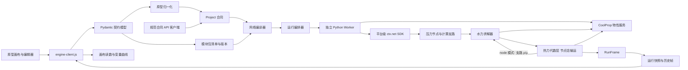
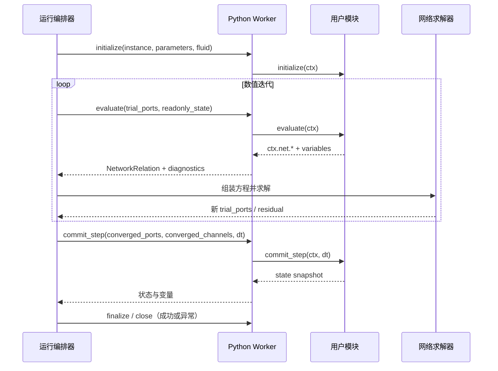
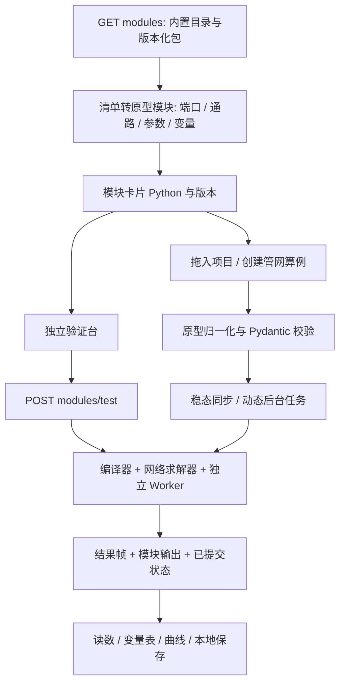
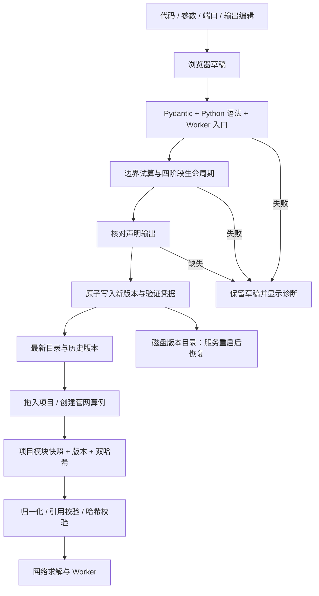

# 架构

## 原型决定产品对象，合同约束可计算含义

原型继续负责项目编辑、设备型号、三组库值、画布、参数草稿与观察窗口。新内核只接受经过校验的计算合同。原型原始导出用于完整恢复界面，归一化后的 `Project` 是求解投影，不承诺无损恢复所有界面配置。

## 模块分工

| 文件 | 职责 | 不承担的职责 |
| --- | --- | --- |
| `models.py` | Pydantic 类型、版本、引用约束、API/Worker 输入输出合同、JSON Schema 来源 | UI 布局、求解器内部数组 |
| `catalog.py` | 注册模型、参数默认值和范围、单位、变量、通路 | 执行用户代码 |
| `packages.py` | 模块发现、不可变版本存储、预期版本冲突检测、试算后原子写入 | 全网求解算法 |
| `module_validation.py` | Python 语法、Worker 加载及四阶段入口检查 | 在 API 进程执行用户代码 |
| `runtime.py` | `initialize/evaluate/commit_step/finalize` 生命周期、上下文、Worker RPC | 全网节点求解 |
| `worker.py` | 独立进程的行式 JSON Worker 协议 | 项目编排和持久化 |
| `properties.py` | CoolProp AbstractState 物性适配（PT/PH 单次 flash、两相干度）、线程隔离与缓存、相态/范围诊断 | 网络残差组装 |
| `bridge.py` | 选择活动项目；读取真实端口和通路；显示值转规范值 | 自动猜测未知模块算法 |
| `compiler.py` | 参数与工况覆盖校验、端口连接并查集、通路支路、每个子网络的压力参考、按回路分配工质、边界温度与冲突检查 | 求解数值方程 |
| `solver.py` | 支路关系、非线性方程组（稠密或稀疏 Jacobian）、模块 evaluate 关系、残差验证；`solve_network` 编排水力与热力及 `node` 耦合、动态热启动、结果采样 | 管理界面草稿 |
| `simulation.py` | `SimulationSession`：可逐帧推进的动态会话，持有 Worker、水箱/管段状态和 PID；运行时参数写入、隔离管段保压、子步减半与液位事件 | 线程调度、HTTP |
| `controllers.py` | 采样 PID：零阶保持、测量值微分滤波、条件积分抗饱和、手自动无扰切换 | 写参数（由会话执行） |
| `jobs.py` | `RunManager`：后台运行调度线程加 2 个计算线程，实时/快速节奏，命令队列与回执，历史发布 | 求解数值方程 |
| `batch.py` | 多个 Python 实例按分片共用 Worker 进程，每次迭代每个分片一次 evaluate RPC | 实例状态合并（各实例独立） |
| `examples.py` | 内置 PID 液位/温控示例，前端与验收测试共用 | — |
| `thermal.py` | 节点焓稀疏线性方程、支路出口焓关系、ε–NTU、闭合回路与停滞节点回退、相态检查、能量校核、端口热力状态 | 求解压力与流量 |
| `bench.py` | 为每条启用通路各接一组压力边界，复用编译/求解/Worker，返回状态及历史 | 生成演示流量 |
| `api.py` | 模块/项目契约端点、同步运行、后台运行与命令端点（转交 `RunManager`）、变量读写与推送、示例项目、运行事件和历史 | 永久数据库或集群调度 |
| `auth.py` | 令牌文件（只存哈希）、只读/控制两级权限、按监听地址决定是否强制认证 | 用户账户、HTTPS |
| `engine-client.js` | 请求、运行/回放、真实变量映射、断线及失败显示 | 生成模拟物理结果 |
| `studio.js` | 保留原型交互与本地保存 | 计算物理方程 |

## 一次运行的数据一致性

- 前端收集已应用的 `params`，`draft` 单独保存；型号应用后产生新的实例参数。
- 后端每次创建新的运行 ID 和请求快照，工况覆盖作用于副本。
- 规范合同包含本次使用的完整模块定义，避免模块目录后来变化导致历史不可解释。
- 运行帧使用完整变量路径；实例重命名不改变 ID。
- 前端检查设备参数、连接和模块端口/通路是否在请求期间变化；发生变化就拒绝把旧结果当作当前结果。
- 回放期间应用参数会暂停回放；下一次运行/单步重新请求后端。
- 三组库值只有显式应用后才影响求解。原型导入保留参数库值、型号 ID/版本；自定义变量库值仍由原型原始文件保留。
- `evaluate()` 可能在同一个时间步中被数值求解器调用多次，只能读取只读状态并注册关系；`commit_step()` 只在收敛后调用一次。
- Pydantic 模型用于项目文件、HTTP、Worker 消息和结果帧；稀疏矩阵、残差向量和节点数组保留在求解器内部。

## 可编程模块调用顺序

## 扩展顺序

1. 热力代数层（v0.3 已完成）：端口压力 + 焓、迎风传焓、节点混合、管道散热、泵轴功、换热器 ε–NTU、能量残差，以及可选的 `node` 物性耦合。
2. 状态积分层：开式水箱的质量/焓与隐式 Euler 时间推进（子步减半、液位事件）v0.4.0 已完成；管道热容分段 v0.4.1 已完成；PID 控制器与关阀隔离段保压 v0.4.2 已完成。没有状态设备的项目仍走准稳态序列。
3. 任务控制层：v0.4.2 起后台运行是可逐帧推进的会话，支持暂停/继续/单步/停止、运行中改 runtime 参数和 PID 设定、实时节奏和命令回执；WebSocket 推送和跨重启历史恢复已接入，跨重启续算仍待实现；保持已有 RunFrame 合同（只新增字段）。
4. 模型扩展层：验证过的声明式算法注册、组合模块展开、算法版本和测试算例。
5. 用户代码层：已有独立进程、RPC 超时和异常清理；继续补充 OS 资源限制、权限隔离和检查点恢复。独立进程不是操作系统安全沙箱。

这些是扩展设计，当前可运行范围以 README 的能力表和 `/api/v1/health` 为准。

## 运行控制、取消与执行器生命周期

v0.4.2 起后台运行由 `jobs.RunManager` 管理，同步 `POST /runs` 仍在请求线程里一次算完（`compute_run`，经 `solve_dynamic` → `simulation.run_dynamic`）。

- 每个后台运行是一个 `SimulationSession`，一次 `advance()` 推进一帧（帧内可有多个子步）。会话在整个运行期间持有 Python Worker、水箱/管段状态和 PID，单步和运行中改参数都不重新 initialize。
- 一个调度线程挑选到期的任务，交给 2 个计算线程，每个计算线程一次只推进一个会话一帧。暂停的会话不占计算线程，只占内存和 Worker 进程；非终态运行最多 20 个，超出时创建返回 422 `RUN_LIMIT`。
- 节奏：`execution_mode='fast'` 连续推进；`realtime` 按 `dt_s / speed_ratio` 的墙钟间隔推进，落后时 `lag_s` 报告滞后秒数，不跳帧。
- 命令先进入任务队列并立即返回 `accepted` 回执，在下一帧开始前由持有会话的计算线程按到达顺序执行，再记为 `applied` 或 `rejected`（带 `applied_time_s` 或原因）。因此命令总在帧边界生效，正在计算的帧照常完成。同一 `command_id` 重复提交返回原回执，内容不同返回 409。
- 发布：每帧经 `selected_variables` 和 trend 瘦身后写入记录。会话自身只留最近 8 帧（`SESSION_FRAMES`），按 `sequence` 判断哪些帧还没发布；记录里的 history 只保留最近 `history_window` 帧，另有一条全程抽稀曲线（`OVERVIEW_POINTS`=2000，超出时步距翻倍）。因此持续运行的内存有上限：约 `history_window` 帧加 2000 行精简帧。结束时末帧写回完整帧。暂停期间不过期，没有自动恢复。
- 持续运行（`duration_s=None`）的帧时刻是 `index·dt`，不累加误差；它只能由 stop 或失败结束，占一个活动运行名额。
- 终态：completed、failed、cancelled，服务关闭时仍未结束的运行记为 interrupted。任何路径都会关闭会话、回收 Worker，并把未执行的命令记为 rejected。终态记录保留最近 20 个，活动运行不计入淘汰。

FastAPI lifespan 关闭时先 `RunManager.close()`（等待计算线程，再终止剩余运行）。同步运行没有会话，命令端点对它返回 409 `RUN_ALREADY_FINISHED`。

## 前端模块工作流

同一运行内，每个实例的 Worker 在全部试算与成功时间步间复用。失败时通过 finally 回收；Worker 初始化部分失败也会关闭已启动进程。每次新运行使用新的 Worker 和状态。编辑器草稿只进入独立验证；项目运行使用已绑定的版本快照，过期检查关注项目参数和快照。

## 模块开发、保存与绑定流程

保存使用 `expected_latest_version` 检测陈旧草稿，进程内锁覆盖检查与试算，目录重命名处理跨进程同版本竞争。已有版本不被覆盖。版本文件保存在可配置本地目录；storage.py 用 SQLite 存储工作区修订和运行归档，jobs.py 在发布帧与命令边界落盘。control.py 在独立 Worker 执行项目控制脚本。

前端区分当前编辑定义、可插入的已保存定义、项目固定快照。同一项目中一个模块 ID 固定一个版本，更新模块库不会替换项目实例；跨版本实例迁移和同项目多版本混用尚未提供。新项目可使用最新或显式载入的历史版本。
