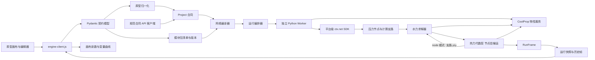
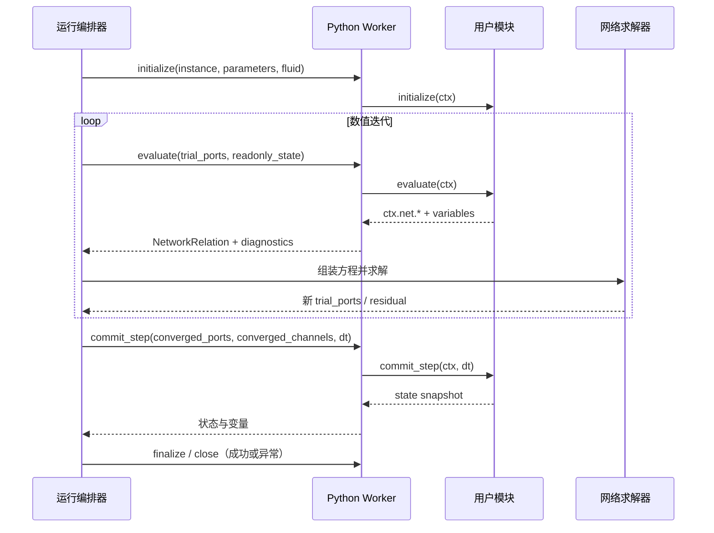
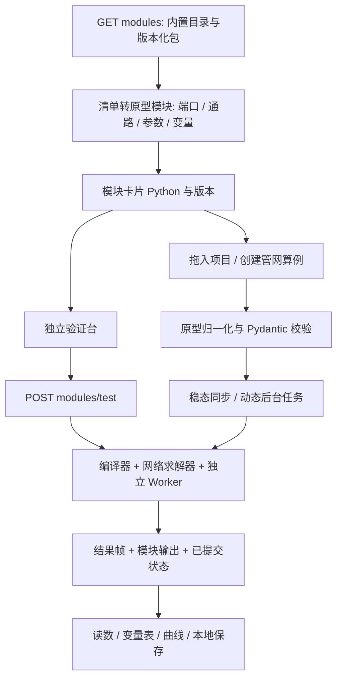
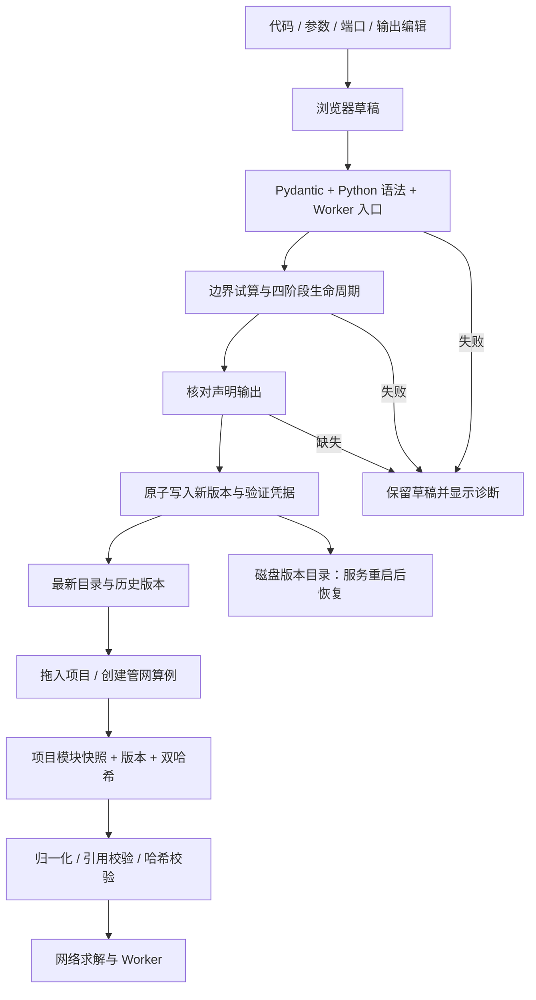

# 架构

## 原型决定产品对象，合同约束可计算含义

原型继续负责项目编辑、设备型号、三组库值、画布、参数草稿与观察窗口。新内核只接受经过校验的计算合同。原型原始导出用于完整恢复界面，归一化后的 `Project` 是求解投影，不承诺无损恢复所有界面配置。

## 模块分工

| 文件 | 职责 | 不承担的职责 |
| --- | --- | --- |
| `models.py` | Pydantic 类型、版本、引用约束、API/Worker 输入输出合同、JSON Schema 来源 | UI 布局、求解器内部数组 |
| `catalog.py` | 注册模型、参数默认值和范围、单位、变量、通路 | 执行用户代码 |
| `packages.py` | 模块发现、不可变版本存储、预期版本冲突检测、试算后原子写入 | 全网求解算法 |
| `module_validation.py` | Python 语法、Worker 加载及四阶段入口检查 | 在 API 进程执行用户代码 |
| `runtime.py` | `initialize/evaluate/commit_step/finalize` 生命周期、上下文、Worker RPC | 全网节点求解 |
| `worker.py` | 独立进程的行式 JSON Worker 协议 | 项目编排和持久化 |
| `properties.py` | CoolProp AbstractState 物性适配（PT/PH 单次 flash、两相干度）、线程隔离与缓存、相态/范围诊断 | 网络残差组装 |
| `bridge.py` | 选择活动项目；读取真实端口和通路；显示值转规范值 | 自动猜测未知模块算法 |
| `compiler.py` | 参数与工况覆盖校验、端口连接并查集、通路支路、每个子网络的压力参考、边界温度与冲突检查 | 求解数值方程 |
| `solver.py` | 支路关系、非线性方程组、模块 evaluate 关系、残差验证；`solve_network` 编排水力与热力及 `node` 耦合、动态热启动、结果采样 | 管理界面草稿 |
| `thermal.py` | 节点焓稀疏线性方程、支路出口焓关系、ε–NTU、闭合回路与停滞节点回退、相态检查、能量校核、端口热力状态 | 求解压力与流量 |
| `bench.py` | 为每条启用通路各接一组压力边界，复用编译/求解/Worker，返回状态及历史 | 生成演示流量 |
| `api.py` | 模块/项目契约端点、同步稳态、可选后台动态任务、运行控制与协作取消、运行事件和历史 | 永久数据库或集群调度 |
| `engine-client.js` | 请求、运行/回放、真实变量映射、断线及失败显示 | 生成模拟物理结果 |
| `studio.js` | 保留原型交互与本地保存 | 计算物理方程 |

## 一次运行的数据一致性

- 前端收集已应用的 `params`，`draft` 单独保存；型号应用后产生新的实例参数。
- 后端每次创建新的运行 ID 和请求快照，工况覆盖作用于副本。
- 规范合同包含本次使用的完整模块定义，避免模块目录后来变化导致历史不可解释。
- 运行帧使用完整变量路径；实例重命名不改变 ID。
- 前端检查设备参数、连接和模块端口/通路是否在请求期间变化；发生变化就拒绝把旧结果当作当前结果。
- 回放期间应用参数会暂停回放；下一次运行/单步重新请求后端。
- 三组库值只有显式应用后才影响求解。原型导入保留参数库值、型号 ID/版本；自定义变量库值仍由原型原始文件保留。
- `evaluate()` 可能在同一个时间步中被数值求解器调用多次，只能读取只读状态并注册关系；`commit_step()` 只在收敛后调用一次。
- Pydantic 模型用于项目文件、HTTP、Worker 消息和结果帧；稀疏矩阵、残差向量和节点数组保留在求解器内部。

## 可编程模块调用顺序

## 扩展顺序

1. 热力代数层（v0.3 已完成）：端口压力 + 焓、迎风传焓、节点混合、管道散热、泵轴功、换热器 ε–NTU、能量残差，以及可选的 `node` 物性耦合。
2. 状态积分层：开式水箱的质量/焓与隐式 Euler 时间推进（子步减半、液位事件）v0.4 已完成；管道热容与 PID 控制器待做。没有状态设备的项目仍走准稳态序列。
3. 任务控制层:后台运行已支持协作式取消、暂停/继续和 `POST /runs/{id}/command`;参数命令(step/set)、事件时刻和推送仍待实现;保持已有 RunFrame 合同。
4. 模型扩展层：验证过的声明式算法注册、组合模块展开、算法版本和测试算例。
5. 用户代码层：已有独立进程、RPC 超时和异常清理；继续补充 OS 资源限制、权限隔离和检查点恢复。独立进程不是操作系统安全沙箱。

这些是扩展设计，当前可运行范围以 README 的能力表和 `/api/v1/health` 为准。

## 运行控制、取消与执行器生命周期

后台运行由 `api.py` 内的 `ThreadPoolExecutor(max_workers=2)` 执行。每次后台 `POST /runs?background=true` 生成一个 `RunControl`(一个 `Event` 取消标志加一个 pause/running 模式锁),与运行记录一起放进内存字典;`run_task` 先写 running 再调用 `compute_run`,并用 `except BaseException` 兜底,保证任何路径都会把记录终止为 completed/failed/cancelled 之一,不再残留 running。

取消与暂停都通过同一个协作钩子传给 `solver.solve_dynamic(..., should_cancel=...)`:

- 钩子在每个时间帧求解之前轮询一次。因此取消与暂停都是帧粒度:正在计算的那一帧照常完成,在下一帧之前才停下,不是抢占式中断。
- `stop` 先触发取消，再在锁内把记录标为 cancelled(仅当记录仍非终态时写入)，`solve_dynamic` 抛出 `SolveCancelled`(刻意不继承 ValueError)，求解器的 `finally` 照常 `finalize`/`close` 各实例的 Worker 进程，取消不单独 kill Worker(测试确认取消后子进程已退出)。取消前已算出的帧保留在 history，最后算出的那一帧标记为 status=cancelled，valid=false。
- `pause` 让钩子在帧边界阻塞等待 resume，超过 30 秒自动恢复，避免客户端消失后长期占住求解线程。每次 pause 递增一个暂停序号，停驻的线程醒来后只有序号未变才清除暂停标志，因此在停驻期间再来一次 pause 不会被上一次的清理吞掉，运行保持暂停。
- `compute_run` 在写记录前再查一次取消标志,把竞争到最后的 stop 反映为 cancelled;`run_task` 的兜底只把未捕获的 `SolveCancelled` 判为 cancelled,其余异常一律判为 failed 并保留诊断——一次 stop 只是请求取消,不证明逃逸的异常就是取消导致的,而且 `stop` 已经先写了一条临时 cancelled,兜底必须用真正的 failed 帧把它盖掉,否则引擎崩溃会被这条临时记录永久掩埋。

FastAPI app 通过 lifespan 在关闭时调用 `executor.shutdown(wait=False, cancel_futures=True)`;teardown 自身吞掉异常,避免与仍在进行的运行竞争。同步 `POST /runs` 不走执行器,也不生成 RunControl,因此无法中途控制;命令端点对其返回 409:终态检查在前,同步运行到达命令端点时已结束,所以报 `RUN_ALREADY_FINISHED`(`RUN_NOT_CONTROLLABLE` 是防御性分支)。

## 前端模块工作流

同一运行内，每个实例的 Worker 在全部试算与成功时间步间复用。失败时通过 finally 回收；Worker 初始化部分失败也会关闭已启动进程。每次新运行使用新的 Worker 和状态。编辑器草稿只进入独立验证；项目运行使用已绑定的版本快照，过期检查关注项目参数和快照。

## 模块开发、保存与绑定流程

保存使用 `expected_latest_version` 检测陈旧草稿，进程内锁覆盖检查与试算，目录重命名处理跨进程同版本竞争。已有版本不被覆盖。版本文件保存在可配置本地目录，没有引入数据库；运行历史仍是原有内存保留机制。

前端区分当前编辑定义、可插入的已保存定义、项目固定快照。同一项目中一个模块 ID 固定一个版本，更新模块库不会替换项目实例；跨版本实例迁移和同项目多版本混用尚未提供。新项目可使用最新或显式载入的历史版本。
