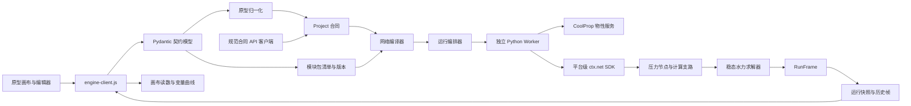
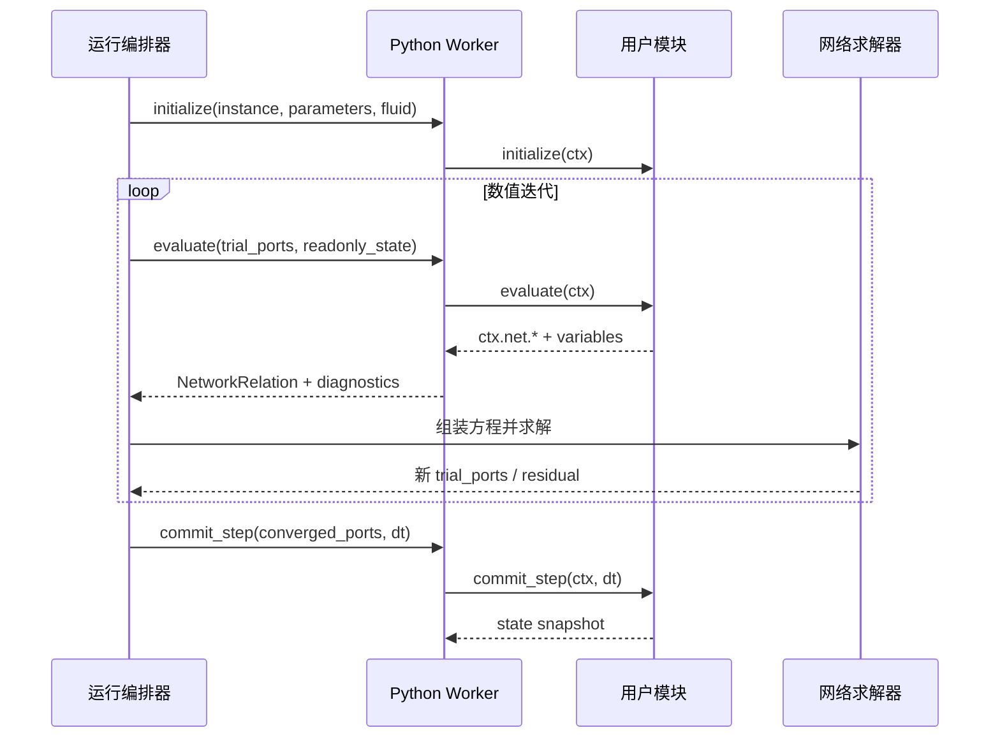

# 架构

## 原型决定产品对象，合同约束可计算含义

原型继续负责项目编辑、设备型号、三组库值、画布、参数草稿与观察窗口。新内核只接受经过校验的计算合同。原型原始导出用于完整恢复界面，归一化后的 `Project` 是求解投影，不承诺无损恢复所有界面配置。

## 模块分工

| 文件 | 职责 | 不承担的职责 |
| --- | --- | --- |
| `models.py` | Pydantic 类型、版本、引用约束、API/Worker 输入输出合同、JSON Schema 来源 | UI 布局、求解器内部数组 |
| `catalog.py` | 注册模型、参数默认值和范围、单位、变量、通路 | 执行用户代码 |
| `packages.py` | 读取 `manifest.json + module.py`，校验内容哈希并生成模块定义 | 执行模块 |
| `runtime.py` | `initialize/evaluate/commit_step/finalize` 生命周期、上下文、Worker RPC | 全网节点求解 |
| `worker.py` | 独立进程的行式 JSON Worker 协议 | 项目编排和持久化 |
| `properties.py` | CoolProp 单相物性适配和相态/范围诊断 | 网络残差组装 |
| `bridge.py` | 选择活动项目；读取真实端口和通路；显示值转规范值 | 自动猜测未知模块算法 |
| `compiler.py` | 参数校验、端口连接并查集、通路支路、每个子网络的压力参考 | 求解数值方程 |
| `solver.py` | 支路关系、非线性方程组、模块 evaluate 关系、残差验证、结果采样 | 管理界面草稿 |
| `api.py` | 模块/项目契约端点、同步稳态、可选后台动态任务、运行事件和历史 | 永久数据库或集群调度 |
| `engine-client.js` | 请求、运行/回放、真实变量映射、断线及失败显示 | 生成模拟物理结果 |
| `studio.js` | 保留原型交互与本地保存 | 计算物理方程 |

## 一次运行的数据一致性

- 前端收集已应用的 `params`，`draft` 单独保存；型号应用后产生新的实例参数。
- 后端每次创建新的运行 ID 和请求快照，工况覆盖作用于副本。
- 规范合同包含本次使用的完整模块定义，避免模块目录后来变化导致历史不可解释。
- 运行帧使用完整变量路径；实例重命名不改变 ID。
- 前端检查设备参数、连接和模块端口/通路是否在请求期间变化；发生变化就拒绝把旧结果当作当前结果。
- 回放期间应用参数会暂停回放；下一次运行/单步重新请求后端。
- 三组库值只有显式应用后才影响求解。原型导入保留参数库值、型号 ID/版本；自定义变量库值仍由原型原始文件保留。
- `evaluate()` 可能在同一个时间步中被数值求解器调用多次，只能读取只读状态并注册关系；`commit_step()` 只在收敛后调用一次。
- Pydantic 模型用于项目文件、HTTP、Worker 消息和结果帧；稀疏矩阵、残差向量和节点数组保留在求解器内部。

## 可编程模块调用顺序

## 扩展顺序

1. 热力代数层：有向流向、节点混合、管道热损失、换热器 ε–NTU 与能量残差。
2. 状态积分层：水箱质量/焓、管道热容、控制器状态；将 `dynamic` 从准稳态序列升级为 DAE 时间推进。
3. 异步运行层：独立计算任务、取消、暂停、参数命令、事件时刻及推送；保持已有 RunFrame 合同。
4. 模型扩展层：验证过的声明式算法注册、组合模块展开、算法版本和测试算例。
5. 用户代码层：独立进程资源限制、能力隔离及失败恢复。现在的 Python 文本不参与执行。

这些是扩展设计，当前可运行范围以 README 的能力表和 `/api/v1/health` 为准。
