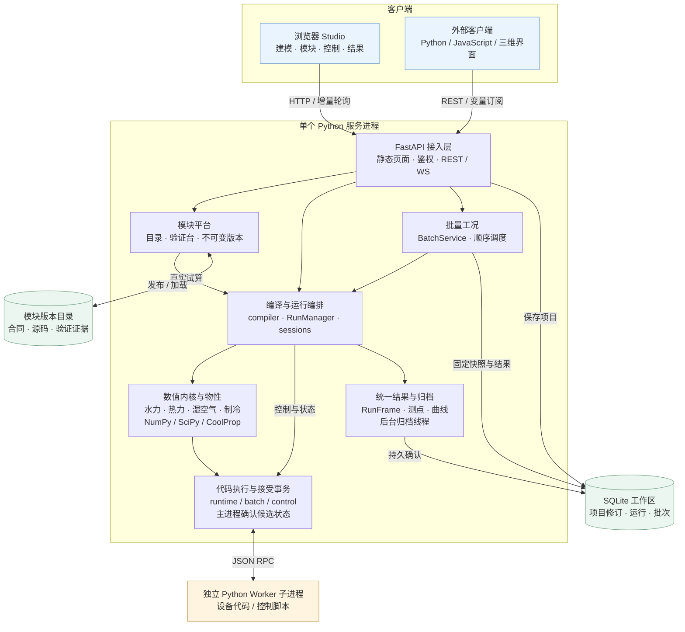
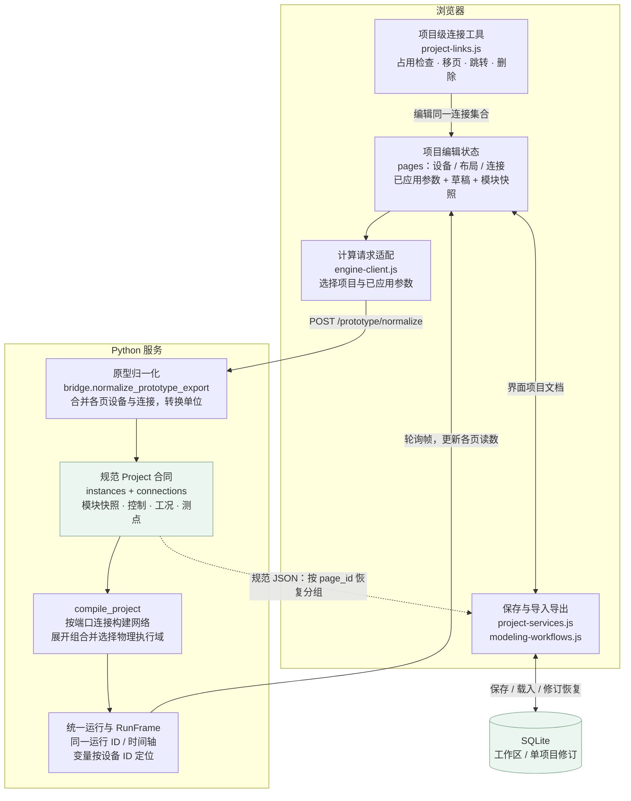
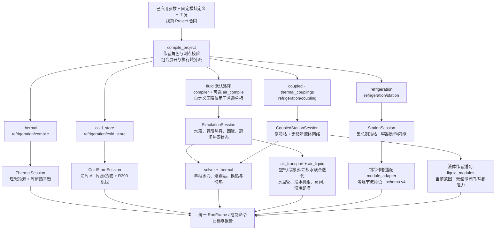
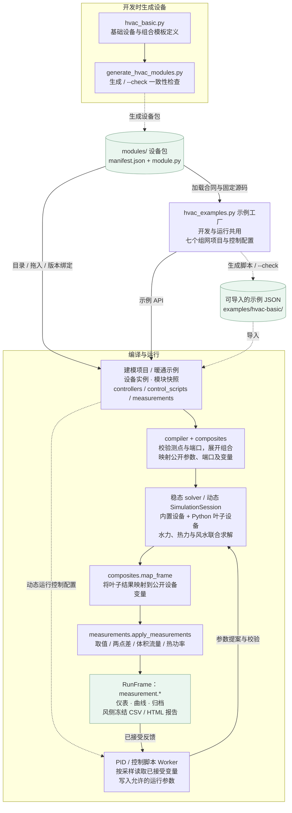
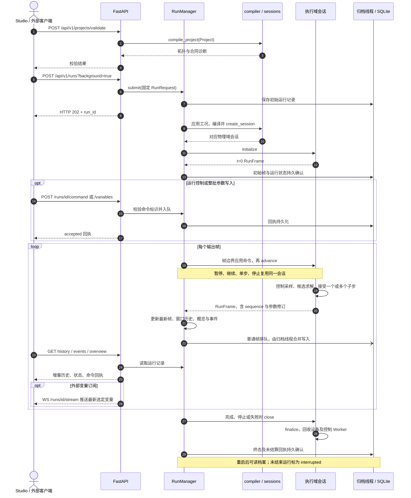
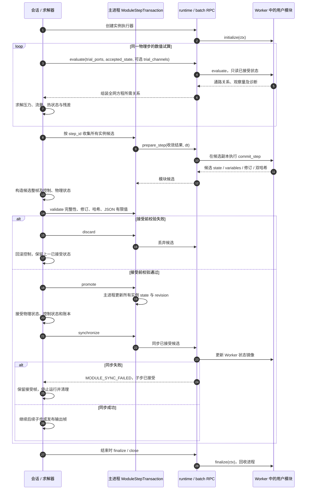
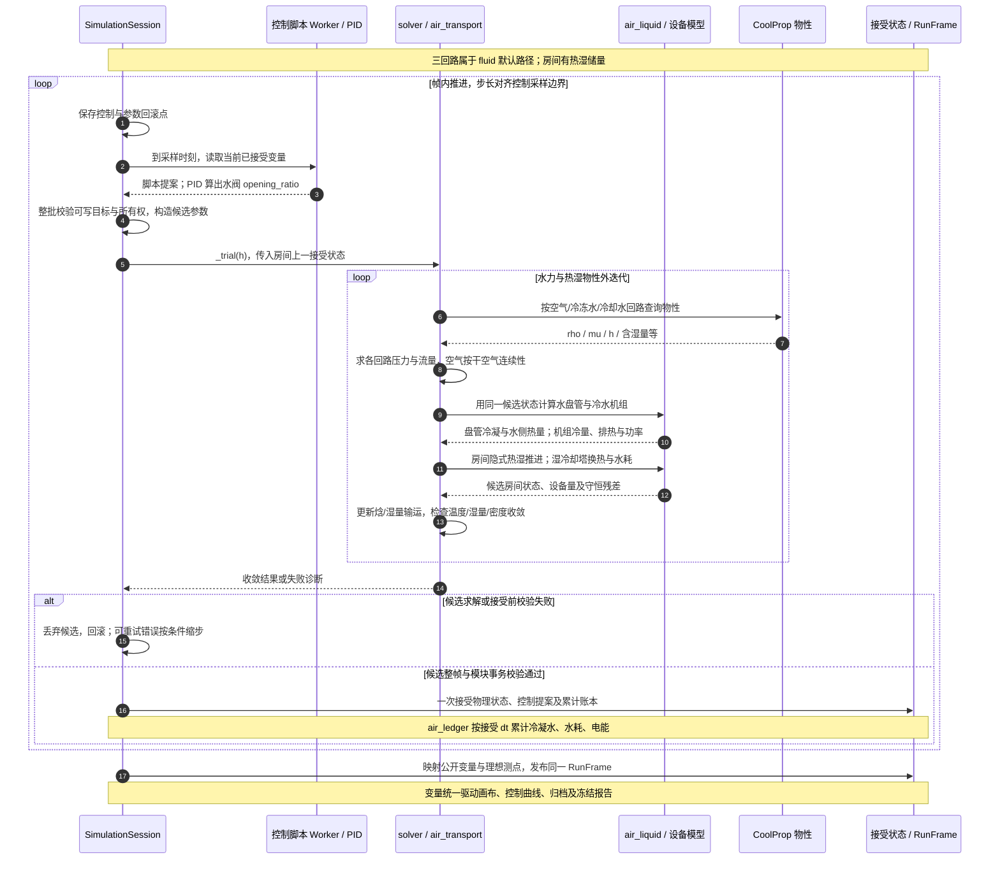
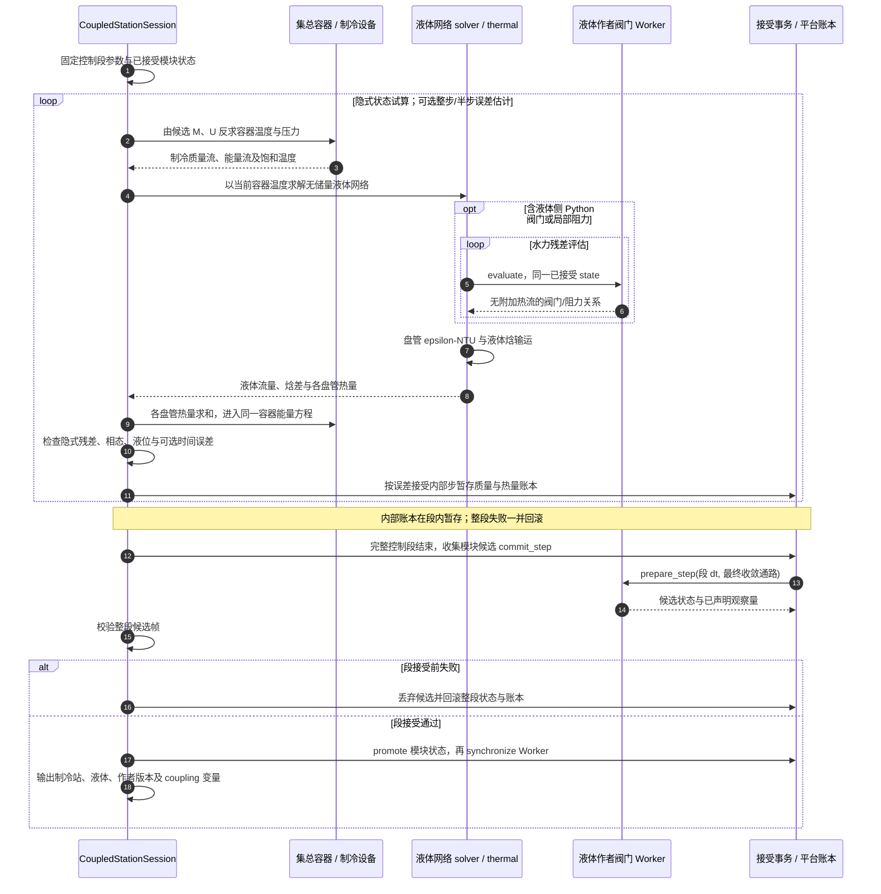
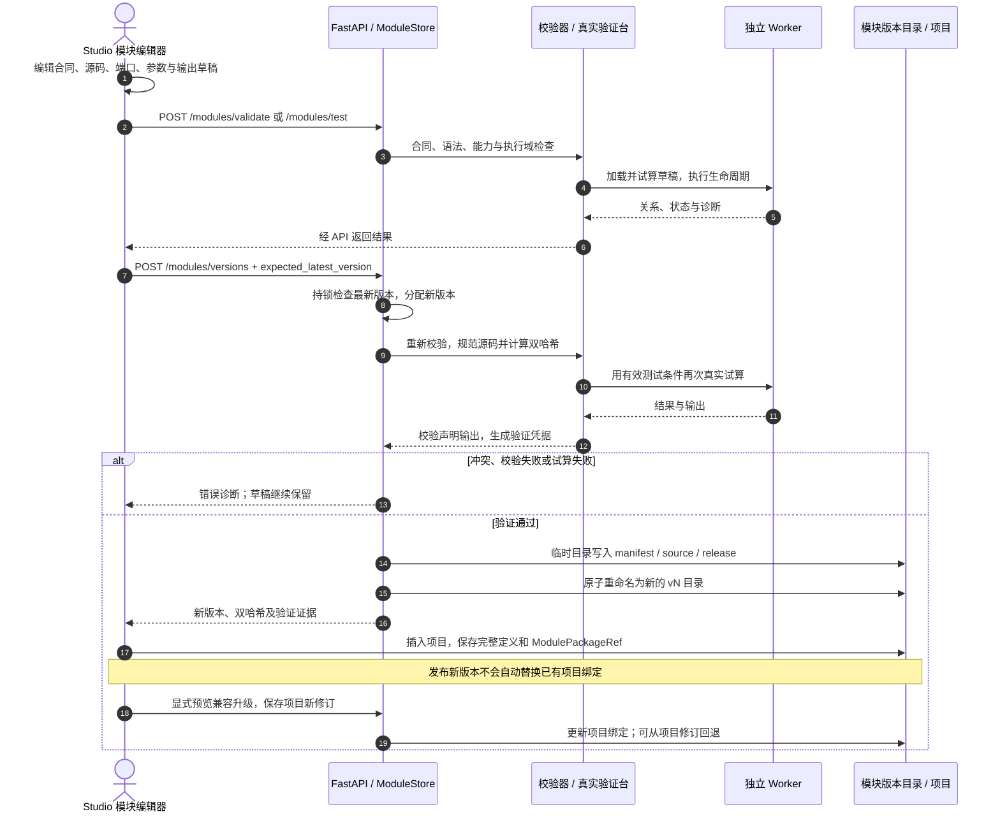
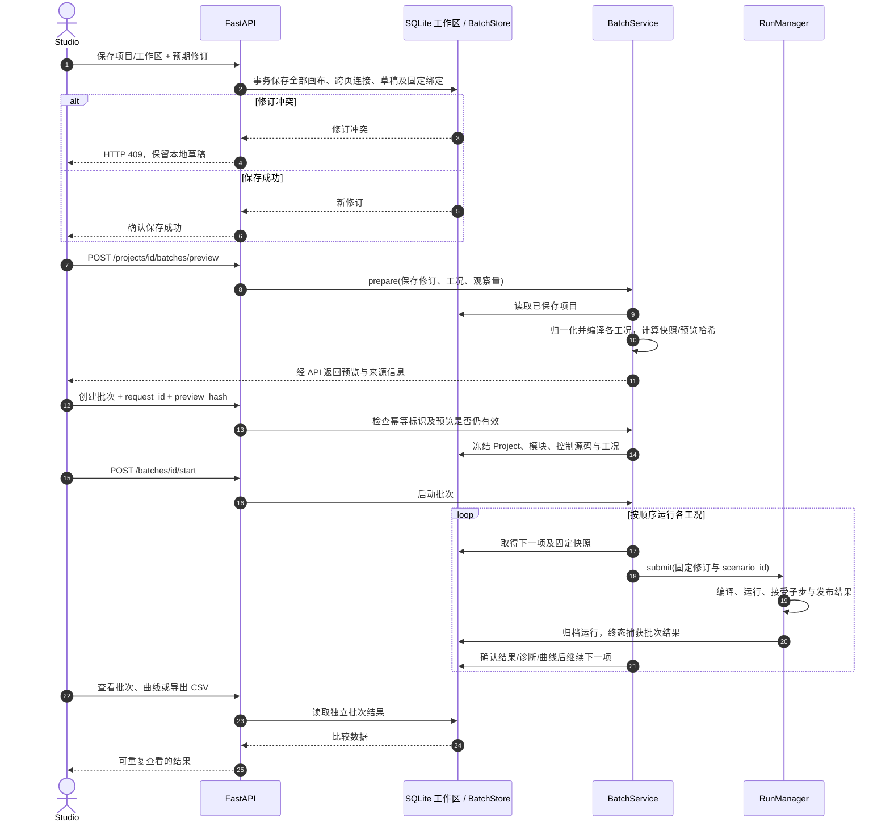

# FluidNet 当前架构图与核心时序

核对日期：**2026-11-03（北京时间）**。源码基线：`7424576`；引擎声明版本 `0.5.0`。本页描述当前开发源码，包含暖通基础设备、标准机房、理想测点、多画布连接及自定义压降接口；不等同于 2026-10-22 的 v0.5.0 发布包范围。

项目由浏览器 Studio、单个 Python 服务、独立代码 Worker 和本机存储组成。**画布是编辑视图，物理回路由端口连通性决定；多个画布归一化为一个 Project，再选择对应的执行域。** 内置设备由主进程计算，Python 设备返回网络关系；全网求解和状态接受仍由主进程负责。

建议先读前四张架构图，再按需要查看六张时序图。进程、存储与源码导航见 [架构索引](ARCHITECTURE_MAP.md)。

| 图 | 要回答的问题 | 图片与可编辑源码 |
| --- | --- | --- |
| 1. 系统总览 | 界面、引擎、Worker 和数据存在哪里？ | [SVG](diagrams/architecture.svg) · [PNG](diagrams/architecture.png) · [Mermaid](diagrams/architecture.mmd) |
| 2. 多画布与计算项目 | 拆页后如何保持同一网络、保存和导入？ | [SVG](diagrams/architecture-project-model.svg) · [PNG](diagrams/architecture-project-model.png) · [Mermaid](diagrams/architecture-project-model.mmd) |
| 3. 执行域分派 | 项目由哪套模型编译和计算？ | [SVG](diagrams/architecture-execution-domains.svg) · [PNG](diagrams/architecture-execution-domains.png) · [Mermaid](diagrams/architecture-execution-domains.mmd) |
| 4. 暖通设备与测点 | 设备包、组合、机房示例和仪表如何接入引擎？ | [SVG](diagrams/architecture-hvac.svg) · [PNG](diagrams/architecture-hvac.png) · [Mermaid](diagrams/architecture-hvac.mmd) |
| 5. 后台运行 | 运行、命令、帧发布与归档何时发生？ | [SVG](diagrams/sequence-run.svg) · [PNG](diagrams/sequence-run.png) · [Mermaid](diagrams/sequence-run.mmd) |
| 6. 模块接受事务 | 用户代码的候选状态何时真正生效？ | [SVG](diagrams/sequence-module-worker.svg) · [PNG](diagrams/sequence-module-worker.png) · [Mermaid](diagrams/sequence-module-worker.mmd) |
| 7. 房间温控与风水联算 | 控制、水力、热湿迭代如何协作？ | [SVG](diagrams/sequence-air-water-control.svg) · [PNG](diagrams/sequence-air-water-control.png) · [Mermaid](diagrams/sequence-air-water-control.mmd) |
| 8. 制冷站与液体热耦合 | 制冷剂容器和液体盘管如何交换热量？ | [SVG](diagrams/sequence-thermal-coupling.svg) · [PNG](diagrams/sequence-thermal-coupling.png) · [Mermaid](diagrams/sequence-thermal-coupling.mmd) |
| 9. 模块开发与发布 | 草稿怎样变成不可变版本并绑定项目？ | [SVG](diagrams/sequence-module-release.svg) · [PNG](diagrams/sequence-module-release.png) · [Mermaid](diagrams/sequence-module-release.mmd) |
| 10. 保存与批量工况 | 修订冲突、固定快照和批次结果如何管理？ | [SVG](diagrams/sequence-workspace-batch.svg) · [PNG](diagrams/sequence-workspace-batch.png) · [Mermaid](diagrams/sequence-workspace-batch.mmd) |

图中实线为调用或数据流；虚线为生成、绑定或配置依赖。主服务内的方框是职责划分，不代表独立服务。第 4 图单独区分开发时生成链路与运行链路。

## 1. 组件、进程及存储架构

<!-- diagram: architecture -->



Studio 通过 HTTP 增量轮询读取运行历史和状态；WebSocket 提供外部变量订阅。规范化、编译、数值计算、物性和模块状态接受都在主服务进程内。稳态直接进入求解器，动态由五类会话推进；后台运行使用一个调度线程和两个计算线程，批量工况依次提交到同一个 `RunManager`。

内置设备不经过 Python 设备 Worker；组合模块先展开成叶子设备，再按各叶子的运行类型执行。设备 Worker 可按实例分片，控制脚本使用独立执行器。Worker 隔离进程与生命周期，尚不是操作系统权限沙箱。REFPROP 是可选的本地物性后端。CLI 的 `--headless` 关闭前端挂载，保留 API。

模块版本在文件目录持久化，项目、运行和批次由 SQLite 保存。普通帧通过 `_ArchiveWriter` 合并落盘，保存回执与运行持久确认的具体边界见第 5、10 图。归档 Studio、旧便携包及 `output/` 概念稿不在当前启动链路中。

依据：[api.py](../backend/fn_engine/api.py)、[jobs.py](../backend/fn_engine/jobs.py)、[sessions.py](../backend/fn_engine/sessions.py)、[batches.py](../backend/fn_engine/batches.py)、[runtime.py](../backend/fn_engine/runtime.py)、[control.py](../backend/fn_engine/control.py)。

## 2. 多画布、项目合同与保存

<!-- diagram: architecture-project-model -->



跨页连接沿用 `[连接ID, 起点设备, 起点端口, 终点设备, 终点端口]`，只在起点画布的 `edges` 中存储一次；另一端的连接标记由同一条记录派生。`project-links.js` 在整个项目内检索端口、移页并调整连接存放位置。界面最多八张画布，每页最多 64 台设备。

归一化汇总全部画布后形成同一个 `Project`，`page_id` 保留界面分组信息；压力节点、工质回路和参考边界由连接及设备合同确定。**移页不新增边界、不复制设备，也不单独启动求解。** 编辑拓扑或移页先停止运行；运行中切页与跳转复用已有运行。

保存链路与计算链路分开：单项目格式保存名称、布局、草稿及模块等绑定；规范 Project JSON 保留 `page_id` 和跨页连接，导入时按 `page_id` 分组，但不保证恢复全部界面信息。图中的数据库读写经 FastAPI / `WorkspaceStore` 完成。恢复或替换同 ID 项目前，浏览器先备份该项目及其绑定，再应用服务器结果；修订冲突返回 409。

依据：[project-links.js](../frontend/project-links.js)、[engine-client.js](../frontend/engine-client.js)、[project-services.js](../frontend/project-services.js)、[modeling-workflows.js](../frontend/modeling-workflows.js)、[bridge.py](../backend/fn_engine/bridge.py)、[多画布说明](CROSS_PAGE_CONNECTIONS.md)。

## 3. 编译与五类执行域

<!-- diagram: architecture-execution-domains -->



| 执行域 | 编译与会话 | 当前边界 |
| --- | --- | --- |
| `fluid`（默认路径） | `compile_project` → `SimulationSession` | 单相流体；湿空气与风水三回路仍走此路径。普通 `CompiledNetwork` 没有单独的 `execution_domain='fluid'` 字段，由会话工厂默认分支处理 |
| `thermal` | `compile_thermal_project` → `ThermalSession` | 理想冷源与库房热模型 |
| `cold_store` | `compile_cold_store` → `ColdStoreSession` | 冷库 A，库房/货物热节点与机组状态机 |
| `refrigeration` | `compile_station` → `StationSession` | 集总制冷站；schema v4 作者模块目前仅支持节流角色 |
| `coupled` | `compile_coupled_project` → `CoupledStationSession` | 最多两条盘管关系，关联同一个饱和制冷剂容器；液体侧无物理储量 |

分派见 [compiler.py](../backend/fn_engine/compiler.py) 和 [sessions.py](../backend/fn_engine/sessions.py)。风水三回路和 `thermal_couplings` 是不同路径：前者在一个湿空气/液体网络中联合求解，后者在集总制冷站的隐式试算中嵌套液体网络。制冷作者角色 `refrigeration.isenthalpic_throttle.v1` 当前不能放入湿空气、普通流体或 `coupled` 项目。组合模块已由 [composites.py](../backend/fn_engine/composites.py) 展开并校验子版本。

自定义压降 `net.pressure_drop`（SDK 0.8.0）仅开放普通单相网络中的被动、无独立储量设备；湿空气／风水、冷库、制冷站与热耦合不接受此新关系。理想测点支持单相与风水路径，组合展开前校验，公开变量映射后计算。详见 [自定义压降](CUSTOM_PRESSURE_DROP.md)及第 4 图。

## 4. 暖通设备、标准机房与理想测点

<!-- diagram: architecture-hvac -->



`hvac_basic.py` 是生成来源，设备执行时加载 `modules/` 内的包。异径管等手写设备包同样通过目录加载。空调箱、新风机组、风机盘管、分集水器和定压补水等组合先由 `composites` 展开；生成脚本的 `--check` 保证受管理包与示例文件一致。

理想测点在编译前按公开设备合同检查引用和单位，结果先经过组合变量映射，再计算 `measurement.<id>`。测点不添加阻力、储量或网络方程；输入无效时输出空值和诊断，不补零。当前支持普通单相及风水联算项目，不支持集总制冷站或 `thermal_couplings` 项目。仪表读数保留在 trend 历史，风侧报告使用冻结测点目录和运行帧。

标准机房 `hvac-basic-plant` 的三条物理回路如下，全部走 `fluid` 默认路径：

| 回路 | 连接与耦合 |
| --- | --- |
| 空气 | 新风／回风混合 → 过滤 → 两台水盘管串联 → 风机 → 房间 → 回风／排风 |
| 冷冻水 | 泵 → 冷水机组蒸发侧 → 过滤器／异径管／关断阀 → 分水器 → 两条“平衡阀 + 水盘管”并联支路 → 集水器 → 泵 |
| 冷却水 | 泵 → 冷水机组冷凝侧 → 冷却塔 → 泵 |

机房、末端和空气画布是同一系统的视图分组，不与三条物理回路一一对应。标准机房验收覆盖稳态、调阀、报告及保存重载；房间自动温控和工作／备用泵联锁分别由专用示例验证，不代表该机房示例已包含完整多机群控。

依据：[hvac_basic.py](../backend/fn_engine/hvac_basic.py)、[hvac_examples.py](../backend/fn_engine/hvac_examples.py)、[composites.py](../backend/fn_engine/composites.py)、[measurements.py](../backend/fn_engine/measurements.py)、[solver.py](../backend/fn_engine/solver.py)、[simulation.py](../backend/fn_engine/simulation.py)、[air_variables.py](../backend/fn_engine/air_variables.py)、[标准机房](HVAC_STANDARD_PLANT.md)。

## 5. 后台运行、命令、发布与归档时序

<!-- diagram: sequence-run -->



`POST /api/v1/projects/{project_id}/runs` 也会启动后台运行，先读取指定保存修订再归一化。同步 `/runs` 在请求中计算并返回，动态最多 2001 帧。普通帧异步归档，命令及关键状态边界等待落盘；返回计算帧不表示该帧已确认落盘。重启后需新建运行，尚不支持续算。

依据：[api.py](../backend/fn_engine/api.py)、[jobs.py](../backend/fn_engine/jobs.py)、[storage.py](../backend/fn_engine/storage.py)。

## 6. Python 模块候选状态与接受事务时序

<!-- diagram: sequence-module-worker -->



接受点由主进程掌握，`commit_step` 生成候选不等于立刻接受；`promote()` 内不执行 RPC 或用户代码。接受前失败可丢弃候选，接受后的同步失败则保留该状态并停止。扩展热力、观察和求导回调按模块能力声明执行，图中省略可选调用。声明 `net.pressure_drop` 的普通单相模块还接收当前试算通路流量；流量参与缓存键和方程依赖，`observe` 才读取最终收敛结果。

依据：[module_transactions.py](../backend/fn_engine/module_transactions.py)、[simulation.py](../backend/fn_engine/simulation.py)、[runtime.py](../backend/fn_engine/runtime.py)、[refrigeration/station.py](../backend/fn_engine/refrigeration/station.py)。

## 7. 房间自动温控与风水三回路时序

<!-- diagram: sequence-air-water-control -->



房间示例用 `Room.state.temperature_k` 反馈到 `WaterValve.opening_ratio`。房间有真实热湿动态，两个水回路无储量；盘管与机组通过 `air_liquid.coupled_device_results` 在同一候选状态中换热。示例脚本在 600 s 控制边界改变负荷或目标，600 s 帧仍是变化前值，630 s 帧包含变化后值。报告读取冻结变量目录和已保存接受帧，不重新求解。

依据：[simulation.py](../backend/fn_engine/simulation.py)、[air_transport.py](../backend/fn_engine/air_transport.py)、[air_liquid.py](../backend/fn_engine/air_liquid.py)、[air_ledger.py](../backend/fn_engine/air_ledger.py)、[房间温控说明](ROOM_TEMPERATURE_CONTROL.md)。

## 8. 制冷站与液体盘管热耦合时序

<!-- diagram: sequence-thermal-coupling -->



最多两条耦合关系，绑定同一饱和容器；同一液体通路不得重复绑定。液体作者设备支持声明事务能力的无储量单通路阀门/局部阻力，不支持泵、主动供热或独立物理储量。平台累计通过质量按实际接受的内部步积分，作者 `commit_step` 按完整控制段执行；整步/半步误差试算不触发模块提交。

依据：[coupling.py](../backend/fn_engine/refrigeration/coupling.py)、[liquid_modules.py](../backend/fn_engine/refrigeration/liquid_modules.py)、[station.py](../backend/fn_engine/refrigeration/station.py)、[使用说明](COUPLED_LIQUID_MODULES.md)。

## 9. 模块开发、发布与项目绑定时序

<!-- diagram: sequence-module-release -->



普通流体、制冷节流及热耦合液体作者模块复用模块平台，验证台按合同选择执行路径。同一项目同一模块 ID 固定一个版本；支持显式兼容升级与修订回退。源码哈希和定义哈希分别校验源码、合同与绑定一致性。

依据：[packages.py](../backend/fn_engine/packages.py)、[bench.py](../backend/fn_engine/bench.py)、[refrigeration/bench.py](../backend/fn_engine/refrigeration/bench.py)、[projects.py](../backend/fn_engine/projects.py)。

## 10. 项目可靠保存与批量工况时序

<!-- diagram: sequence-workspace-batch -->



恢复或替换项目时，浏览器先保留该项目文档及模块、型号和曲线绑定，不复制整个工作区；跨页连接随项目文档保存。

每批最多 20 个工况、16 个观察变量，固定保存修订、模块与控制快照后顺序运行。批次结果独立于普通运行最近 20 条终态记录的保留策略。预览校验合同与拓扑，不保证数值收敛；数值失败会保存为对应工况的失败结果。工作区支持 ZIP 备份与恢复到新目录；中断运行不能续算，批次可重新运行未完成项。

依据：[batches.py](../backend/fn_engine/batches.py)、[batch_api.py](../backend/fn_engine/batch_api.py)、[batch_store.py](../backend/fn_engine/batch_store.py)、[storage.py](../backend/fn_engine/storage.py)。

## 11. 更新与导出

本文件中的 Mermaid 块是图的维护源。命令提取每个 `diagram` 标记后的图，导出同名 `.mmd`、`.svg` 和 `.png`：

```powershell
cd fluidnet-prototype-engine
node scripts/render_architecture_diagrams.mjs
```

使用项目已有 Playwright 和本机 Edge；首次下载固定版本 Mermaid 11.12.2 到项目 `tmp/architecture-render/`。离线时可传 `--mermaid-js <本地 mermaid.min.js 路径>`。SVG 适合放大与排版，PNG 可直接插入文档。当前共四张架构图、六张时序图；图数由文档标记自动发现，导出文件名保持稳定。

线程、存储与源码导航见 [架构索引](ARCHITECTURE_MAP.md)。本次验证范围为源码调用链核对、Mermaid 实际渲染、图片检查和文档链接检查；不代表重新执行全量物理或浏览器回归。

本轮更新：以 `7424576` 为基线刷新日期与入口；补充多画布计算投影、暖通设备生成与运行链路、组合结果和测点的先后顺序、自定义压降的适用域；统一十张图的导航与导出。
