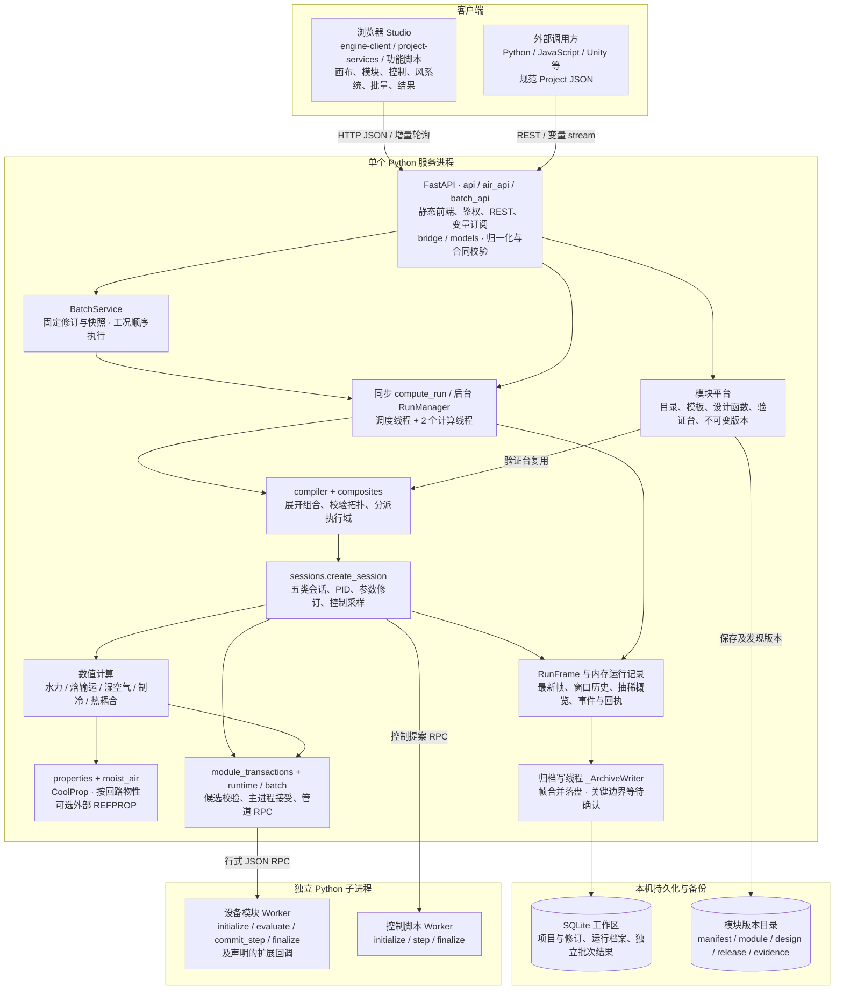
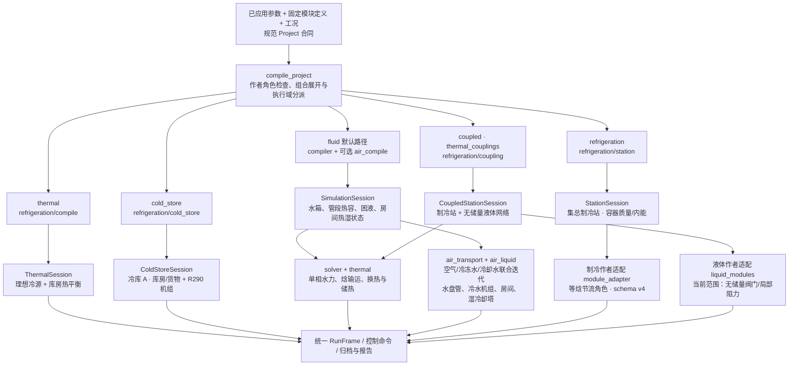
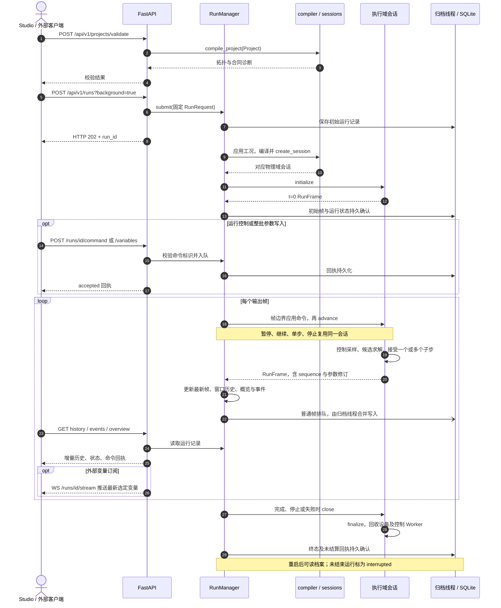
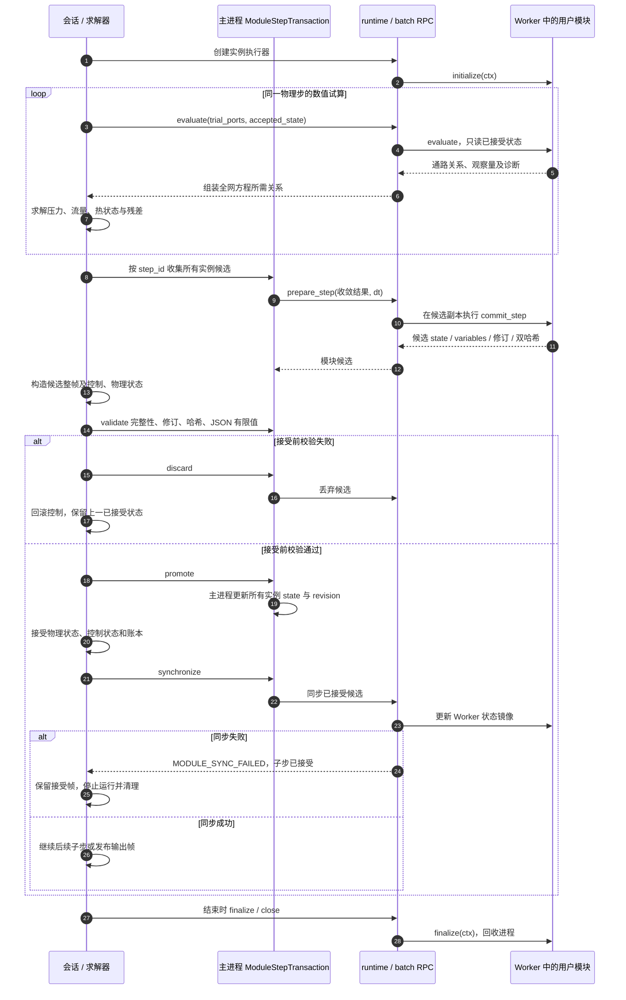
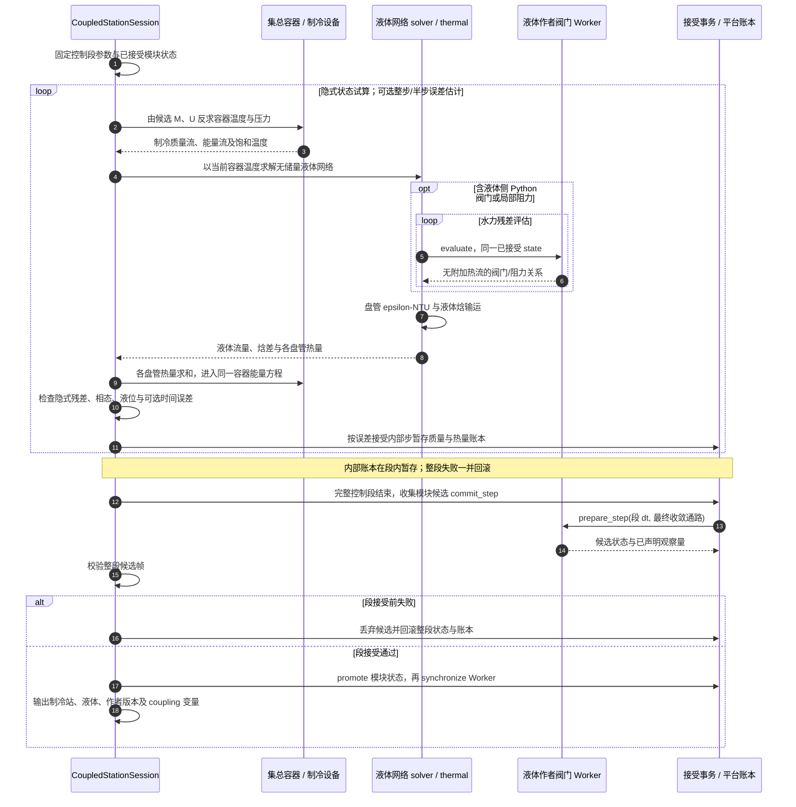
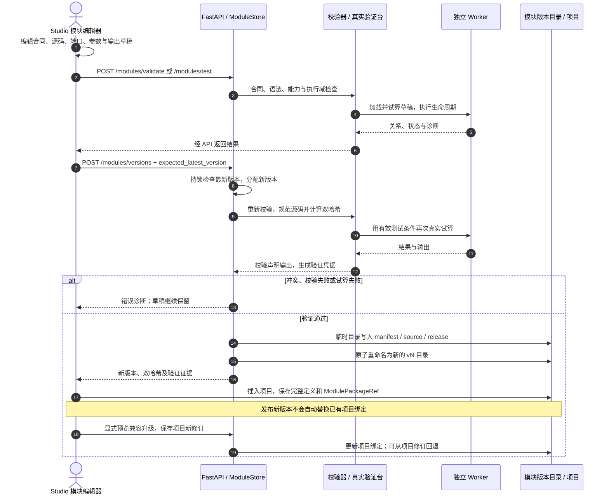
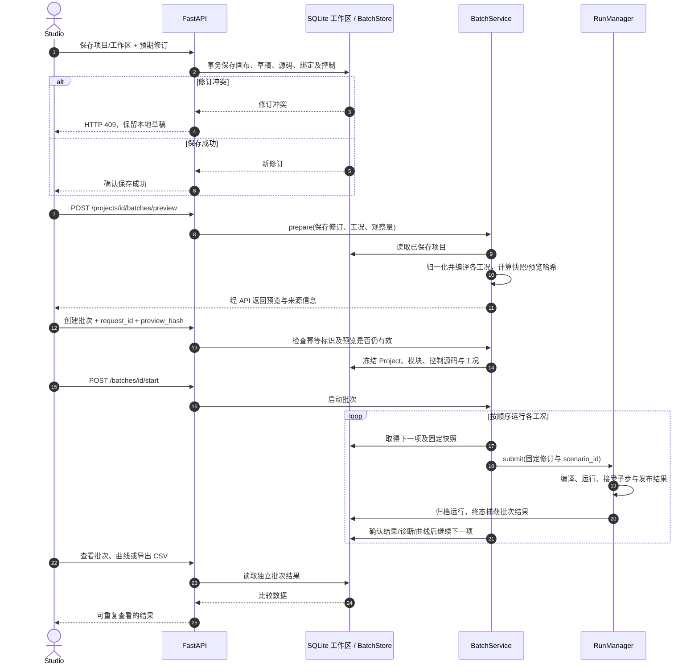

# FluidNet 最新架构图与时序图

核对日期：**2026-10-31（北京时间）**。源码基线：`11db224`，引擎声明版本 `0.5.0`。覆盖该提交已实现的风水联算、制冷作者模块、热耦合液体作者设备和房间自动温控；版本号不表示这些能力都属于 10 月 22 日的发布包。

范围为当前开发项目 `fluidnet-prototype-engine/`。归档 Studio、旧便携包和交互原型不在启动链路中。同一进程内的组件按职责拆分，箭头表示调用或数据流。

| 图 | 内容 | 图片与可编辑源码 |
| --- | --- | --- |
| 1 | 组件、进程及存储架构 | [SVG](diagrams/architecture.svg) · [PNG](diagrams/architecture.png) · [Mermaid](diagrams/architecture.mmd) |
| 2 | 编译与五类执行域 | [SVG](diagrams/architecture-execution-domains.svg) · [PNG](diagrams/architecture-execution-domains.png) · [Mermaid](diagrams/architecture-execution-domains.mmd) |
| 3 | 后台运行、命令、发布与归档 | [SVG](diagrams/sequence-run.svg) · [PNG](diagrams/sequence-run.png) · [Mermaid](diagrams/sequence-run.mmd) |
| 4 | Python 模块候选状态与接受事务 | [SVG](diagrams/sequence-module-worker.svg) · [PNG](diagrams/sequence-module-worker.png) · [Mermaid](diagrams/sequence-module-worker.mmd) |
| 5 | 房间温控与空气/冷冻水/冷却水联算 | [SVG](diagrams/sequence-air-water-control.svg) · [PNG](diagrams/sequence-air-water-control.png) · [Mermaid](diagrams/sequence-air-water-control.mmd) |
| 6 | 制冷站与液体盘管热耦合 | [SVG](diagrams/sequence-thermal-coupling.svg) · [PNG](diagrams/sequence-thermal-coupling.png) · [Mermaid](diagrams/sequence-thermal-coupling.mmd) |
| 7 | 模块开发、发布与项目绑定 | [SVG](diagrams/sequence-module-release.svg) · [PNG](diagrams/sequence-module-release.png) · [Mermaid](diagrams/sequence-module-release.mmd) |
| 8 | 项目可靠保存与批量工况 | [SVG](diagrams/sequence-workspace-batch.svg) · [PNG](diagrams/sequence-workspace-batch.png) · [Mermaid](diagrams/sequence-workspace-batch.mmd) |

## 1. 组件、进程及存储架构

<!-- diagram: architecture -->



Studio 当前通过 HTTP 增量轮询读取历史和状态；WebSocket 是已有的外部变量订阅接口。API 和 BatchService 还直接访问 SQLite 保存工作区、项目和批次。模块验证台复用编译、会话及 Worker。编译、调度、数值和物性服务都在主服务进程内。CLI 可用 `--headless` 关闭前端，继续提供计算 API。Worker 提供进程与生命周期隔离，尚不是操作系统权限沙箱。

依据：[api.py](../backend/fn_engine/api.py)、[jobs.py](../backend/fn_engine/jobs.py)、[batches.py](../backend/fn_engine/batches.py)、[engine-client.js](../frontend/engine-client.js)。

## 2. 编译与五类执行域

<!-- diagram: architecture-execution-domains -->



| 执行域 | 编译与会话 | 当前边界 |
| --- | --- | --- |
| `fluid`（默认路径） | `compile_project` → `SimulationSession` | 单相流体；湿空气与风水三回路仍走此路径。普通 `CompiledNetwork` 没有单独的 `execution_domain='fluid'` 字段，由会话工厂默认分支处理 |
| `thermal` | `compile_thermal_project` → `ThermalSession` | 理想冷源与库房热模型 |
| `cold_store` | `compile_cold_store` → `ColdStoreSession` | 冷库 A，库房/货物热节点与机组状态机 |
| `refrigeration` | `compile_station` → `StationSession` | 集总制冷站；schema v4 作者模块目前仅支持节流角色 |
| `coupled` | `compile_coupled_project` → `CoupledStationSession` | 最多两条盘管关系，关联同一个饱和制冷剂容器；液体侧无物理储量 |

分派见 [compiler.py](../backend/fn_engine/compiler.py) 和 [sessions.py](../backend/fn_engine/sessions.py)。风水三回路和 `thermal_couplings` 是不同路径：前者在一个湿空气/液体网络中联合求解，后者在集总制冷站的隐式试算中嵌套液体网络。制冷作者角色 `refrigeration.isenthalpic_throttle.v1` 当前不能放入湿空气、普通流体或 `coupled` 项目。组合模块已由 [composites.py](../backend/fn_engine/composites.py) 展开并校验子版本。

## 3. 后台运行、命令、发布与归档时序

<!-- diagram: sequence-run -->



`POST /api/v1/projects/{project_id}/runs` 也会启动后台运行，先读取指定保存修订再归一化。同步 `/runs` 在请求中计算并返回，动态最多 2001 帧。普通帧异步归档，命令及关键状态边界等待落盘；返回计算帧不表示该帧已确认落盘。重启后需新建运行，尚不支持续算。

依据：[api.py](../backend/fn_engine/api.py)、[jobs.py](../backend/fn_engine/jobs.py)、[storage.py](../backend/fn_engine/storage.py)。

## 4. Python 模块候选状态与接受事务时序

<!-- diagram: sequence-module-worker -->



接受点由主进程掌握，`commit_step` 生成候选不等于立刻接受；`promote()` 内不执行 RPC 或用户代码。接受前失败可丢弃候选，接受后的同步失败则保留该状态并停止。扩展热力、观察和求导回调按模块能力声明执行，图中省略可选调用。

依据：[module_transactions.py](../backend/fn_engine/module_transactions.py)、[simulation.py](../backend/fn_engine/simulation.py)、[runtime.py](../backend/fn_engine/runtime.py)、[refrigeration/station.py](../backend/fn_engine/refrigeration/station.py)。

## 5. 房间自动温控与风水三回路时序

<!-- diagram: sequence-air-water-control -->


房间示例用 `Room.state.temperature_k` 反馈到 `WaterValve.opening_ratio`。房间有真实热湿动态，两个水回路无储量；盘管与机组通过 `air_liquid.coupled_device_results` 在同一候选状态中换热。示例脚本在 600 s 控制边界改变负荷或目标，600 s 帧仍是变化前值，630 s 帧包含变化后值。报告读取冻结变量目录和已保存接受帧，不重新求解。

依据：[simulation.py](../backend/fn_engine/simulation.py)、[air_transport.py](../backend/fn_engine/air_transport.py)、[air_liquid.py](../backend/fn_engine/air_liquid.py)、[air_ledger.py](../backend/fn_engine/air_ledger.py)、[房间温控说明](ROOM_TEMPERATURE_CONTROL.md)。

## 6. 制冷站与液体盘管热耦合时序

<!-- diagram: sequence-thermal-coupling -->



最多两条耦合关系，绑定同一饱和容器；同一液体通路不得重复绑定。液体作者设备支持声明事务能力的无储量单通路阀门/局部阻力，不支持泵、主动供热或独立物理储量。平台累计通过质量按实际接受的内部步积分，作者 `commit_step` 按完整控制段执行；整步/半步误差试算不触发模块提交。

依据：[coupling.py](../backend/fn_engine/refrigeration/coupling.py)、[liquid_modules.py](../backend/fn_engine/refrigeration/liquid_modules.py)、[station.py](../backend/fn_engine/refrigeration/station.py)、[使用说明](COUPLED_LIQUID_MODULES.md)。

## 7. 模块开发、发布与项目绑定时序

<!-- diagram: sequence-module-release -->



普通流体、制冷节流及热耦合液体作者模块复用模块平台，验证台按合同选择执行路径。同一项目同一模块 ID 固定一个版本；支持显式兼容升级与修订回退。源码哈希和定义哈希分别校验源码、合同与绑定一致性。

依据：[packages.py](../backend/fn_engine/packages.py)、[bench.py](../backend/fn_engine/bench.py)、[refrigeration/bench.py](../backend/fn_engine/refrigeration/bench.py)、[projects.py](../backend/fn_engine/projects.py)。

## 8. 项目可靠保存与批量工况时序

<!-- diagram: sequence-workspace-batch -->



每批最多 20 个工况、16 个观察变量，固定保存修订、模块与控制快照后顺序运行。批次结果独立于普通运行最近 20 条终态记录的保留策略。预览校验合同与拓扑，不保证数值收敛；数值失败会保存为对应工况的失败结果。工作区支持 ZIP 备份与恢复到新目录；中断运行不能续算，批次可重新运行未完成项。

依据：[batches.py](../backend/fn_engine/batches.py)、[batch_api.py](../backend/fn_engine/batch_api.py)、[batch_store.py](../backend/fn_engine/batch_store.py)、[storage.py](../backend/fn_engine/storage.py)。

## 9. 更新与导出

本文件中的 Mermaid 块是图的维护源。命令提取每个 `diagram` 标记后的图，导出同名 `.mmd`、`.svg` 和 `.png`：

```powershell
cd fluidnet-prototype-engine
node scripts/render_architecture_diagrams.mjs
```

使用项目已有 Playwright 和本机 Edge；首次下载固定版本 Mermaid 11.12.2 到项目 `tmp/architecture-render/`。离线时可传 `--mermaid-js <本地 mermaid.min.js 路径>`。SVG 适合放大与排版，PNG 可直接插入文档。

线程、存储与源码导航见 [架构索引](ARCHITECTURE_MAP.md)。本次验证范围为源码调用链核对、Mermaid 实际渲染、图片检查和文档链接检查；不代表重新执行全量物理或浏览器回归。
