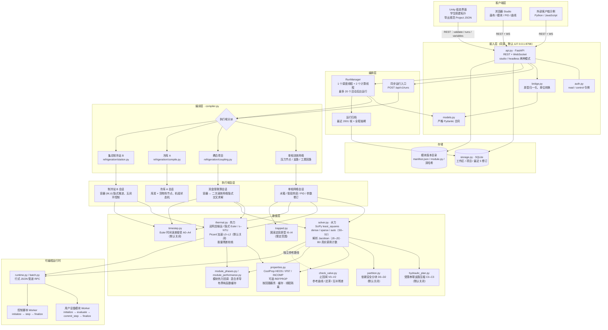
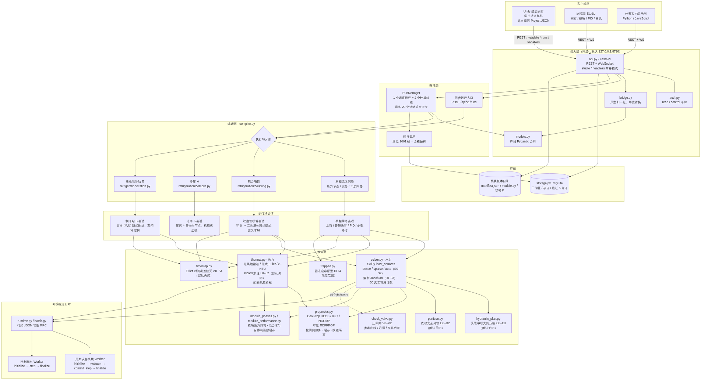
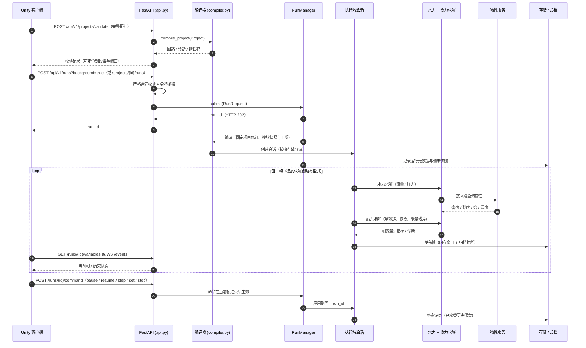
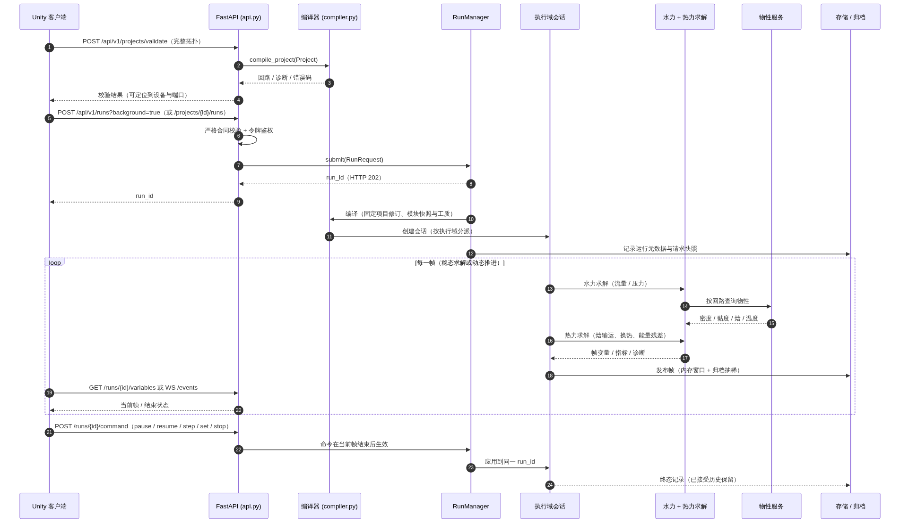
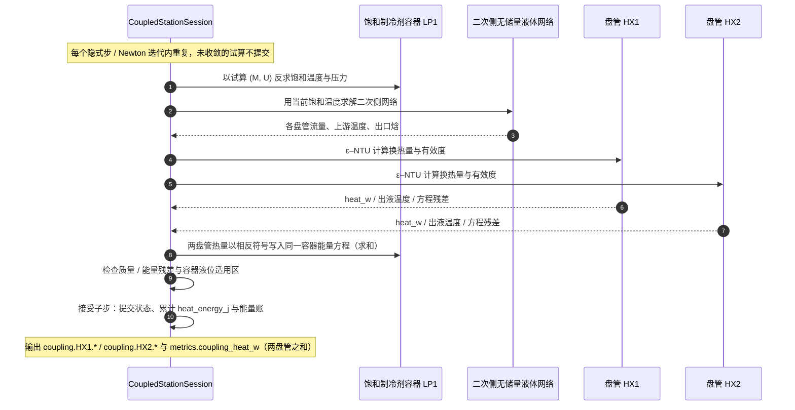
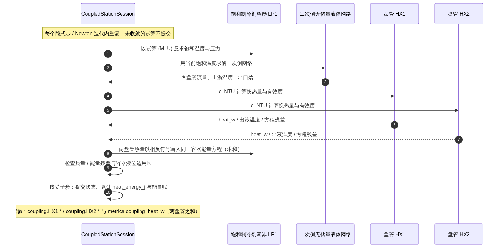
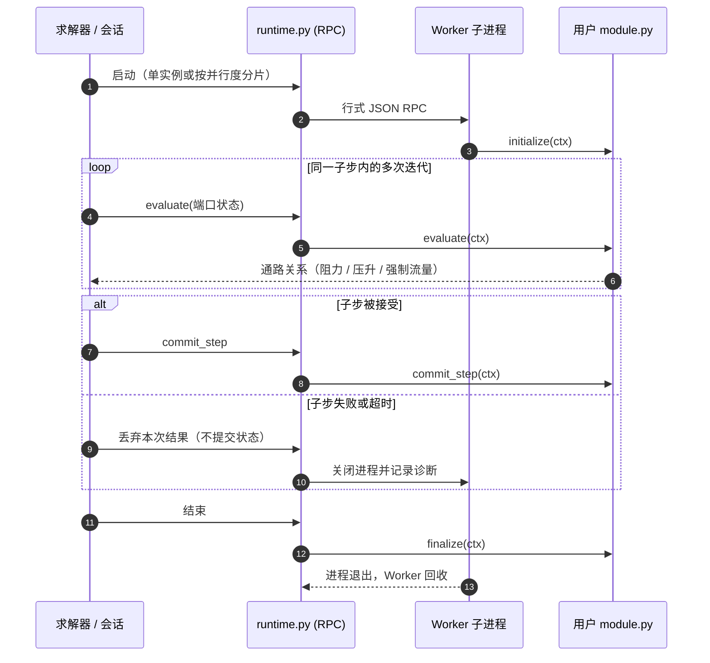
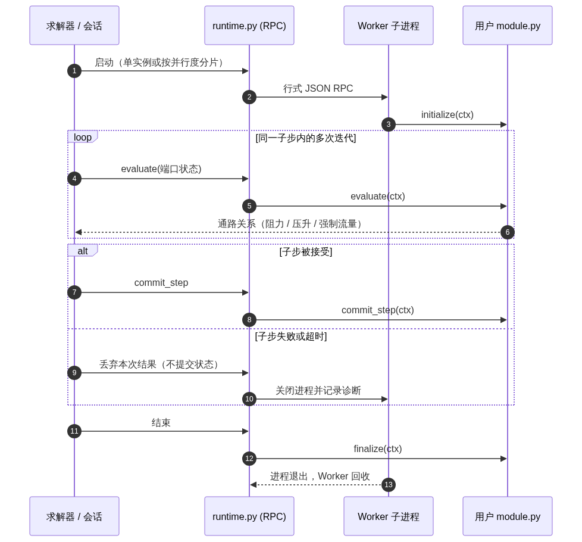
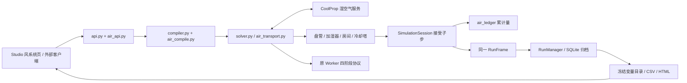

# FluidNet 架构图与时序图

日期：2026-10-27。基线：`codex/development-consistency` 分支提交 `2bf8391`（含热耦合单/双盘管、无界面运行、电加热器与多支路饱和容器）。

本文按当前源码重画**组件架构**与**关键时序**，面向「Unity 组态 → 平台计算」的教学使用方式。历史版本的整体架构（v0.4.6，2026-10-15）仍见 [ARCHITECTURE_MAP](ARCHITECTURE_MAP.md)；两者冲突时以本文与源码为准。图中箭头表示调用、数据流或生命周期，不代表每个方框都是独立服务。

## 1. 组件架构图

要点：

- **一个 Python 服务进程**承担 API、编译、调度与求解；Python 模块与控制脚本在独立 Worker 子进程中执行。
- **执行域由编译器分派**：项目含 `thermal_couplings` → 联算；含 `refrigerant` 端口 → 集总制冷站；含 `thermal` 端口 → 冷库 A；其余为单相流体网络。
- 教学场景中 Unity 只需实现三个 REST 调用（校验、启动、读结果/订阅），算法细节全部在平台内。
- 物性、模块版本与运行归档都在平台侧，客户端不持有求解状态。

### 1.1 数值层细目

| 模块 | 证据系列 | 作用 | 默认 |
| --- | --- | --- | --- |
| `solver.py` | B0、S0–S2、J0–J3 | `least_squares` 水力求解、auto 稀疏选择、纯内置解析 Jacobian、真实残差/Jacobian/RPC 计数 | 解析 Jacobian 开；新建项目 `auto`，旧项目 `dense` |
| `hydraulic_plan.py` | C0–C3 | 受限串联支路压缩与原变量回算 | 关闭（`series_compression=False`） |
| `partition.py` | D0–D2 | 依赖安全的水力分块求解 | 关闭（`hydraulic_blocks=False`） |
| `thermal.py` | L0–L2 | 节点焓输运、隐式 Euler 储热、ε–NTU、能量残差校核、Picard 阻尼加速 | 加速 `none` |
| `timestep.py` | A0–A4 | 整步/两个半步试算、误差归一化与接受/拒绝 | 关闭（`time_step` 未启用） |
| `trapped.py` | I0–I4 | 单容积刚性封闭液腔原型（HEOS 纯水单相） | 仅显式 `closed_volume`，非通用隔离段 |
| `check_valve.py` | V0–V2 | 止回阀解析曲线、开关判据、迟滞状态机与互补残差（独立参考路径） | 求解器不直接调用 |
| `module_phases.py` / `module_performance.py` | 模块系统 | 模块热力回调、混合求导、有界纯函数缓存与端口读取追踪 | 随模块启停 |
| `properties.py` | — | CoolProp HEOS/IF97/INCOMP、可选 REFPROP、按回路物性服务、缓存与线程隔离 | — |

Worker 冷启动优化（W0–W2）属于可编程运行时的启动路径，不在本层；证据与默认开关见 [数值专项证据索引](numerics/README.md)。

## 2. 时序图 A：一次运行（Unity 拓扑 → 平台结果）

## 3. 时序图 B：双盘管热耦合隐式联算

边界：最多两条耦合，须绑定同一个饱和容器，同一液体通路不能重复绑定；液体侧无储热、无 Python 设备模块；两条以上的盘管与不同容器尚未支持。

## 4. 时序图 C：Python 模块与控制脚本的生命周期

控制脚本使用同一 Worker 机制，但按仿真采样周期执行 `initialize / step / finalize`，写入先暂存、整批校验后再应用到下一子步。

## 5. 接口与执行域对照

| 执行域 | 编译器入口 | 会话 | 教学用途 |
| --- | --- | --- | --- |
| 单相流体网络 | `compile_project` | 网络会话（水箱/管段热容/PID） | 泵阀管网、换热器、加热器、水系统 |
| 冷库 A（`cold_store`） | `refrigeration/compile.py` | 库房 + 货物热节点会话 | −18 °C 单库房、机组启停与融霜 |
| 集总制冷站 B（`refrigerant`） | `refrigeration/station.py` | 容器 (M,U) 隐式推进会 | NH₃/CO₂ 制冷站、多支路容器、冷风机 |
| 双盘管联算 | `refrigeration/coupling.py` | 容器 ↔ 二次液体网络交叉求解 | 制冷站与水/乙二醇回路换热 |

客户端可用的主要端点：`POST /api/v1/projects/validate`、`POST /api/v1/runs`、`POST /api/v1/projects/{id}/runs`、`GET /api/v1/runs/{id}/variables`、`GET /api/v1/runs/{id}/history`、`WS /api/v1/runs/{id}/stream`、`GET /api/v1/runs/{id}/events`、`POST /api/v1/runs/{id}/command`，以及示例 `GET /api/v1/examples/{name}`。

## 6. 说明

- 图中组件均按源码核对：域分派见 [compiler.py](../backend/fn_engine/compiler.py)，调度与线程见 [jobs.py](../backend/fn_engine/jobs.py)，会话工厂见 [sessions.py](../backend/fn_engine/sessions.py)，联算见 [coupling.py](../backend/fn_engine/refrigeration/coupling.py)。
- 本文件为 Mermaid 文本，GitHub / GitLab / VS Code 可直接渲染；需要 PNG/SVG 时可用 `@mermaid-js/mermaid-cli` 导出。
- 架构细节（启动、并发、存储、契约）仍以 [ARCHITECTURE_MAP](ARCHITECTURE_MAP.md) 与 [API](API.md)、[数据合同](DATA_CONTRACT.md) 为准。

## 风侧合同 1 的实际调用链（2026-10-29）

湿空气仍是 fluid 执行域。编译器复用既有节点/支路映射并调用 `air_compile`；`solver._solve_network` 调度 `air_transport.solve_air_network`，在水力与 h/w 输运之间反馈物性。`air_devices`、`air_room` 和 `cooling_tower_moist` 只返回候选值；`air_ledger` 随 `SimulationSession._accept` 一次提交累计量。

运行创建时固定 `air_metadata`（物性版本、质量基准、项目摘要、变量目录与假设），沿用现有 JSON 存储事务。报告直接读取已保存的帧和目录，不执行编译或数值求解。新旧模块通过 SDK 0.6.0 能力声明区分，旧 RPC 过滤新增字段。详细行为及验证见 [风侧实施验收](AIR_SIDE_IMPLEMENTATION_ACCEPTANCE.md)。
