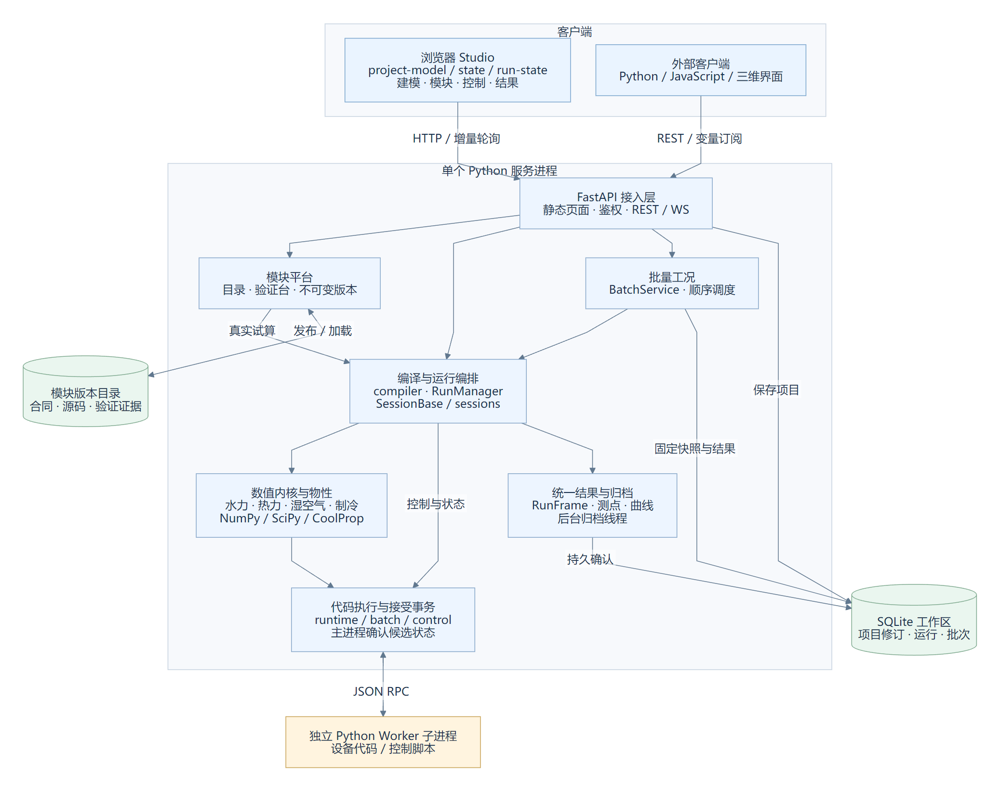

# FluidNet 架构索引、进程与存储

核对日期：**2026-11-03**；源码基线 `7424576`；引擎声明版本 `0.5.0`。完整的四张架构图与六张核心时序图统一维护于 [ARCHITECTURE_AND_SEQUENCE.md](ARCHITECTURE_AND_SEQUENCE.md)，本页补充进程、存储和源码导航。

后续内部整理见 [架构整理执行计划](ARCHITECTURE_REFACTOR_PLAN.md)：按项目转换、编辑状态、运行结果、公共会话和全量验收分八个工作包实施，目前尚未开始。

## 1. 系统与执行域

[系统总览 SVG](diagrams/architecture.svg) · [多画布与项目](diagrams/architecture-project-model.svg) · [五类执行域](diagrams/architecture-execution-domains.svg) · [暖通设备与测点](diagrams/architecture-hvac.svg)

系统是一个提供静态前端与 API 的 Python 服务，编译与数值求解均在该服务进程内。用户设备代码与项目控制脚本在独立 Worker 子进程执行。内置设备直接由平台计算，自定义设备返回关系与候选输出，由主进程组装全网方程并决定接受状态。

`compiler.compile_project` 先检查作者角色、测点合同并展开组合，再根据热耦合、端口域与冷库类型分派。`sessions.create_session` 创建 `SimulationSession`、`ThermalSession`、`ColdStoreSession`、`StationSession` 或 `CoupledStationSession`。湿空气及空气/冷冻水/冷却水三回路仍走默认流体会话；没有单独的空气执行域。

画布分组只影响编辑视图；跨页连接由 `project-links.js` 按项目检索，归一化汇入同一个 `Project.instances/connections`。暖通组合先展开成叶子设备，求解结果再映射回公开设备变量并计算理想测点。标准机房的空气、冷冻水和冷却水三回路与画布分组没有一一对应关系。

## 2. 启动、线程与 Worker

| 对象 | 当前行为 | 源码 |
| --- | --- | --- |
| 启动 | `start.ps1` → `python -m fn_engine serve` → Uvicorn/FastAPI，默认 `127.0.0.1:8798`；`--headless` 不挂载前端 | [cli.py](../backend/fn_engine/cli.py)、[api.py](../backend/fn_engine/api.py) |
| 前端 | 静态页面及普通 JS；`project-links` 管理全项目连接；`engine-client`/`project-services` 和功能脚本连接 API；Studio 用 HTTP 轮询 | [frontend/](../frontend/) |
| 后台运行 | 一个调度线程，两个计算线程，每次推进一个会话一帧；最多 20 个非终态运行 | [jobs.py](../backend/fn_engine/jobs.py) |
| 批量工况 | `BatchService` 的后台线程按固定快照顺序向同一个 `RunManager` 提交工况 | [batches.py](../backend/fn_engine/batches.py) |
| 运行归档 | `_ArchiveWriter` 单写线程合并普通帧；命令、初始状态与终态等关键边界等待持久确认；有积压反压 | [jobs.py](../backend/fn_engine/jobs.py) |
| 模块 Worker | 单实例或分片执行，`batch_modules=True`；`module_parallelism` 默认 1、范围 1–16；与两个计算线程是不同并行层级 | [runtime.py](../backend/fn_engine/runtime.py)、[batch.py](../backend/fn_engine/batch.py) |
| 控制 Worker | 每个启用脚本使用受管理状态与采样提案，独立执行 `initialize/step/finalize` | [control.py](../backend/fn_engine/control.py) |
| 物性 | CoolProp 线程隔离与缓存，湿空气独立适配；可选 REFPROP；不是单独网络服务 | [properties.py](../backend/fn_engine/properties.py)、[moist_air.py](../backend/fn_engine/moist_air.py) |

暂停释放计算线程但保留会话与 Worker。服务退出时回收运行、控制和设备执行器。Worker 是独立进程，不具备操作系统权限沙箱。服务对外监听时启用令牌控制，令牌分 `read`/`control`，TLS 由外部反向代理提供。

## 3. 接受事务与结果一致性

1. 项目运行固定已应用参数、模块定义/版本/双哈希、控制源码和所选工况；界面草稿不直接进入计算。
2. 数值求解可以反复调用 `evaluate`；这些调用读取同一已接受模块状态。模块扩展回调按能力声明执行。
3. `ModuleStepTransaction` 收集 `commit_step` 候选，校验完整性、修订、哈希、状态及整帧，再由主进程 `promote`。该接受点不执行用户代码或 RPC。
4. 接受前失败丢弃候选；接受后 Worker 同步失败保留已接受状态并停止。物理量、控制提案和累计账本遵循对应会话的接受边界。
5. 运行命令和批量参数在帧边界生效，以命令回执和 `parameter_revision` 识别。`sequence` 用于增量历史与识别跳帧。
6. 流体结果先经 `composites.map_frame` 映射公开变量，再经 `measurements.apply_measurements` 计算测点；缺少有效输入输出空值与诊断，测点不会增加网络方程。`measurement.*` 保留在 trend 历史。
7. 风侧报告使用运行冻结的 `air_metadata`、变量目录和已接受帧，生成 CSV/HTML 时不重新编译或求解。

详细时序见 [模块事务](ARCHITECTURE_AND_SEQUENCE.md#6-python-模块候选状态与接受事务时序)、[房间温控](ARCHITECTURE_AND_SEQUENCE.md#7-房间自动温控与风水三回路时序)、[液体热耦合](ARCHITECTURE_AND_SEQUENCE.md#8-制冷站与液体盘管热耦合时序)。

## 4. 数据保存与生命周期

| 数据 | 所在位置 | 保留与恢复 |
| --- | --- | --- |
| 工作区、项目与草稿 | `WorkspaceStore`，默认 `.runtime/workspace/workspace.sqlite3` | 工作区与单项目最近 5 个修订；乐观修订冲突返回 409 |
| 浏览器备份与偏好 | `localStorage` | 草稿恢复和界面偏好；恢复／替换单项目时备份该项目及绑定；服务确认保存后才标记已保存 |
| 浏览器令牌 | `sessionStorage` | 当前标签页使用 |
| 用户模块版本 | 默认 `.runtime/module-packages/module-ID/vN/` | 不可变版本，包含 manifest、源码、可选设计函数、release 与证据；可配置目录 |
| 同步运行 | API 内存记录与启用后的 SQLite 归档 | 内存最近 20 条；动态请求最多 2001 帧 |
| 后台运行 | `RunManager.jobs`、会话与 SQLite | 最多 20 个非终态运行，另保留最近 20 条终态记录 |
| 帧历史 | 运行滚动窗口 | 默认 2001，可配 10–20001；会话自身保留最近 8 帧 |
| 全程曲线 | 内存与 SQLite overview | 2000 点阈值触发抽稀，查询补末帧 |
| 事件与已结算命令 | 运行记录 | 各有 1000 条上限 |
| 批次快照与结果 | 同一 SQLite 中的独立批次表 | 独立于普通运行淘汰；最多 20 工况、16 观察变量 |
| 备份 | ZIP、目标恢复目录 | 保存数据、模块版本和运行档案；支持恢复到新目录 |
| 令牌哈希 | 默认 `.runtime/tokens.json` | 只存哈希与元数据 |

CLI 默认启用持久工作区，直接调用 `create_app(data_root=None)` 则没有 SQLite 工作区与批次能力。普通运行帧会短暂排队等待归档，应以 `persisted_at`/`persisted_rows` 判断确认落盘边界。服务重启把未结束运行标为 `interrupted`，可查看档案，但不能继续原会话。批次可重新运行未完成项。

## 5. 源码导航

| 领域 | 主要源码 |
| --- | --- |
| 多画布、保存与导入 | [project-links.js](../frontend/project-links.js)、[project-services.js](../frontend/project-services.js)、[modeling-workflows.js](../frontend/modeling-workflows.js)、[engine-client.js](../frontend/engine-client.js) |
| 暖通包与示例生成 | [hvac_basic.py](../backend/fn_engine/hvac_basic.py)、[hvac_examples.py](../backend/fn_engine/hvac_examples.py)、[generate_hvac_modules.py](../scripts/generate_hvac_modules.py)、[generate_hvac_examples.py](../scripts/generate_hvac_examples.py)；运行时加载 [modules/](../modules/) |
| 理想测点 | [measurements.py](../backend/fn_engine/measurements.py)、[air_variables.py](../backend/fn_engine/air_variables.py)；经组合变量映射后计算，报告读取冻结目录 |
| 合同与兼容 | [models.py](../backend/fn_engine/models.py)、`_module_schema_v1..v4.py`、[module_contracts.py](../backend/fn_engine/module_contracts.py)、[fn_sdk/](../backend/fn_sdk/) |
| 规范化、项目与组合 | [bridge.py](../backend/fn_engine/bridge.py)、[projects.py](../backend/fn_engine/projects.py)、[composites.py](../backend/fn_engine/composites.py)、[compiler.py](../backend/fn_engine/compiler.py) |
| 接入与任务 | [api.py](../backend/fn_engine/api.py)、[air_api.py](../backend/fn_engine/air_api.py)、[batch_api.py](../backend/fn_engine/batch_api.py)、[auth.py](../backend/fn_engine/auth.py)、[jobs.py](../backend/fn_engine/jobs.py)、[sessions.py](../backend/fn_engine/sessions.py) |
| 水力热力与状态 | [solver.py](../backend/fn_engine/solver.py)、[thermal.py](../backend/fn_engine/thermal.py)、[simulation.py](../backend/fn_engine/simulation.py)、[trapped.py](../backend/fn_engine/trapped.py) |
| 数值优化与时间误差 | [hydraulic_plan.py](../backend/fn_engine/hydraulic_plan.py)、[partition.py](../backend/fn_engine/partition.py)、[hydraulic_derivatives.py](../backend/fn_engine/hydraulic_derivatives.py)、[timestep.py](../backend/fn_engine/timestep.py)；适用边界见 [数值专项索引](numerics/README.md) |
| 湿空气与房间 | [air_compile.py](../backend/fn_engine/air_compile.py)、[air_transport.py](../backend/fn_engine/air_transport.py)、[air_room.py](../backend/fn_engine/air_room.py)、[air_ledger.py](../backend/fn_engine/air_ledger.py) |
| 风水设备 | [air_liquid.py](../backend/fn_engine/air_liquid.py)、[air_devices.py](../backend/fn_engine/air_devices.py)、[water_chiller.py](../backend/fn_engine/water_chiller.py)、[cooling_tower_moist.py](../backend/fn_engine/cooling_tower_moist.py) |
| 冷库、制冷站与热耦合 | [refrigeration/](../backend/fn_engine/refrigeration/)，其中 `session`/`cold_store`/`station`/`coupling` 分别实现热、冷库、集总站、热耦合会话 |
| 作者设备适配 | [refrigeration/module_adapter.py](../backend/fn_engine/refrigeration/module_adapter.py)、[refrigeration/liquid_modules.py](../backend/fn_engine/refrigeration/liquid_modules.py)、[refrigeration_roles.py](../backend/fn_engine/refrigeration_roles.py) |
| 模块运行与事务 | [runtime.py](../backend/fn_engine/runtime.py)、[batch.py](../backend/fn_engine/batch.py)、[worker.py](../backend/fn_engine/worker.py)、[module_transactions.py](../backend/fn_engine/module_transactions.py)、[module_execution.py](../backend/fn_engine/module_execution.py) |
| 作者工作流 | [packages.py](../backend/fn_engine/packages.py)、[module_validation.py](../backend/fn_engine/module_validation.py)、[module_testing.py](../backend/fn_engine/module_testing.py)、[bench.py](../backend/fn_engine/bench.py)、[design.py](../backend/fn_engine/design.py) |
| 控制、批次与存储 | [controllers.py](../backend/fn_engine/controllers.py)、[control.py](../backend/fn_engine/control.py)、[batches.py](../backend/fn_engine/batches.py)、[batch_store.py](../backend/fn_engine/batch_store.py)、[storage.py](../backend/fn_engine/storage.py)、[backup.py](../backend/fn_engine/backup.py) |
| 冻结报告 | [air_report.py](../backend/fn_engine/air_report.py)、[refrigeration/report.py](../backend/fn_engine/refrigeration/report.py) |

## 6. 当前模型边界

普通管网支持单相水力、焓输运和已有储量模型，尚不计算水锤或通用管网两相流。湿空气要求合同 1、热力开启及 `property_coupling='node'`。房间温控示例只有温度闭环，水侧仍无储量；不包含独立湿度控制或厂家性能标定。

集总制冷站可在设备内部使用两相物性；制冷作者角色当前仅为等焓节流。`coupled` 最多两条盘管、同一个饱和容器，液体侧仅允许限定的无储量 Python 阀门/阻力模块。模块发布不会自动替换项目绑定，但已支持显式兼容升级与项目修订回退。组合定义已有展开实现，不能继续沿用早期文档的“尚未实现”描述。

自定义压降 `net.pressure_drop`（SDK 0.8.0）只支持普通单相、无独立储量的被动阻力设备。理想测点支持单相水力与风水联算，不支持集总制冷站和 `thermal_couplings`。暖通标准机房验证稳态、调阀和保存复算，自动温控与泵联锁各有独立案例。
