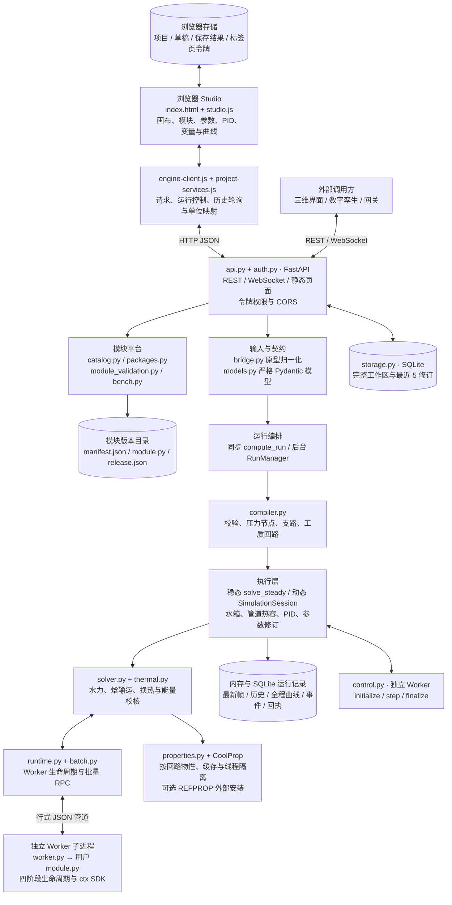
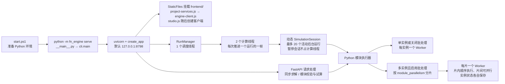
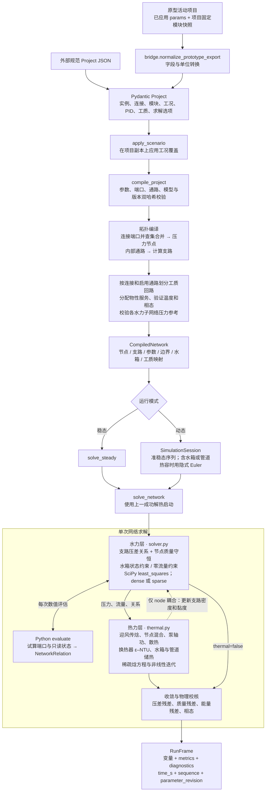
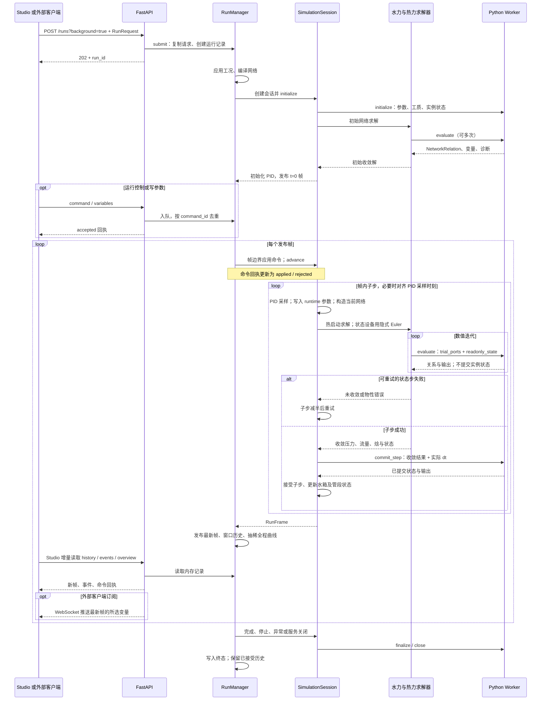
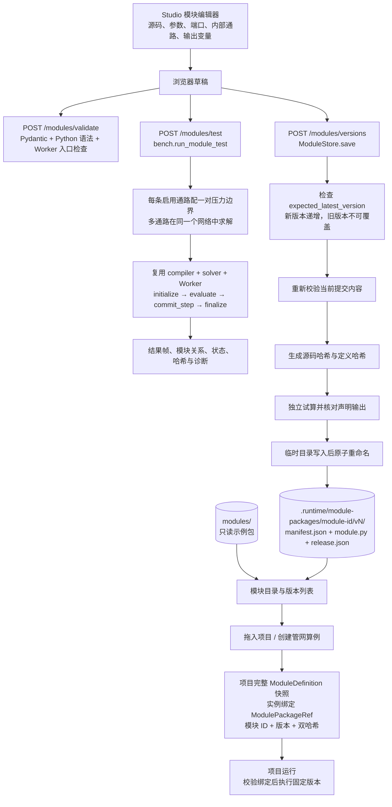
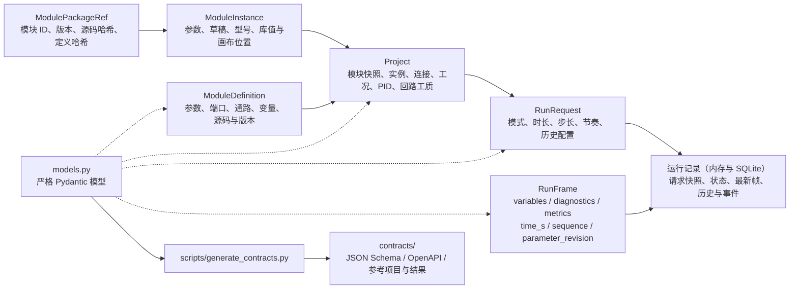

# FluidNet 完整架构图

按当前源码核对：版本 **0.4.6**，基线提交 `5c05c79` 加本轮工作区修改，日期 **2026-10-15**。主体为 `fluidnet-prototype-engine/`；根目录 README 已将 `archive/fluidnet-studio-v0.2/` 标为归档项目。

系统采用浏览器前端、单个 Python 服务和用户模块 Worker 子进程的结构。前端与 API 同源，由 FastAPI 同时提供；网络编译、任务调度和数值求解都在服务进程内。下面的箭头分别按图示表示调用、数据流或生命周期，不代表每个方框都是独立服务。

## 1. 系统总览

图中 FastAPI、模块平台、编译器、运行编排、求解器和运行记录都位于主服务进程内。结果由 API 提供给访问端；模块独立验证复用编译器、求解器和 Worker。令牌哈希另存于 `.runtime/tokens.json`。

`properties.py` 同时被主服务和 Worker 导入；它不是单独的网络服务。内置设备直接进入求解器，自定义 Python 模块通过 `ctx.net.*` 返回关系，再由同一个全网求解器计算压力与流量。

## 2. 启动、进程与并发

- `module_parallelism` 默认 1，可设置 1–16；`batch_modules` 默认开启。两个后台计算线程与模块 Worker 并行度是两层不同的配置。
- Worker 是独立 Python 进程，通过管道 RPC 通信，默认单次响应超时 10 秒。正常结束调用 `finalize`，失败或超时关闭进程。
- 服务默认本机访问。对外监听时强制令牌认证；跨域来源显式配置。TLS 可以由外部反向代理提供。

依据：[cli.py](../backend/fn_engine/cli.py)、[api.py](../backend/fn_engine/api.py)、[jobs.py](../backend/fn_engine/jobs.py)、[runtime.py](../backend/fn_engine/runtime.py)、[batch.py](../backend/fn_engine/batch.py)。

## 3. 网络编译与数值求解

默认 `property_coupling='reference'`：每个回路采用固定参考密度、黏度完成水力求解，再计算热力。`node` 模式在外循环中把热力结果更新为支路物性后重新求解；物性在单轮水力迭代内冻结。默认水力算法是 `dense`，大网络可选择 `sparse`。

工质回路与水力连通分量不同：工质回路按启用的内部通路划分，阀门关闭不会把工质回路分开；压力参考检查则考虑阀门是否关闭。换热器两侧可以使用不同工质，只传热、不混合。

物性经 `CoolProp.AbstractState` 查询；普通后端按线程隔离状态并缓存。REFPROP 调用受锁保护，每种工质首次使用前用临时子进程探测其文件兼容性。

依据：[bridge.py](../backend/fn_engine/bridge.py)、[compiler.py](../backend/fn_engine/compiler.py)、[solver.py](../backend/fn_engine/solver.py)、[thermal.py](../backend/fn_engine/thermal.py)、[properties.py](../backend/fn_engine/properties.py)。

## 4. 动态运行与控制时序

- 一帧可包含多个成功子步；`commit_step` 对每个成功子步调用一次，失败试算不提交。单步、暂停和恢复复用同一会话与模块状态。
- 同步动态接口同样使用 `SimulationSession`，但在请求内一次执行完毕；最多返回 2001 帧。持续运行必须使用后台接口。
- 后台 `fast` 尽快推进，`realtime` 按 `dt_s / speed_ratio` 调度。暂停释放计算线程，仍保留会话和 Worker。
- `/variables` 批量写入在同一帧边界统一校验和应用，成功时生成一个参数修订号；可写目标为 runtime 参数和 PID 设定。
- 水箱排空或满箱会定位事件时刻、停止运行并保留已接受帧。运行中被阀门隔离的被动管段可保压，含泵或 Python 模块的隔离段会报错。
- Studio 当前使用 HTTP 轮询更新运行界面。WebSocket 已实现，面向后台运行的变量订阅；慢客户端只取得最新帧，可通过 `sequence` 识别跳帧。

依据：[jobs.py](../backend/fn_engine/jobs.py)、[simulation.py](../backend/fn_engine/simulation.py)、[controllers.py](../backend/fn_engine/controllers.py)、[engine-client.js](../frontend/engine-client.js)、[api.py](../backend/fn_engine/api.py)。

## 5. 自定义模块开发、发布与绑定

编辑草稿用于独立试算；项目运行使用插入时固定的保存版本。发布新版不会改变已有项目。同一项目内同一模块 ID 固定一个版本，目前没有项目内版本迁移或同 ID 多版本混用。

`ctx.net` 支持声明管道、阀门、泵和指定质量流量的压缩机关系；`ctx.fluid` / `ctx.fluid_at(port)` 查询项目或端口回路物性。Worker 负责执行模块代码与保存实例状态，全网方程仍由主服务求解器组装和求解。独立进程提供生命周期隔离，并非操作系统权限沙箱。

依据：[module_validation.py](../backend/fn_engine/module_validation.py)、[bench.py](../backend/fn_engine/bench.py)、[packages.py](../backend/fn_engine/packages.py)、[runtime.py](../backend/fn_engine/runtime.py)、[worker.py](../backend/fn_engine/worker.py)。

## 6. 数据合同与持久化

| 数据 | 所在位置 | 生命周期与用途 |
| --- | --- | --- |
| 项目、模块编辑草稿、已保存的运行结果 | 浏览器 `localStorage` 草稿备份与服务端工作区，主键 `fluidnet-prototype-engine-v1` | 保存/刷新恢复；原型 JSON 导入导出；全程抽稀数据不写入该存储 |
| 界面偏好 | 浏览器 `localStorage`，键后缀 `-ui` | 主题、页签等 |
| 浏览器访问令牌 | `sessionStorage` | 当前标签页使用，由请求头携带 |
| 内置 Python 示例模块 | `modules/programmable_valve/` | 随源码提供的种子版本，不被发布操作覆盖 |
| 用户发布模块 | 项目 `.runtime/module-packages/` | 可用 `FLUIDNET_MODULE_STORE` 指定目录；服务重启后保留 |
| 令牌记录 | 项目 `.runtime/tokens.json` | 可用 `FLUIDNET_TOKEN_FILE` 指定；只保存令牌哈希及元数据 |
| 同步运行记录 | `api.py` 内的 `OrderedDict` | 内存中保留最近 20 条；启用 data_root 时归档到 SQLite，重启可读 |
| 后台运行记录与会话 | `RunManager.jobs` / `SimulationSession` | 最多 20 个活动运行，另保留最近 20 个终态记录；重启后可查看归档，未结束运行标为 interrupted |
| 后台历史 | 运行记录中的滚动窗口 | 默认 2001 帧，可配 10–20001；会话自身只保留最近 8 帧 |
| 全程曲线 | 内存与 SQLite overview | 按 2000 点阈值加倍抽稀步距；查询时补入末帧 |
| 事件与已结算命令回执 | 后台运行记录 | 各受 1000 条限制，避免长时间运行无限增长 |
| 接口合同和参考算例 | `contracts/` | 从可执行模型及接口生成的开发资料，不作为运行数据库 |
| REFPROP DLL 与工质文件 | 外部安装目录或 `FLUIDNET_REFPROP_PATH` | 通过 CoolProp 的 REFPROP 后端调用；根目录同名资料不代表已自动接入 |

变量使用稳定的实例 ID 路径，例如 `V1.ch0.mass_flow_kg_s`、`T1.state.level_m`、`V1.param.opening_ratio`、`controller.pid1.output`。显示单位转换由前端适配器完成，计算合同使用规范单位。

## 7. 代码导航与当前边界

| 层次 | 主要源码 |
| --- | --- |
| 页面、画布、模块编辑、曲线 | [frontend/index.html](../frontend/index.html)、[studio.js](../frontend/studio.js) |
| API 适配、版本绑定、真实数据映射 | [engine-client.js](../frontend/engine-client.js) |
| 启动和接入 | [cli.py](../backend/fn_engine/cli.py)、[api.py](../backend/fn_engine/api.py)、[auth.py](../backend/fn_engine/auth.py) |
| 契约、目录、归一化、编译 | [models.py](../backend/fn_engine/models.py)、[catalog.py](../backend/fn_engine/catalog.py)、[bridge.py](../backend/fn_engine/bridge.py)、[compiler.py](../backend/fn_engine/compiler.py) |
| 任务、动态状态和控制 | [jobs.py](../backend/fn_engine/jobs.py)、[simulation.py](../backend/fn_engine/simulation.py)、[controllers.py](../backend/fn_engine/controllers.py) |
| 数值算法与物性 | [solver.py](../backend/fn_engine/solver.py)、[thermal.py](../backend/fn_engine/thermal.py)、[properties.py](../backend/fn_engine/properties.py) |
| 模块执行与版本 | [runtime.py](../backend/fn_engine/runtime.py)、[worker.py](../backend/fn_engine/worker.py)、[batch.py](../backend/fn_engine/batch.py)、[packages.py](../backend/fn_engine/packages.py) |
| 模块验证 | [module_validation.py](../backend/fn_engine/module_validation.py)、[bench.py](../backend/fn_engine/bench.py) |
| 示例、合同生成、性能评估 | [examples.py](../backend/fn_engine/examples.py)、[generate_contracts.py](../scripts/generate_contracts.py)、[benchmark_scaling.py](../scripts/benchmark_scaling.py) |
| 回归与端到端验证 | `tests/test_*.py` 覆盖物理、状态、接口、版本、工质和并发；`tests/browser-*.mjs` 使用 Playwright 验证页面工作流 |

当前可计算的内置模型包括压力源、连接节点、泵、阀门、管道、双侧换热器和开式水箱，以及版本化 Python 模块与项目级 PID。动态部分包含水箱质量/焓和分段管道热容；不计算水锤、完整可压缩流动或管网内两相流。模块物性查询可使用显式两相状态接口。

Python 项目控制脚本已接通采样执行和独立 Worker；串口演示、原型自定义变量等部分入口仍为编辑或预览。未支持的模型进入求解器时会被拒绝；组合设备只有已经展开为普通实例和连接的项目可计算，递归组合定义展开尚未实现。

项目新增本地 SQLite 工作区与运行归档，没有外部消息队列或分布式调度依赖。Node/Playwright 用于前端检查与浏览器测试，不是线上前端服务。归档 Studio、旧版 `dist/`、`output/` 原型和算法参考资料不属于当前引擎的启动链路。

本图以源码为准：旧文档中“WebSocket 待实现”“一个项目只用一种流体”和前端脚本加载顺序等描述与当前实现有差异，已在这里按实际行为呈现。

本轮补充：`storage.py` 持久化完整工作区（最近 5 修订）、请求/最新帧/事件、最近窗口和全程抽稀；`control.py` 由 `worker.py` 调度 initialize/step/finalize，SimulationSession 在下一接受子步提交控制状态。前端新增 project-services.js，提供工作区版本冲突检测、控制预览和运行归档查看。具体合同见 API.md 与 DATA_CONTRACT.md。
