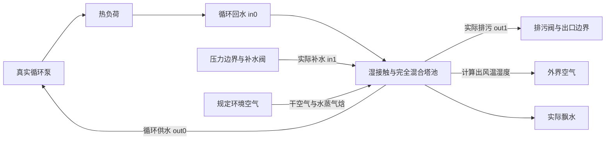

# 湿接触冷却塔与真实池体联算（H09 后续）

2026-11-05。新设备 `coupled_tower_pool` 将湿空气接触、蒸发、飘水、池体质量与热库存共同求解。蒸发量来自实际空气进出口含湿量差，已经不是外给蒸发率。四个水口分别为循环回水 `in0`、真实补水 `in1`、循环供水 `out0` 和排污 `out1`，水量由连接的泵、管和阀共同决定。

## 明确的组合边界

该模型是**完全混合湿接触容积**：接触水膜温度等于池体混合温度，池体水流接普通单相水力网络；空气是给定压力、温湿度与风机实际风量的外界流股。与原有 `cooling_tower_moist` 一样没有空气管网端口，但空气出口温湿度和流量由真实湿空气物性计算。

它不计算填料区与池体两个独立水温、填料传质微分方程、自然通风或水滴粒径，也不开放任意 `moist_air=true` 网络中的水侧储量。它与原代数湿塔是不同设备，**不能串接两个设备并把相同接触过程重复计算**。旧代数湿塔及它的补水/排污账保持原用途；新模型没有 `cycles_of_concentration` 自动排污或代数补水参数。



## 不重复计热的质量与能量账

空气接触效能 ε 复用既有湿空气塔的定义，饱和目标取池温：

```text
h_air,out = h_air,in + ε × (h_sat(T_pool) − h_air,in)
w_out = w_in + ε × (w_sat(T_pool) − w_in)
m_evap = m_dry_air × (w_out − w_in)
m_drift = drift_fraction × 实际循环回水流量
```

水的 CoolProp 比焓基准与湿空气流股的水蒸气基准相差 δh，采用与旧湿塔一致的参考转换。池体对外总焓流为：

```text
Q_out = m_dry_air × (h_air,out − h_air,in) + m_evap × δh + m_drift × h_pool
dM/dt = Σm_water,in − Σm_water,out − m_evap − m_drift
d(Mh)/dt = Σm_water,in h_in − Σm_water,out h_pool + Q_external − Q_out − Q_ambient
```

**空气焓增加已经包含蒸发潜热，不能再扣一遍 `m_evap × h_vapor`。** `heat_rejected_w` 是上式 Q_out（含飘水焓和基准修正），`air_heat_w` 单独给空气焓增加。补水与排污带来的质量和焓只从真实水口计入；关补水阀后库存按蒸发/飘水真实下降。

风量按额定实际风量×转速比，风机电功率采用额定功率×转速比³。该功率排向外界，不进入池体，也不额外加入已报告的接触空气焓差；可从独立电量变量计入系统耗能。风机停转、效能为零或循环回水为零时无湿接触和飘水。需向池体凝水的工况明确拒绝，未冒充蒸发塔正常运行。

## 接受事务与控制

外层将水力质量损失、池体热量和湿空气出口共同迭代；每轮使用临时网络视图，原设备参数和已接受库存不变。最终质量损失缺陷须小于 `1e-11 kg/s`，对外焓流缺陷小于 `1e-5 W`，同时通过原水力/热力判据。失败或拒帧不提交任何质量、焓或累计量。

蒸发、飘水、实际补水、实际排污、对外焓和风机电量都按最终候选步的实际流率，由已有 `air_ledger` 在接受时积分。运行中可改变风机转速、进风温湿度、接触效能和独立外部热源；无效湿空气条件在参数写入时拒绝。首版未增加自动液位控制器，用户可用现有 PID/Python 控制真实补水阀，阀门开度仍须经过水力求解。

## 示例与证据

- [真实补排项目](../examples/hvac-expansion/wet-pool-makeup.project.json)／[组装清单](../examples/hvac-expansion/wet-pool-makeup.recipe.json)。循环泵＋5 kW 热负荷，补排阀都接实际压力边界。
- [无补水项目](../examples/hvac-expansion/wet-pool-no-makeup.project.json)／[组装清单](../examples/hvac-expansion/wet-pool-no-makeup.recipe.json)。关闭补水和排污阀，观察库存损失。

两例 300 s、30 s 输出均有 11 帧有效结果。初始池水质量 995.653806 kg：无补水时蒸发 0.898997 kg、飘水 0.160129 kg，最终 994.594681 kg；有补排时实际补水 1.569139 kg、排污 0.005197 kg、蒸发 0.898289 kg、飘水 0.160128 kg，最终 996.159331 kg。最终池温约 29.7856／29.7707°C，空气出口约 27.426／27.419°C；最终质量残差均低于 `7.5e-17 kg/s`。

```powershell
$env:PYTHONPATH = 'backend'
python -m pytest -q tests/test_coupled_tower_pool.py tests/test_cooling_tower_moist.py tests/test_tower_pool.py tests/test_expansion_tank.py tests/test_closed_buffer_tank.py tests/test_states.py tests/test_thermal.py
```

本次 **83 项通过**，其中新模型 6 项：用独立 `HAPropsSI` 重算空气流股及水蒸气增量，逐步审计真实水流股和池体 Mh 差、累计接受量、无补水损失、风机启停、湿度扰动、候选重复试算/拒帧回滚和无效环境参数写入。相关旧代数湿塔测试通过；没有运行全量测试。
