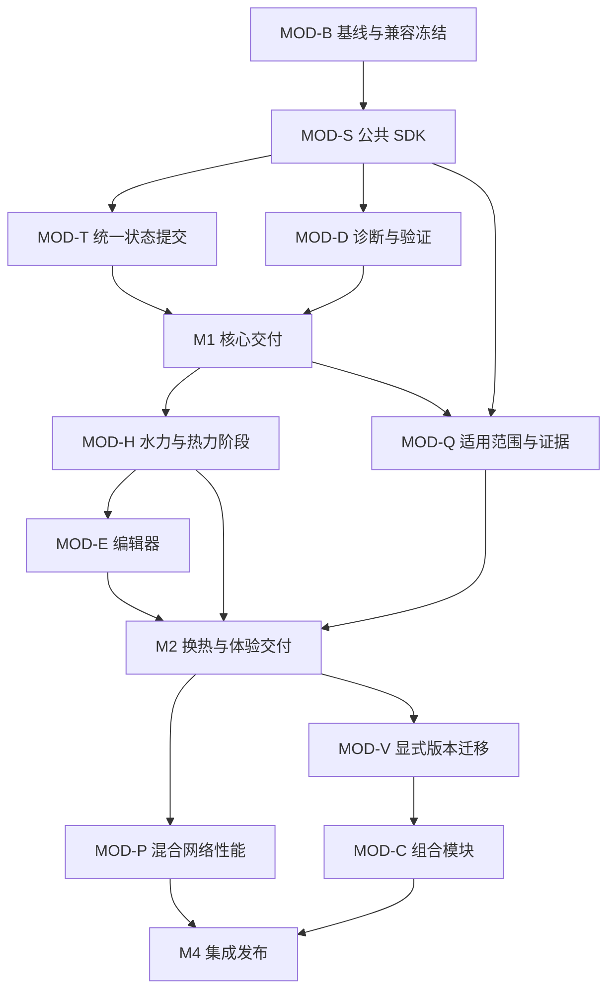

# FluidNet 模块系统优化实施计划

制定日期：2026-10-23。适用工程：FluidNet Prototype Engine。

本计划将公共 SDK、状态提交、诊断验证、水力与热力接口、模块编辑器、适用范围、混合网络性能、组合模块和版本迁移拆成可单独评审的工作包。目标是让设备模块容易开发、结果可验证、失败后状态一致，并能长期复用。

**实施状态（2026-10-24）：52 个工作包均已形成源码候选并通过本地全量验收 [MOD-R2-gates-r4](modules/results/PLAN_CANDIDATE.md)，状态为待评审；P5 性能目标未达到，两项优化保持默认关闭。以下 10-23 状态说明为当时记录。** 10-23：MOD-B0/B1/B2/S0/S1/S2/S3 已形成实现及本地验证，状态为待评审；其余 45 包待启动。 交付和实测结果见 [M0 证据](modules/results/M0.md)、[S0 证据](modules/results/S0.md)、[S1 证据](modules/results/S1.md)、[S2 证据](modules/results/S2.md)及 [S3 证据](modules/results/S3.md)，尚未完成评审或远端 required CI，不能登记为完成。S0–S3 已交付公共类型、水力工具、schema/SDK 协商及时间/阶段/身份；正式作者模块版本、事务、热回调、性能目标和工期仍按后续方案推进。

**人力假设：**1 名熟悉现有项目的全职开发者，配合阶段性的流体/热力模型复核。基础投入初估 **59–86 人日**，加 20% 联调与修订预留为 **71–104 工作日，约 15–21 个工作周**。每周按 5 个工作日计，不含节假日、外部数据等待及其他主线占用。先交付核心模块基础，含预留约 5–7 周；每个阶段门后重新估算。此区间尚未经过接口原型验证，尤其不将 H2、P3、C2 的 1.5–2 人日作为实施承诺；第 14.1 节规定设计门后的拆分与重估。

## 1. 基线、范围与交付目标

### 1.1 本次核对基线

- 核对日期：2026-10-23。
- 初次编制时 HEAD：98ec24be23c066e7890a49be4ec85728b1f8828f；审阅后复核 HEAD：98dadd52ff728af366ef973579894e0000a70eb0。软件版本字段仍为 0.5.0。
- 初次编制时提及的数值优化修改已有后续提交；本次复核 git status 仅见本计划尚未跟踪，未见其他源码修改。这里记录审阅时状态，实施前仍由 MOD-B0 固定 commit、工作区补充和可复现环境，不能据此将 B0 标为完成。
- v0.5.0 文档中的 532 项测试和覆盖率属于发布记录；本次规划没有重跑全量测试，不能作为新接口的验收证据。
- 当前已有调用计数、auto 稀疏选择、内置解析 Jacobian、止回阀 v2、批量 Worker、不可变模块版本与项目快照。直接复用，不重复立项。
- 后续数值提交已接入受限串联压缩和依赖安全分块路径，当前两个选项均默认关闭；其余数值专项能力由 B0 按代码、实际适用范围和证据复核，不能仅根据提交标题登记通过。
- 与[数值专项计划](NUMERICS_OPTIMIZATION_PLAN.md)共享的能力按代码及证据复核。其草案的进度文字不能覆盖已有提交，也不能把本模块计划登记为已经完成。

下表记录初始审阅基线；后续实现进度以第 14.5 节及各包证据为准。

| 环节 | 本次源码检查所见 | 本计划补齐 |
| --- | --- | --- |
| 合同与 SDK | 严格 Pydantic 模型；ctx.net 没有公开 resistance() | 稳定公共 SDK、完整关系构建器、明确兼容版本 |
| 换热计算 | 风机盘管、冷却塔、毛细管复制阻力与流量反解函数 | 公共工具；使用真实水力解的热力/观察阶段 |
| 状态提交 | 按实例调用 commit_step 并立即更新各自状态 | 全步候选状态校验、父进程统一接受、故障一致性 |
| 错误诊断 | Worker 普通异常主要返回错误字符串 | 实例/阶段/源码行定位、有界日志和重放输入 |
| 编辑器 | 复制 Python 示例作为起点，代码与契约分处编辑 | 分类模板、代码骨架、单位预览、引用检查 |
| 模型适用范围 | 主要在人读说明中表达 | 机器可读适用工况、独立验证证据 |
| 混合网络性能 | 含 Python 模块的水力求解块保守采用有限差分；已有可选串联压缩/分块路径 | 经校验的依赖声明、块内混合导数、精准批处理 |
| 模型复用 | 已展开设备组能计算；组合定义尚未递归展开 | 可追溯组合展开和原变量映射 |
| 版本升级 | 已有兼容预览、快照和修订回退 | 显式参数/端口/变量映射及引用迁移 |

源码入口：[合同模型](../backend/fn_engine/models.py)、[模块运行时](../backend/fn_engine/runtime.py)、[Worker](../backend/fn_engine/worker.py)、[批量 Worker](../backend/fn_engine/batch.py)、[求解器](../backend/fn_engine/solver.py)、[动态会话](../backend/fn_engine/simulation.py)、[热力层](../backend/fn_engine/thermal.py)、[模块存储](../backend/fn_engine/packages.py)、[项目升级](../backend/fn_engine/projects.py)。

### 1.2 范围边界

本轮服务于通用流体网络的 Python 设备模块，支持已有单相液体/气体回路及现有热力耦合方式。模块提供设备关系，引擎负责网络守恒和求解。

本轮不增加通用两相管网、水锤、完整可压缩流动、任意 DAE 方程插件，也不开放 Python 设备模块进入冷库/集总制冷站执行域。适用范围字段明确拒绝不支持的模型组合。

状态检查点用于本次运行内的试算、接受和故障处理；跨服务重启继续原运行仍属于[总路线图](ROADMAP.md)独立任务。依赖信息用于兼容检查，不在运行中自动安装第三方包。本计划不含 OS 沙箱和离线发行包。

### 1.3 用户可见的交付

1. 选择阻力、泵/风机、双侧换热或带状态模板，创建契约和可运行代码骨架。
2. 在编辑器中检查参数单位、端口通路、输出名称及“运行中可改”选项。
3. 错误定位到设备、模块版本、运行阶段和源码位置。
4. 所有模块在同一接受子步推进状态；失败、试算和重复请求不重复累计。
5. 换热模块不用复制求解器摩擦公式来反解流量。
6. 旧保存版本继续按原合同和计算路径运行；新能力由新版本显式启用。
7. 模块卡片展示适用范围及验证依据；设备组可封装，升级可预览引用变化。

## 2. 组织方式、依赖与阶段门

所有工作包使用 MOD- 前缀，与数值专项的 B/S/J/V 等编号区分。一个工作包对应一个可评审变更，预计 0.5–2 人日；超过 2 人日继续拆分，并保留验证与兼容工作。估算包含设计、实现、相关测试、文档及一次评审修订。

所有工作包负责人初始为“待分配”，状态为“待启动”。当前 MOD-B0/B1/B2/S0/S1/S2/S3 由 Codex 实施，状态为待评审；实施记录见第 14.5 节，负责人、PR、基线和证据随工作包更新。

| 阶段 | 工作包 | 基础人日 | 含预留的累计时间 | 可独立验收的结果 |
| --- | --- | --- | --- | --- |
| M0 基线与设计冻结 | MOD-B0–B2 | 2–3.5 | 约 1 周 | 可复现基线、样例、兼容和接口决策 |
| M1 核心模块基础 | MOD-S0–S4、T0–T4、D0–D3、R0 | 16.5–25 | 约 5–7 周 | SDK、统一状态提交、诊断与验证台第一版 |
| M2 换热与开发体验 | MOD-H0–H6、E0–E4、Q0–Q3、R1 | 20–28.5 | 约 10–14 周 | 新计算阶段、三个设备新版、四类模板、适用范围 |
| M3 混合性能与迁移 | MOD-P0–P5、V0–V4 | 13–18.5 | 约 13–19 周 | 依赖/导数接口、性能证据、显式迁移 |
| M4 组合模块与发布 | MOD-C0–C4、R2 | 7.5–10.5 | 约 15–21 周 | 组合等价验证、设备组复用、最终源码候选版 |
| 合计 | 52 包 | 59–86 | 71–104 工作日 | 完整模块系统优化范围 |

累计时间为工程区间估算，不是承诺日期。M1、M2 均可先交付；M3/M4 在需求复核后继续。数值专项未收口时先固定其结果；共享文件中的同时修改不能被记作两份独立收益。



图中的并列路线表达依赖关系，不代表本次规划已启动并行人员或其他 agent。

## 3. MOD-B：基线与兼容冻结

小计 2–3.5 人日。复用已有平台测试和数值基准。

| ID / 依赖 | 代码与交付物 | 验收标准 | 人日 |
| --- | --- | --- | --- |
| MOD-B0 / 无 | 固定实施 commit、工作区补充变更、解释器/依赖版本、运行设置；记录模块与 API 清单 | 从复核 HEAD 起重新盘点数值专项及其开关/证据；可在隔离数据目录重放；区分已发布代码、未提交实现、未验证能力；不把用户工作区当测试目录 | 0.5–1 |
| MOD-B1 / B0 | 复用数值样例工厂，补模块输入、关键变量、状态和真实 RPC/调用计数；拟新增 scripts/benchmark_modules.py | 覆盖单阀、多实例、风机盘管、双侧换热、动态状态、Worker 失败；结果附配置和模块双哈希 | 1–1.5 |
| MOD-B2 / B0 | 冻结 v1 哈希、旧执行路径、各阶段合同版本策略、支持的状态范围与指标语义 | 已发布模块与保存项目“加载→导出→重载”双哈希一致；建立逐 schema 规范化和跨阶段固定样例维护规则；形成接口决策记录和兼容矩阵 | 0.5–1 |

参考优先采用 Kv 解析式、管道压降、质量累计和 ε–NTU 独立公式。倍思鹿快照没有收敛结果时仅用于输入重放；缺外部数据的条目记录“待数据”，不阻塞可独立完成的平台接口。

## 4. MOD-S：公共 SDK

小计 5–8 人日。公共 SDK 位于 backend/fn_sdk/，S0/S1 已提供类型接口和共享水力工具，保持标准库导入；S2 在引擎合同层提供 schema/SDK 协商。fn_engine 继续管理进程、模型和求解。包装路径与安装方式由 S0 冻结，不在同一轮拆成独立发行仓库。

| ID / 依赖 | 代码与交付物 | 验收标准 | 人日 |
| --- | --- | --- | --- |
| MOD-S0 / B2 | 公共上下文、关系构建器和返回类型；API 文档、类型示例、公开/内部清单 | 导入 SDK 不启动 Worker、不做物性 flash、不强制导入 SciPy/CoolProp；示例不依赖求解器内部对象 | 1–1.5 |
| MOD-S1 / S0、B1 | 补 resistance()；提取共享阻力和单位明确的工具，保持原公式 | 局部阻力与等效 Kv 解析结果一致；层流、过渡、湍流、正反向、零流量通过 | 1–1.5 |
| MOD-S2 / S0、B2 | models.py、packages.py、runtime.py、合同生成：新合同可声明 SDK 版本、能力及状态合同版本 | v1 及每个已交付 schema 按各自冻结算法校验；新增字段不改变已保存模块双哈希；新合同确定性序列化；不支持 SDK 版本运行前拒绝 | 1–2 |
| MOD-S3 / S0、S2 | 上下文明确 time_s、阶段、请求/子步身份和可用量；保留旧适配 | 试算、收敛、已接受量语义可区分；旧接口不变；同输入/状态/时间的纯函数返回相同关系 | 1–1.5 |
| MOD-S4 / S1–S3 | 发布采用新 SDK 的阻力/阀门示例版本，更新手册与最小样例 | 可试算、保存、插入、导出重载；旧快照保持原源码和哈希 | 1–1.5 |

**兼容必须先于新增字段。** 当前 ModuleDefinition 严格校验，添加默认字段可能改变旧 definition_hash。目标方案是按 schema 版本冻结解析、默认值解释和规范化函数；不能把全部旧模块补默认字段再重算哈希。模块整数版本编号沿用现有机制，SDK API 版本与合同版本独立管理。

兼容对象包括本计划各阶段已经交付的合同。S2 定义扩展策略，R0 固定 M1 样例；Q0、C0 增加字段前，先运行所有已交付 schema 的固定样例。需要改变规范化语义或默认值解释时使用新 schema，旧数据继续按原规则加载。R1、R2 累积验证 v1、M1、M2 及后续合同的“加载→导出→重载”源码、双哈希和执行路径，保留缺字段/显式默认字段、整数/浮点表示和浏览器往返用例；未经兼容验证不保存新合同。

SDK 明确质量/体积流量、绝压/压差、热流正号、适用相态和单位。非法输入通过定位诊断处理，不靠静默截断掩盖。

## 5. MOD-T：全步候选状态与统一接受

小计 6.5–9.5 人日。解决一个子步内状态一致性；跨重启续算另行立项。

| ID / 依赖 | 代码与交付物 | 验收标准 | 人日 |
| --- | --- | --- | --- |
| MOD-T0 / B2、S3 | 冻结候选/接受/同步协议、父进程权威状态、子步 ID、基础修订号和故障状态机；列清模块、PID、脚本、参数及内部接受点快照 | 区分已确认用户指令与候选控制写入；明确试算失败、候选超时、接受后通信失败、重复请求、停止/取消时每类状态归属和恢复规则 | 1–1.5 |
| MOD-T1 / T0 | InProcessModuleRunner 候选执行；状态结构/有限值/大小检查；旧 commit_step 适配 | 候选不改变已接受状态；异常、非法输出、诊断 error 保持旧状态；嵌套深拷贝有效 | 1.5–2 |
| MOD-T2 / T1 | worker.py、runtime.py、batch.py：候选传输、修订检查、幂等同步和丢弃 | 单/批 Worker 一致；重复请求不重复累计；过期候选不覆盖新状态；通信失败不伪造回执 | 1.5–2 |
| MOD-T3 / T2、D0 | solver.py、simulation.py、controllers.py、control.py：收集模块及控制候选，预校验帧和冲突，统一接受状态/参数修订/时间/结果 | 第二个模块提交失败时模块与控制候选均不生效；已确认用户指令保留；成功时同一子步推进；故障可保留最近内部接受点，输出采样间隔不变 | 1.5–2 |
| MOD-T4 / T3 | 故障注入、重试及混合设备；拟新增 tests/test_module_transactions.py | 覆盖候选超时、进程退出、响应丢失、输出覆盖、NaN/越界；控制写入后第二模块失败、PID/脚本重试、用户指令保留及事件缩步逐项核对快照 | 1–2 |

拟定接受流程：

1. 从最近已接受边界及已确认用户指令建立事务基础；按原仿真时刻采样 PID/脚本，在候选参数视图上完成水力/热力试算，取得收敛结果。
2. 所有模块在状态副本上执行提交回调，返回候选状态与输出；Worker 不提升已接受状态。
3. 父进程检查全部模块及控制候选、哈希、基础修订、有限值、输出冲突及待发布帧；此时不提升 PID/脚本状态或参数修订。
4. 父进程在单一接受点更新模块及控制状态、候选参数及其修订、结果、时间和子步版本，形成可归档的内部接受点快照；常规输出帧仍按原采样间隔发布。
5. Worker 从权威快照同步。接受后同步失败属于“已接受子步后的执行故障”，保留该帧；不回滚已确认时间，不重复执行累计回调。

这是父进程管理的状态事务，不宣称多个进程获得数据库式分布式事务。验收区分接受前/后故障。现有脚本提案、PID 和参数采样时序继续有效，不以改变采样时刻获得通过。

T0 至少冻结以下引擎事务范围，不能只复制模块状态字典：

| 对象 | 候选及接受前失败规则 | 接受点行为 |
| --- | --- | --- |
| 模块状态与输出 | ctx.state、提交输出和诊断在副本上计算；丢弃失败候选 | 同一子步统一接受 |
| PID | 积分、微分、测量、输出、time_s、next_s、reset 及候选配置与旧值隔离 | 保持原采样时刻，随成功子步接受；重试不重复采样累计 |
| 控制脚本 | state、pending、next_s、last_s、samples 和提案写入按候选管理 | 同一提案至多接受一次；失败后丢弃或按身份复用，不重复累计受管理状态 |
| 参数及控制写入 | 候选参数、控制器配置和参数修订只供本次试算；失败不提升基础修订 | 与对应模块及控制状态一并接受 |
| 引擎物理状态与结果 | 水箱、管段热容、困液状态/账本、时间和结果保持最近已接受快照 | 统一更新；故障历史可记录最近内部接受点 |

用户已在接受边界得到成功回执的参数/控制命令属于事务基础；后续子步失败不能撤销该指令或其已确认修订。试算期间到达的命令应排队到下一接受边界，或明确拒绝，不得悄悄改变正在计算的候选基础。内部接受点即使尚未达到常规输出时刻，也须保留供故障报告使用，不能丢弃已接受状态或把它当作未接受子步重做。

**模块作者代码可恢复的可变状态只包括 ctx.state；引擎管理的 PID、脚本调度和参数状态另按上述事务范围处理。** 修改 self、全局变量、随机外部状态或外部 IO 不能靠复制字典恢复。SDK 明确这些副作用不属于恢复合同；静态检查只提示明显用法，不能证明任意 Python 无副作用。允许故障后重建 Worker 的模块还需符合初始化/恢复合同，否则停止并保留历史。

状态 JSON 限制总字节数、深度、容器规模和有限数值；T0 冻结限值及配置方式。旧版本采用明确诊断的兼容策略，不截断状态。

## 6. MOD-D：诊断、日志与验证台

小计 4–6 人日。复用现有诊断模型、modules/validate 和 modules/test。

| ID / 依赖 | 代码与交付物 | 验收标准 | 人日 |
| --- | --- | --- | --- |
| MOD-D0 / S2 | 结构化错误：模块/实例/版本/阶段/时间/源码行/通路；旧错误码适配 | 生命周期异常、语法、物性错误、超时可定位；旧错误码和主要字段兼容 | 1–1.5 |
| MOD-D1 / D0、S3 | 有界 ctx.log、重复诊断合并、源码筛选、错误重放输入导出 | 长运行内存有界；日志不污染 RPC stdout；重放包含参数/状态/工质/哈希 | 1–1.5 |
| MOD-D2 / D0、B1 | 测试组合、逐通路边界/工质、参数覆盖和逐项结果；发布复用相同服务 | 正反向、零流、端点、动态、多通路、异工质、非法输入可分项执行；不隐藏失败 | 1–1.5 |
| MOD-D3 / D1、D2 | engine-client.js、studio.js：源码定位、日志和测试组合界面 | 点击错误行定位；取消/失败可重试；关联实际实例和版本，保留草稿 | 1–1.5 |

验证分层：L1 合同/入口；L2 单模块纯逻辑；L3 真实编译求解/生命周期；L4 独立解析或外部收敛数据。发布最低门是适用 L1–L3 及输出完整性，L4 单独显示，不用一次试算代替物理标定。

验证台当前限制通路共享端口，D2 的逐通路边界不会自动取消该限制。共享端口先用真实项目图验证，并显示测试拓扑。

## 7. MOD-H：水力、热力与观察阶段

小计 9.5–13 人日。是本计划数值风险最高的一组；H0 阶段门通过后再接入新路径。

| ID / 依赖 | 代码与交付物 | 验收标准 | 人日 |
| --- | --- | --- | --- |
| MOD-H0 / R0 | 冻结可选热力/观察回调、流向、输入、热流和循环时机；耦合设计及固定点/热流/账本容差 | 用风机盘管和双侧换热推演完整调用；零流、反向、反馈没有隐含状态提交；最终复核和失败策略可执行 | 1–1.5 |
| MOD-H1 / H0、S3、T4 | 新热力/观察 Worker 请求与上下文；旧 evaluate 适配 | 读取当前水力解与试算热状态；状态只读；旧 heat_w 与新回调禁止重复供热；t=0 可观察 | 1.5–2 |
| MOD-H2 / H1 | solver.py、thermal.py、simulation.py：迭代内热回调、最终状态复核，node 模式继续外循环 | 仅含 Python 换热模块也进入热迭代；最终温度/流量重算的热流及固定点缺陷满足 H0 容差；质量/压力/能量和两侧账本通过；全步接受后才推进状态 | 1.5–2 |
| MOD-H3 / H2、D2 | 风机盘管新版：水力、ε–NTU、观察量和能量累计分离 | 独立 ε–NTU、正反流、零流、水温变化、UA 端点、动态账本通过；不反解流量 | 1.5–2 |
| MOD-H4 / H2、D2 | 冷却塔新版：热回调/SDK，保持干空气显热假设 | 冻结公式与独立热账本通过；水/空气零流、热流符号、逼近度与累计可解释 | 1.5–2 |
| MOD-H5 / H1、H2 | 毛细管新版：水力保留，速度等输出使用观察阶段真实流量 | 单相层流/湍流、零流、反向、t=0 输出通过；移除反解复制；两相拒绝 | 1–1.5 |
| MOD-H6 / H3–H5、T4 | 双侧异工质、反馈、reference/node、管段热容和回滚专项 | 新版满足独立参考；温度敏感热流及强反馈识别旧轮热流/假收敛；最终两侧及动态账本一致；旧快照结果与基线一致；失败不重复计热/累计 | 1.5–2 |

拟定调用语义：

| 阶段 | 输入 | 输出 | 状态 |
| --- | --- | --- | --- |
| 水力 evaluate | 试算压力、参考/节点物性、参数、已接受状态 | 既定支路关系及必要派生量 | 只读、多次 |
| 可选热力 evaluate | 当前水力解的流量/压差、热迭代焓温、各回路工质 | 通路热流和诊断 | 只读、热迭代内多次 |
| 可选 observe | 当前收敛结果 | 派生变量，不改关系 | 只读、包含 t=0 |
| 提交候选 | 整体收敛结果、实际 dt_s、已接受状态 | 候选状态与输出 | MOD-T 统一接受 |

热阶段流量来自本次水力解，仍可能在 node 模式继续更新密度/黏度并重解。热回调在固定点内看到最新焓温，不能在首次水力后只计算一次热流。

新热回调必须参与热迭代的启用判定，即使网络没有内置换热器、管段散热或热容，也不能被归入只求解一次的线性路径。候选收敛后，用最终温度/焓、压力及当前水力解流量重新执行热回调，比较实际用于求解的热流与重算热流，并以重算热流复核固定点缺陷和设备账本。全网能量残差通过不能替代这项检查；双侧模型还须独立核对正负热流、焓流差，动态模型核对累计能量与已接受子步积分。

H0 冻结有单位的固定点绝对容差、热流绝对/相对容差、近零尺度和账本容差。复核不通过时继续迭代，达到上限则按现有失败/缩步机制处理，不发布收敛结果。H2/H6 至少包含仅含 Python 换热模块、温度敏感热流、强反馈、正反向/零流及 reference/node 两种模式；故意冻结上一轮热流的反例应被复核拒绝。observe 与提交候选使用同一最终复核结果，累计回调不得另外计算一份不一致的热量。

零流通路热流须为零；设备停流储热需要状态设备模型，不能伪造出口焓。双侧分别提交正负热量并检查守恒。新回调由能力声明启用，旧保存版本不改写。

## 8. MOD-E：模块编辑器与模板

小计 5.5–8 人日。复用现有绘制、属性、库值、型号、代码和契约页；高级 JSON 入口保留。

| ID / 依赖 | 代码与交付物 | 验收标准 | 人日 |
| --- | --- | --- | --- |
| MOD-E0 / S4、D3、H0 | 四类模板及生成规格：两端口阻力、泵/风机、双侧换热、受管理状态；拟新增 examples/module_templates/ | 每个模板包含契约、代码、单位、示例边界和验证入口；带状态模板明确数值推进方式与适用范围 | 1–1.5 |
| MOD-E1 / E0、H1 | 新建向导：模板、英文 ID、中文名、端口/通路和参数；生成代码骨架 | 不写代码即可创建阻力示例并试算；双侧模板经 H2 接通后可运行；避免无效 ID、重复命名和悬空引用 | 1.5–2 |
| MOD-E2 / S2、D3 | 参数编辑直接配置 runtime/writable、单位、上下限，显示引擎值预览；型号/库值联动 | 80%→0.8、20°C→293.15、kPa→Pa 往返正确；派生只读量不显示可写；运行参数行为与契约一致 | 1–1.5 |
| MOD-E3 / E1、D0 | 端口/通路覆盖图、声明与输出名称检查、草稿缺失能力提示 | 悬空/重名通路、少返回关系、漏输出能定位；静态不确定情况提示并交给真实试算，不误报为已验证 | 1–1.5 |
| MOD-E4 / E1–E3、H6 | 浏览器工作流与草稿保存验证；拟新增 tests/browser-module-workflow.mjs | “创建→调参→验证→发布→插入→保存→重载→复算”四类模板通过；失败保留草稿；旧编辑流程可用 | 1–1.5 |

代码骨架只生成新模块或明确选择的未修改区域；修改端口后给出建议差异，不自动覆盖作者已写代码。界面中的“允许运行中修改”需要同时满足类型、可写权限和控制者约束。

带状态模板用于累计量或明确的离散记忆。完整隐式容积/热容状态由引擎已有状态设备承担；模板不能暗示任意 ctx.state 都会参与内核隐式积分。

## 9. MOD-Q：适用范围、证据与发布质量

小计 4–6 人日。物理定义留在模块契约，测试证据放发布凭据，避免运行后的测试结果改变模块定义哈希。

| ID / 依赖 | 代码与交付物 | 验收标准 | 人日 |
| --- | --- | --- | --- |
| MOD-Q0 / S2、B2、R0 | 新合同增加工质/相态、温压/流量工况范围、模型假设；release.json 增加验证证据模型 | 扩字段前 v1/M1 固定样例双哈希不变；明确硬限制/工程包络、单位、按端口/通路范围；证据含结果、来源、输入哈希、引擎/SDK 版本和容差 | 1–1.5 |
| MOD-Q1 / Q0、D0 | compiler.py、运行阶段校验：配置硬限制预检，运行值越界诊断 | 不支持相态/执行域直接拒绝；额定包络 warning；试算越界与接受帧超工况区分，不被 NaN 混淆 | 1–1.5 |
| MOD-Q2 / Q0、D2、S4 | SDK 快速门禁、模块分层测试、发布证据保存；修改现有 workflow 触发/覆盖范围 | SDK 改动触发相关模块回归；L1/L2 轻依赖运行；L3 走全量环境；L4 待数据不标通过 | 1–1.5 |
| MOD-Q3 / Q1、Q2、D3 | 模块卡片、详情、版本记录显示适用范围和验证层级；旧包未知状态适配 | 只显示有证据的通过状态；旧包显示“未登记”；缺标定数据不阻止声明范围内试算，但清楚显示限制 | 1–1.5 |

证据等级建议：

| 状态 | 所需证据 | 表示什么 |
| --- | --- | --- |
| 接口通过 | L1/L2、入口和输出完整性 | 契约及基本逻辑可执行 |
| 网络验证通过 | L3、真实守恒残差和生命周期结果 | 在记录的拓扑/边界中工作 |
| 独立解析验证通过 | L4 解析式或独立参考实现 | 在所列工况内与参考一致 |
| 外部标定通过 | 收敛实测/厂家数据、采集工况与约定容差 | 在标定范围内满足外部数据 |
| 未登记/待数据/失败 | 对应缺项或失败报告 | 保留事实，不能折算成“通过” |

模型适用范围是合同内容，变更需新模块版本；后续追加测试证据独立保存、关联双哈希，不覆写旧 release.json。可采用每版独立证据目录，Q0 冻结命名和备份行为。

温压硬限制涉及试算包络和物性服务可计算范围，不能把一次求解迭代中的暂态越界直接当成用户最终工况错误；按已有失败/诊断机制处理。warning 合并后仍记录首次及最近时刻。

## 10. MOD-P：混合网络性能

小计 7.5–10.5 人日。继续使用已有 auto、解析 Jacobian、计数器与 Worker 分片。先测量，再选择优化；不以新的计数名称宣称速度提升。

| ID / 依赖 | 代码与交付物 | 验收标准 | 人日 |
| --- | --- | --- | --- |
| MOD-P0 / R1、B1 | 模块性能剖析：计算、物性、序列化、RPC、提交、端到端；定位最重模块 | 冷启动新进程 5 次，热运行预热后 7 次；报告中位/极值/失败、实例数、批次数、残差调用和峰值 RSS | 1–1.5 |
| MOD-P1 / P0、S3 | 每通路可选依赖声明；读取追踪与保守回退；jacobian_pattern 接入 | 缺声明仍依赖全部端口；可检测的越声明访问拒绝/回退；多端口、分支与工况切换不遗漏耦合 | 1.5–2 |
| MOD-P2 / P1、H6 | 可选关系参数导数协议、缩放、有限值/维度检查；与数值导数对照工具 | 管道/阀门/泵可微区间按独立差分校验；止回阀阈值或活动集切换明确不使用普通光滑导数 | 1.5–2 |
| MOD-P3 / P2 | solver.py：内置解析块和模块导数/有限差分块组成混合 Jacobian | 混合解与保守路径满足物理及差值门；非光滑/不支持情况回退；导数异常可诊断，不影响已接受状态 | 1.5–2 |
| MOD-P4 / P0、P1、T4 | 基于实测缩减请求负载、逐实例重复计算；可选有界精确缓存 | 键包含所有声明输入、工质配置、状态/参数修订、时间与双哈希；变更正确失效；缓存关闭时可对照 | 1–1.5 |
| MOD-P5 / P3、P4、Q2 | 固定环境 A/B 与性能摘要；补小/中/大混合网络、不同 Worker 分片 | 正确性先过门；目标负载端到端中位数改善达到 20% 或说明为何不启用；小模型回退不超过 10% | 1–1.5 |

20%/10% 是拟定发布目标，不是已有收益。达不到收益门时保留功能默认关闭并记录结果，不能放宽守恒容差掩盖性能问题。

依赖声明、动态读取追踪及抽样扰动都不能证明任意 Python 函数在全部分支下正确。P1 必须保留保守默认；经评审/验证的模块才能选择缩小依赖。对绕过公共接口、运行期变更依赖或未注册量的代码继续使用完整依赖。分块、串联压缩同样读取该保守依赖信息，不能仅依据几何拓扑拆开多端口耦合模块。

导数协议针对完整残差链：关系参数可能随端口压力/物性变化，不能只提供固定 Kv 的局部流量导数就认定整条关系可解析。H2 的热力/node 外循环沿用独立收敛门，不把水力 Jacobian 提速登记为全部热力提速。

P4 只缓存严格相同输入的纯函数结果，不对浮点输入近似分桶。时间相关、未声明副作用和无法确定依赖的模块不缓存。状态字典在协议中由修订/权威快照管理，不能用 stale state 换取通信减少。

## 11. MOD-V：显式版本迁移

小计 5.5–8 人日。复用现有 upgrade_project、项目修订与原子替换；本组先于组合模块的版本映射收口。

| ID / 依赖 | 代码与交付物 | 验收标准 | 人日 |
| --- | --- | --- | --- |
| MOD-V0 / R1、B2 | 声明式迁移模型：参数/端口/通路/变量映射、默认值、标准单位转换；拟新增 migrations.py | 映射源/目标与类型可校验；歧义/多对一冲突拒绝；迁移不执行任意用户脚本 | 1–1.5 |
| MOD-V1 / V0 | projects.py、bridge.py：在项目副本映射连接、参数、草稿、库值、型号引用 | 多实例全部成功或不变；冲突定位；计算参数保持 canonical；型号来源与版本可追溯 | 1.5–2 |
| MOD-V2 / V1 | 同步工况覆盖、PID、控制脚本声明和曲线变量映射；无法自动迁移的引用清单 | 失效引用明确拒绝/待人工处理；脚本源码中的旧字符串不自动替换；历史档案继续原快照 | 1–1.5 |
| MOD-V3 / V2、D3 | UI 差异预览、输入映射、受影响设备与引用清单；保存升级前修订 | 预览不改原项目；确认后统一替换；停止运行后升级；可回到升级前修订 | 1–1.5 |
| MOD-V4 / V3 | 导入/导出/重启与故障验收；拟新增 tests/test_module_migrations.py | 兼容增加、端口改名、单位显示变化、参数删除、曲线/PID/脚本冲突均覆盖；失败保留原数据 | 1–1.5 |

显示单位改变通常不要求改变 canonical 值；物理量或规范单位改变必须明确迁移规则。不得通过简单乘系数把绝压变表压，也不自动解析和替换任意 Python 字符串。

已经发布的旧模块文件不覆盖；升级产生新项目修订，原运行结果保持原绑定。迁移不会恢复旧运行状态，新运行按新模块初始化。状态跨版本迁移和跨重启续算后续单列。

## 12. MOD-C：组合模块

小计 6.5–9 人日。首版只组合已支持设备；递归展开复用编译器和求解器，不创造新方程类型。

| ID / 依赖 | 代码与交付物 | 验收标准 | 人日 |
| --- | --- | --- | --- |
| MOD-C0 / V4、S2 | 组合合同：子实例、连接、外部端口、参数映射、输出别名、版本依赖；拟新增 composites.py | 扩字段前 v1/M1/M2 固定样例双哈希不变；版本闭包固定；端口/参数引用合法；循环依赖、ID 冲突、展开规模/深度超限拒绝 | 1–1.5 |
| MOD-C1 / C0 | 编译前确定性递归展开，内部 ID 命名空间与源映射，模块绑定快照 | 展开结果与手工普通实例网络相同；两层嵌套通过；哈希/结构顺序确定；不遗漏多端口依赖 | 1.5–2 |
| MOD-C2 / C1、D3 | 状态/变量/诊断/控制/曲线映射回组合；运行参数转发与单控制者检查 | 同时保留内部可追溯路径和公开别名；内部实例状态独立；写参数没有重复目标/控制者冲突 | 1.5–2 |
| MOD-C3 / C1、E4 | 画布选中设备组→封装向导，配置外端口/公开参数，提供展开查看 | 设备组可封装、发布、插入和展开查看；保留原草稿；首版不做独立复杂组合绘图系统 | 1–1.5 |
| MOD-C4 / C2、C3、V4 | 泵阀支路和双侧换热机组两个案例；嵌套、升级、导出重启验证 | 手工/组合各物理量和状态账本满足等价门；公开引用可迁移；缺子版本明确拒绝，不自动升版 | 1.5–2 |

组合与手工网络按相同参数/工质/运行选项对比；外端口先限制一对一映射，需要分支时显式使用 junction。映射不制造新的零阻力连接或压力参考。

组合定义绑定子模块的精确版本及双哈希；父版本变更包含依赖闭包。组合升级映射复用 MOD-V，不能绕过项目同一模块 ID 使用同一版本的现有约束；存在子版本冲突时先拒绝，并给出受影响组合清单。

首版不包含组合内任意可执行控制程序、不增加电/机械信号端口求解，也不允许跨执行域组合。C0 开工时再次核对这些范围是否足以满足实际设备组需求。

## 13. MOD-R：阶段集成、回归与发布

小计 3–4.5 人日，分摊到 M1、M2、M4。

| ID / 依赖 | 交付物 | 验收标准 | 人日 |
| --- | --- | --- | --- |
| MOD-R0 / S4、T4、D3 | M1 源码候选版、SDK/事务/诊断手册、核心回归和问题清单；冻结 M1 合同样例 | 旧模块重放、模块与控制状态故障矩阵、验证台工作流通过；契约同步；M1 限制明确 | 1–1.5 |
| MOD-R1 / H6、E4、Q3 | M2 候选版、三模块新版本、四模板、证据目录及浏览器回归；冻结 M2 合同样例 | 最终状态热力复核、独立参考、能量账本、v1/M1 跨阶段兼容、作者流程通过；发布证据/范围可查看 | 1–1.5 |
| MOD-R2 / P5、V4、C4 | 最终源码候选版、模块开发套件新版、迁移/组合手册、基准报告和验收清单 | 完整回归/合同/浏览器门禁、所有已交付 schema 跨阶段重载、旧数据恢复、重复请求/故障、组合等价和性能证据收口 | 1–1.5 |

候选版先在隔离数据目录保存模块和项目。版本号在发布阶段依据 API 兼容影响确定，不在计划中预先把软件登记为已发布。现有用户模块目录和旧发布版本不作为试验目标。

### 13.1 共同正确性与兼容门

- 每个优化有可选的参考路径或被冻结的旧版本，不以“新旧都使用同一新公式”作为独立物理验证。
- 继续满足项目压力/质量容差；默认项目约定为 1 Pa、1e-8 kg/s，实施前 B0 核对。
- 对等价重构的拟定差值门：流量 1e-8 kg/s + 1e-6×|q_ref|，压力 1 Pa + 1e-8×|p_ref|，温度 1e-5 K。不同有效解、事件/非光滑阈值和新模型语义不能直接套等价门，应使用独立验收公式。
- 最终状态热回调重算、固定点缺陷、全网能量残差、换热两侧守恒和动态累计分别验证；热状态隐式推进不被候选提交替代。
- 失败/拒绝/取消/重复请求不增加未接受子步的模块质量、能量、PID/脚本采样累计或候选参数修订；已确认用户指令及其修订保留，按第 5 节区分事务基础与候选写入。
- 已接受后的执行/落盘故障清楚记录历史边界；不能把内存接受等同于跨重启持久化保证。
- 每个已交付 schema（含 M1/M2 新合同）、原源码、原双哈希、显式求解选项、变量 key 和历史读取有跨阶段兼容证据。
- 新字段同步严格模型、JSON Schema/OpenAPI、项目归一化、模块保存和前端。
- 状态、日志、候选结果、缓存均有上限；停止/失败后关闭进程与线程，验证无 Worker 遗留。

### 13.2 测试与证据

| 层次 | 复用入口 | 本计划新增或扩展 |
| --- | --- | --- |
| SDK/合同 | test_module_versions.py、test_platform_contracts.py、test_design.py | 各已交付 schema 跨阶段固定样例、resistance、上下文类型/单位、状态限制 |
| 网络物理 | test_bsl_integration.py、test_thermal.py、test_multifluid.py | 新热阶段、最终状态复核/旧轮热流反例、正反/零流、双侧异工质、独立热账本 |
| 动态/故障 | test_states.py、test_live.py、test_controls_storage.py、test_scaling.py | 模块及控制全步事务、重复请求、跨 Worker 故障、候选回滚、用户指令保留、内部接受点恢复 |
| 编辑/版本 | browser-authoring.mjs、browser-module-catalog.mjs、test_project_workflows.py | 四模板流程、源码定位、范围证据、显式迁移 |
| 性能/组合 | 现有数值基准与调用计数 | 混合导数、缓存失效、组合展开/别名/版本闭包 |

拟新增测试文件分别随实现包创建，不能在尚未实现接口时用空测试或实现镜像测试登记通过。物理测试使用独立解析/账本，事务测试注入有意义的故障。

日常先跑相关测试，阶段候选版执行现有门禁：

```powershell
python -m pytest -q --cov=fn_engine
python -m ruff check backend tests scripts modules examples/control_templates
python -m mypy
python scripts/generate_contracts.py --check
npm run check
npm run test:browser
```

现有 mypy 仍是 advisory；新公共 SDK 单独设置严格类型检查门，并同步 CI。若 SDK 放在 backend/fn_sdk，覆盖率和测试源范围相应调整，不能只用 fn_engine 的旧范围宣称 SDK 已被覆盖。新增 JS 文件加入语法清单，新增浏览器脚本加入 package.json 单一测试清单。

轻依赖 bsl-modules workflow 的触发路径、lint 与测试需包含公共 SDK 和相关模块测试；L3 网络测试继续在主 ci.yml 全量环境执行。新增依赖同步 pyproject/requirements/锁文件；不让轻依赖任务为工具导入意外安装全部 SciPy/CoolProp。

每个实现包原始输出放忽略提交的 artifacts/module-system/<baseline>/<package>/<case>/；精简摘要拟放 docs/modules/results/，包含：
基线 commit 与工作区补充、依赖/硬件、模块双哈希、输入与参考、命令、结果/失败/跳过、适用范围、性能中位数、PR 和未完成项。

### 13.3 性能测量协议

固定解释器、依赖、原生线程数、硬件、物性后端、求解选项、Worker 数量、项目与模块快照。冷启动用新进程 5 次；热运行预热后 7 次，报告中位数、最小/最大值及失败次数，不用这点样本宣称可靠 P95。

区分编译、首次可用、物性、evaluate、候选提交、序列化、RPC、求解、归档及端到端时间；嵌套计时注明重叠。同时报告真实残差调用、模块实例调用、批 RPC、状态字节数和进程树峰值 RSS。

固定环境评估墙钟目标，CI 硬门禁优先使用确定性的调用/结构/守恒。只在新变更或失败需要时扩大验证，避免重复跑无关物理测试。

## 14. 执行顺序、风险与记录规范

### 14.1 建议首批顺序

1. MOD-B0、B1、B2：冻结真实基线和旧版本哈希。
2. MOD-S0、S1、S2、S3、S4：建立 SDK 与新旧合同适配。
3. MOD-D0：先提供结构化错误，帮助后续故障验证。
4. MOD-T0–T4：统一状态接受，完成多模块失败和重复请求验收。
5. MOD-D1–D3、R0：收口日志/验证台，交付 M1。
6. MOD-H0–H6：冻结耦合方案后逐模块迁移，保留旧版本。
7. MOD-E、Q、R1：完成模板、编辑体验、范围与证据。
8. MOD-P、V：基于实测改混合性能，并补显式迁移。
9. MOD-C、R2：组合复用和最终集成。

单人按上述顺序推进。若以后增加开发者，独立前端/诊断工作可以与后端协议实现交错，但共享 models.py、runtime.py、worker.py、solver.py、simulation.py 的变更必须按依赖顺序集成；不能按人数线性缩短估算。

H2、P3、C2 目前仅为初估包：分别在 H0、P2、C1 完成后，用设计结果或最小可执行样例核对下列拆分，再登记实际子包与工期：

| 原包 / 重估点 | 建议拆分的独立交付 | 重估依据 |
| --- | --- | --- |
| H2 / H0 | 热回调迭代与启用判定；最终状态复核及假收敛反例；node 外循环和动态接受集成 | reference/node 两种模式的完整调用与残差；失败、反向/零流和账本覆盖 |
| P3 / P2 | 混合矩阵装配与索引；非光滑/非法导数回退；与保守路径的物理及性能对照 | 完整导数链、缩放、稀疏结构、结构优化开关组合 |
| C2 / C1 | 状态/诊断源映射；变量/曲线别名；运行参数及控制者校验 | 展开映射样例、嵌套引用、重复写目标和控制冲突 |

上述拆分是设计门后的工作清单，当前仍计 52 个原始包。拆分后保留父 ID 追溯，汇总只累加可执行子包，不再重复计入父包。若合计超过原区间，须同步更新阶段表、总人日和依赖；不得挤掉测试或沿用原人日登记完成。M0 先复核整体估算，M1/M2 优先交付，M3/M4 根据阶段验收和实际需求决定投入。

### 14.2 主要风险与处理

| 风险 | 触发信号 | 处理和阶段门 |
| --- | --- | --- |
| 基线不断变化 | 数值专项继续修改同一文件、基准差异无法归因 | B0 固定集成点；按工作包提交及记录来源；必要时重新测基线 |
| 已交付合同哈希漂移 | 后续阶段增加默认字段后 v1 或 M1/M2 模块拒绝加载 | B2/S2 按 schema 冻结规范化；Q0/C0 扩字段前运行跨阶段固定样例；通过前不保存新合同 |
| 隐藏 Python 副作用 | self/全局/IO 在候选失败后仍变化 | 限定 ctx.state 恢复合同；不承诺任意程序回滚；无法恢复时停在已接受边界 |
| 跨 Worker 接受不一致 | 某进程候选超时或接受后失联 | 父进程权威快照、幂等修订；T4 故障矩阵通过后接入热阶段 |
| 控制候选提前生效 | 模块失败后 PID/脚本调度、参数或修订已变化 | T0 冻结完整快照；T3 统一接受；T4 验证候选丢弃/重试及已确认用户指令保留 |
| 热力反馈不收敛或假收敛 | 热流只更新一次、沿用旧轮热流、反流取错入口、node 外迭代振荡 | H0 冻结容差；H2 最终状态重算；H6 独立参考/双侧及动态账本；保留旧路径，不放宽容差 |
| 依赖/导数声明错误 | 缺耦合导致稀疏/分块获得错误解 | 保守默认、可检测访问校验、导数差分对照；非光滑回退 |
| 缓存输入不完整 | 参数/工质/时间/状态变更后返回旧输出 | 仅纯函数精确输入缓存；P4 全维度失效测试；默认可关闭 |
| 组合范围失控 | 递归版本冲突、任意控制/执行域混入 | 首版限受支持设备组与一对一外端口；C0 阶段门再估算 |
| 缺外部标定数据 | 只有参数快照，缺收敛输出 | 平台任务继续；L4 记录待数据；不伪造标定通过 |
| 工期偏离 | 单包超过 2 人日、阶段超区间 | 拆包保留验收；阶段门重新估算；优先交付 M1/M2 |

### 14.3 完成标准与工作包记录

每个工作包只有在实现、适用测试、相关合同/文档、评审和所需 CI 通过且证据落盘后标为“完成”。计划、草稿、部分单测通过不能作为完成。

记录字段：

```text
工作包：MOD-xx
状态：待启动 / 进行中 / 待数据 / 待评审 / 完成
负责人：
基线 commit 与工作区补充：
开始/结束日期：
实际人日：
PR/提交：
适用范围与拒绝条件：
验证命令、参考、失败/跳过说明：
证据路径：
兼容/回退方式：
遗留项与下一依赖：
```

建议分支名 codex/modules-<工作包ID>-<说明>。一个包只提交自身必要变更，不夹带现有工作区的其他数值修改；生成合同随对应行为提交。源码目录中的种子模块、已保存用户版本和试验数据目录区分管理。

### 14.4 阶段验收后的决策

- **M1：**能否可靠开发、定位错误和处理模块失败？若不能，修复基础，不先扩模型数量。
- **M2：**三个新模块是否减少重复公式、满足独立账本，四模板是否完成作者流程？以实测复核后续投入。
- **M3：**混合网络优化是否有端到端收益，迁移是否保护引用？无收益的优化默认关闭并记录结论。
- **M4：**真实设备组是否能通过组合等价和版本迁移？通过后交付源码候选版；离线发行、外部标定、跨重启续算继续按各自专项推进。

### 14.5 当前执行记录

实施日期：2026-10-23。基础 commit：98dadd52ff728af366ef973579894e0000a70eb0；工作区补充由 MOD-B0 的 patch/overlay 固定，未创建 PR 或实施提交。负责人：Codex（实施），评审待分配。实际人日未折算，不用测试墙钟替代人工工时。

后续工作包各自归档源码补充快照，M0 历史基线不覆盖；S0–S3 的工作区分别由各自 source-snapshot 归档。

| 工作包 | 当前状态 | 交付 / 本地证据 | 未完成项 / 下一依赖 |
| --- | --- | --- | --- |
| MOD-B0 | 待评审 | scripts/module_baseline.py；环境/默认选项、模块/API 清单、源码哈希、binary patch + untracked overlay；隔离输出与不可覆盖测试 | 独立 checkout 重放结果见原始 replay-validation.json；待评审及 required CI |
| MOD-B1 | 待评审 | scripts/module_cases.py、benchmark_modules.py；七场景及批量/逐实例/双分片对照，真实请求与接受帧归档 | 正确性基线不代替 P0 性能协议；待评审及 required CI |
| MOD-B2 | 待评审 | 十个模块/三个项目 v1 固定样例、兼容测试与版本决策；原有保存/重启/旧项目测试继续通过 | S0/S2 按冻结规则设计 SDK 与新 schema；具体事务/热力协议待 T0/H0 |
| MOD-S0 | 待评审 | backend/fn_sdk 标准库类型接口、PEP 561 标记、带类型示例、独立严格类型/轻依赖 CI；接口与真实宿主/Worker 对照 | 历史预览版本 0.1.0；S1–S3 扩展见下行；旧阀反向/等压数值现象未登记修复 |
| MOD-S1 | 待评审 | resistance 构建器、SDK 0.2.0 六个公共水力工具、共享标量核心与旧入口；冻结 34 组提取前数值/导数；带类型局部阻力示例 | 430 项相关测试通过；旧模块七场景回放一致；输入范围与流向验证不代表修复旧压差驱动反向冷启动；正式模块版本待 S4 |
| MOD-S2 | 待评审 | v1/v2 冻结解析及规范化；schema 2 声明 SDK/能力/状态合同版本；编译、单/批 Worker、设计、保存前兼容校验；新增固定样例及生成合同 | 全量 1121 项通过，fn_engine 覆盖率 91.04%，53 份合同一致；七个旧场景回放一致；SDK 仍为 0.2.0，状态事务未实现；下一依赖 S3 |
| MOD-S3 | 待评审 | SDK 0.3.0 只读时间/阶段/ExecutionInfo；请求与子步关联、数据来源、接受时间标记；单/批 Worker 与真实网络/失败输入验证；带类型时间示例 | 全量 1151 项通过，fn_engine 覆盖率 90.93%，55 份合同一致，七场景回放一致；不把模块本地提交当成原子接受；无事务回滚或请求去重；下一依赖 S4 |

完整命令、实测结果、范围及未运行检查见 [M0 结果](modules/results/M0.md)；工具入口见[模块实施索引](modules/README.md)，兼容规则见 [v1 决策](modules/V1_COMPATIBILITY.md)。M0 阶段相关测试联合 60 项通过，末轮复测新增的 40 项通过，51 份契约一致；该阶段没有修改生产求解器、模型、Worker、种子模块或用户保存目录。

S0 的 API、严格类型门、打包验证及工况边界见 [SDK API](modules/SDK_API.md)和 [S0 结果](modules/results/S0.md)。M0 的测试数字为该阶段历史记录，后续工作包分别记录，不累加冒充一次全量回归。

S1 将引擎标量阻力计算提取到共享核心，并在运行时增加 resistance 构建器；模型字段、Worker 协议和种子版本不变。公共水力工具的范围、当前环境逐位回放及对应回归见 [S1 结果](modules/results/S1.md)。

S2 的 schema 2、显式 SDK 支持表、能力/状态合同版本与旧 schema 冻结策略见[协商合同](modules/CONTRACT_VERSIONING.md)，命令、固定样例、全量回归及范围见 [S2 结果](modules/results/S2.md)。S1 的测试数字和“模型字段不变”为该阶段历史记录；S2 已扩展新 schema 字段，未改写 v1 保存数据。

S3 的时间、阶段、身份和数据来源见[执行上下文](modules/EXECUTION_CONTEXT.md)，命令和范围见 [S3 结果](modules/results/S3.md)。S2 的 SDK 0.2.0/53 份合同为该阶段记录；S3 增加可选请求元数据和两个协议模型，模块 schema 及其历史哈希保持。

**2026-10-24 续：** S4、T0–T4、D0–D3、R0、H0–H6、E0–E4、Q0–Q3、R1、P0–P5、V0–V4、C0–C4、R2 按依赖实施，逐包交付与证据入口见[源码候选与验收索引](modules/results/PLAN_CANDIDATE.md)。四次全量记录 r1–r3 失败原样保留，[r4](../artifacts/module-system/98dadd5/MOD-R2-gates-r4/report.json) 通过：pytest 1232 项，覆盖率 90.37%，66 份合同一致，15 个浏览器脚本通过；后端全局 mypy 仍为 advisory（37 个错误）。独立 P5 重跑（MOD-P5-r2）流量等价，但热态在 4/16/40 规模均变慢（−17% 至 −1384%），module_mixed_jacobian、module_cache 保持默认关闭。全部 52 包状态为**待评审**；评审、远端 required CI、外部标定数据未完成，不登记完成。


