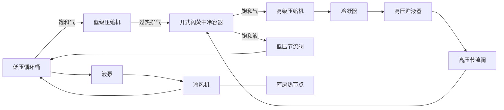

# 两级压缩与开式闪蒸中冷组合（R03）

2026-11-05。该示例用已有压缩机、等焓节流阀、饱和容器、蒸发式冷凝器及单库泵供液部件，组装三个压力等级的 R134a 回路。它是普通 `Project` 的设备与连接组合，计算仍由通用集总制冷站执行，没有按示例设备 ID 编写的专用求解器。

源文件：[two_stage_example.py](../backend/fn_engine/refrigeration/two_stage_example.py)。[规范项目](../examples/refrigeration-modular/two-stage.project.json)包含固定模块定义，可通过项目导入；[组装清单](../examples/refrigeration-modular/two-stage.recipe.json)仅含工质、设备参数与连接，可对照从空白画布组装。共 11 台设备、13 条连接，默认动态时长 600 s、输出步长 60 s、内部步长 10 s。

## 拓扑与模型

低压循环桶的饱和气进入低级压缩机，排气进入中压容器 `in0`；高压贮液器的饱和液经高压节流阀进入同一中压容器 `in1`。两股流在中压容器中达到气液平衡：`vapor` 向高级压缩机供饱和气，`liquid` 经低压节流阀向低压桶供液。高级排气经冷凝器回到高压贮液器。低压桶的液泵、冷风机、库房沿用单库骨架。



中压容器复用 `lp_drum_multi` 的多进口合同。虽然目录名称含“低压循环桶”，其求解语义是通用饱和容器，实际压力等级由拓扑和 `(M,U)` 状态决定。开式中冷采用完全混合、饱和平衡假设；低级排气的显热和高压来液的闪发均进入容器能量账，高级吸气为该容器的饱和气。该组合没有另外施加“中冷功率”或隐含冷源。

三个容器分别具有质量和内能储量；液位、压力、温度由各自存量反求。压缩机和阀门按当前两端压力计算流量。没有内置两级联锁、启停顺序或中间压力控制，初始 -5°C 中压温度是教学设计选择，并不表示最优中间压力。长期运行与调节应另配项目控制。

## 设计点

初始饱和温度为低压 -25°C、中压 -5°C、高压 35°C，库房 -18°C，净库负荷 5 kW。冷风机从制冷剂取走 5.4 kW，其中风机热为 0.4 kW；液泵热约 15.53 W。两级压缩机载量均为 0.75，容积效率 0.8、等熵效率 0.72；压缩机电机损失排向机房。

令 `hf`、`hg` 为对应压力等级的饱和液/气焓，`h2L` 为低级压缩机排气焓，`mL`、`mH` 为两级质量流量，设计采用以下独立平衡反算：

```text
QL = 5400 W + 液泵热
mL = QL / (hgL - hfM)
mH = mL × (h2L - hfM) / (hgM - hfH)
各级理论排量 = m / (载量 × 容积效率 × 吸气饱和气密度)
各级 Kv = m × 3600 / [0.5 × sqrt(1000 × 入口液密度 × 压差 / 1e5)]
冷凝排热 = QL + 低级轴功 + 高级轴功
冷凝器 UA = 冷凝排热 / (35 - 20) K
```

两阀初始开度均为 50%。中压质量平衡要求高级流量等于高压阀流量、低级流量等于低压阀流量；中压能量平衡通常要求高级流量大于低级流量，不能直接把单级压缩机复制为相同排量。

| 项目 | 本机设计点 |
| --- | ---: |
| 低／中／高压力 | 0.106400／0.243342／0.886981 MPa |
| 低／高级质量流量 | 0.02848286118／0.04139373106 kg/s |
| 低／高级理论排量 | 0.008621881923／0.005712397490 m³/s |
| 低／高级轴功率 | 654.946／1545.705 W |
| 低／高级压比 | 2.28706／3.64499 |
| 中至低／高至中阀 Kv | 0.1530474701／0.1087218907 m³/h |
| 冷凝排热 | 7616.183 W |
| 冷凝器 UA | 507.7455582 W/K |

发布示例中的派生排量、Kv、UA 保留 10 位有效数字；该处理只固定新示例的设计输入，不舍入求解状态或更改用户参数。

## 停一级的边界

手动停止任一级只将该级压缩机流量与功率归零，不会自动停另一台压缩机、关阀或停止冷凝排热。低级停机时，中压容器初始净流出；高级停机时，中压容器初始净流入。相应压力、液位和储能通过容器动态改变。测试只验证短时间停一级后的真实储量与能量平衡，不把长期无控制运行视为安全工况；后续若越出容器适用液位或物态范围，沿用引擎原有拒绝行为。

此模型不包含管路两相流、管路压降、油路、液滴夹带、非平衡中冷效率、压缩机过热吸气修正或厂家性能标定。

## 本轮定向验证

运行环境：Python 3.11，项目锁定依赖（NumPy 2.3.2、Pydantic 2.13.4、FastAPI 0.137.1）。执行：

```powershell
$env:PYTHONPATH = 'backend'
python -m pytest -q tests/test_two_stage_modular.py
python -m ruff check backend/fn_engine/refrigeration/two_stage_example.py tests/test_two_stage_modular.py
```

结果：**5 项通过**，ruff 通过。包含清单重建与规范 JSON 一致性、三个独立压力等级、逐容器质量和能量账、两级不同流量与饱和中冷、任意设备 ID 和顺序、分别停止低级／高级的一秒储量变化及全系统能量积分。

初始逐容器质量残差不超过 `1.5e-11 kg/s`，能量残差不超过 `4.2e-6 W`。另外按发布清单运行 600 s、输出间隔 60 s，11 帧全部有效；总质量漂移为 0，累计能量残差约 `0.000200 J`，库温保持 -18°C，三个容器饱和温度无可见漂移。此处记录本轮定向证据，不代替项目全量检查。
