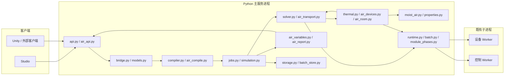

# 01 架构、文件职责与内部接口

> 实施更新（2026-10-29）：本页保留初始设计依据；对应功能已落地。实际文件、接口和验证见[实施记录](IMPLEMENTATION_LOG.md)及[完整验收](../AIR_SIDE_IMPLEMENTATION_ACCEPTANCE.md)。原“本次不运行测试”描述的是 10 月 28 日的文档任务。

本文件描述拟实施架构；“现有”表示本次静态阅读可定位到实现，不表示本次运行验证通过。

## 1. 组件与进程边界

沿用一个 FastAPI 服务进程，编译、数值求解、运行编排及归档服务在该进程内。自定义设备和控制脚本使用既有 Worker 子进程。前端不计算物性、不解方程；不新增数据库、消息队列或独立微服务。



## 2. 文件变更清单

下面是目标拆分；避免继续把全部新算法堆进 `thermal.py` 或 `studio.js`。

| 文件（相对项目根） | 状态 | 单一职责 |
| --- | --- | --- |
| `backend/fn_engine/models.py` | 修改 | 公共 Project、SolverOptions、FluidState、PortState、运行响应扩展 |
| `backend/fn_engine/air_models.py` | 新增 | 湿空气配置、查询与变量目录 DTO；不导入编译器或求解器 |
| `backend/fn_engine/moist_air.py` | 改造 Phase 2a | 物性适配、输入域、统一异常、状态构造；不持有运行状态 |
| `backend/fn_engine/air_compile.py` | 新增 | 风侧语义校验、房间登记、设备能力与回路校验 |
| `backend/fn_engine/compiler.py` | 修改 | 现有拓扑编译后调用 air_compile，建立湿空气编译数据 |
| `backend/fn_engine/air_transport.py` | 新增 | 流量/焓基准转换、边界流股、干空气/水分输运与残差 |
| `backend/fn_engine/air_devices.py` | 新增 | 盘管、加湿器、混合箱的纯函数计算与线性化 |
| `backend/fn_engine/air_room.py` | 新增 | 房间状态、隐式更新、候选状态、累计量 |
| `backend/fn_engine/cooling_tower_moist.py` | 新增 | 湿空气冷却塔代数模型与独立水/能量账本 |
| `backend/fn_engine/solver.py` | 修改 | 湿空气模式的水力变量映射、外迭代、端口输出 |
| `backend/fn_engine/hydraulic_derivatives.py` | 修改 | 转换后的导数链式因子与稀疏结构 |
| `backend/fn_engine/thermal.py` | 修改 | 调度干/湿热力路径；装配热湿耦合与统一收敛检查 |
| `backend/fn_engine/simulation.py` | 修改 | 房间及设备累计量参与 trial/accept/rollback |
| `backend/fn_engine/catalog.py` | 修改 | 新内置设备合同、参数单位、变量定义 |
| `backend/fn_engine/module_contracts.py` | 修改 | SDK 0.6.0 能力注册、湿空气模块编译前协商 |
| `backend/fn_engine/module_phases.py` | 修改 | 湿空气状态传递、调用前后流量转换、回调输出检查 |
| `backend/fn_sdk/`、`runtime.py`、`worker.py`、`batch.py` | 修改 | SDK 类型、RPC 新字段与旧协议过滤；保持批量/单实例一致 |
| `backend/fn_engine/air_variables.py` | 新增 | 从固定 Project 生成稳定变量目录，供 API/批次/报告共用 |
| `backend/fn_engine/air_report.py` | 新增 | 从快照、帧和元数据生成 CSV/HTML；不重跑求解 |
| `backend/fn_engine/air_api.py` | 新增 | 湿空气查询、项目/运行变量目录路由 |
| `backend/fn_engine/api.py` | 修改 | 注册路由、健康能力、风侧报告分派 |
| `backend/fn_engine/bridge.py` | 修改 | 湿空气配置和新设备原型字段双向映射 |
| `backend/fn_engine/storage.py`、`jobs.py`、`batches.py` | 修改 | 运行元数据快照、累计量保留、批次变量发现 |
| `frontend/air-side.js` | 新增 | 配置面板、结果表、状态点、曲线绑定和过期状态 |
| `frontend/engine-client.js`、`project-services.js` | 修改 | 新请求、元数据缓存、导入保存、统一错误显示 |
| `frontend/studio.js`、`index.html` | 修改 | 注册页面与设备入口、脚本加载和 1080p 样式 |
| `frontend/scenario-batches.js` | 修改 | 湿空气参数扫描和变量选择，不另建批次服务 |
| `scripts/generate_contracts.py` | 修改 | 登记新增 DTO 和示例；实施阶段生成 Schema/OpenAPI |
| `modules/fan/`、风阀/风口/管件包 | 新版本 | 发布声明湿空气透传能力的新包；保留旧包快照 |

依赖方向：模型层→物性/纯函数层→编译与求解层→运行编排→API。`air_models.py` 不反向导入 `models.py` 的 Project；包含 Project 的请求 DTO 放在 `models.py` 或独立 API 模型层，避免循环导入。

## 3. 内部接口（拟新增，Python 签名为设计约定）

```python
class MoistAirService:
    def state_ptw(self, pressure_pa: float, temperature_k: float,
                  humidity_ratio_kg_kg: float) -> FluidState: ...
    def state_phw(self, pressure_pa: float, enthalpy_j_kg_dry_air: float,
                  humidity_ratio_kg_kg: float) -> FluidState: ...
    def humidity_from_rh(self, pressure_pa: float, temperature_k: float,
                         relative_humidity: float) -> float: ...
    def saturated_state(self, pressure_pa: float, temperature_k: float) -> FluidState: ...

def compile_air_network(network: CompiledNetwork) -> CompiledAirData: ...
def branch_flow_views(network, dry_air_flows, node_states) -> AirFlowViews: ...
def solve_air_transport(network, hydraulic, previous, device_relations,
                        room_candidate=None) -> AirTransportResult: ...
def evaluate_cooling_coil(inlet, dry_air_flow_kg_s, parameters) -> AirDeviceResult: ...
def evaluate_humidifier(inlet, dry_air_flow_kg_s, parameters) -> AirDeviceResult: ...
def trial_air_rooms(compiled, accepted, ports, dt_s) -> AirRoomTrial: ...
def collect_air_variables(project) -> list[AirVariableDescriptor]: ...
def build_air_report(snapshot, rows, variable_catalog, provenance) -> AirReportData: ...
```

`MoistAirService` 为运行内有界缓存，键使用完整输入、服务版本和质量基准；不能为提高命中率把输入四舍五入后改变物性。推荐 LRU 上限 4096；不跨线程共享可变 CoolProp 状态。各函数只返回候选值，设备函数不得直接写累计量、SQLite 或前端状态。

## 4. 编译数据

| 对象/字段 | 类型 | 约束与用途 |
| --- | --- | --- |
| `CompiledNetwork.air` | `CompiledAirData \| None` | 非湿空气网络为 None |
| `CompiledAirData.node_count` | int | 对应压力节点数 n |
| `branch_count` | int | 对应支路数 m；不能以 n 代替 |
| `boundary_humidity` | `dict[int,float]` | 固定压力节点的流入边界 w；流出时使用内部流股状态 |
| `branch_air_mask` | `bool[m]` | Phase 2 湿空气网络全部为 true；液体网络无此数据 |
| `rooms` | `dict[int,AirRoomSpec]` | 节点→房间参数；同节点最多一个房间状态 |
| `devices` | `dict[int,AirDeviceSpec]` | 支路→设备类型、参数引用、允许方向 |
| `module_air_capabilities` | `dict[str,str]` | 实例→协商后的 `pass_through.v1` |
| `variable_catalog` | `list[AirVariableDescriptor]` | 在运行创建时冻结并持久化 |
| `contract_version` | Literal[1] | 风侧合同版本 |

`AirFlowViews` 包含 `dry_air_kg_s[m]`、`inlet_total_kg_s[m]`、`outlet_total_kg_s[m]`、`volume_m3_s[m]` 和端口映射。所有数组创建时按对应轴分配；编译后的端点索引必须 `0≤node<n`，支路索引 `0≤j<m`。

`AirTransportResult` 包含 `node_h_da[n]`、`node_w[n]`、`outlet_h_da[m]`、`outlet_w[m]`、`node_states[n]`、`outlet_states[m]`、`device_outputs`、`boundary_streams`、三项 residual 和 `iterations`。正式路径不把内部压缩/分块后的数组直接当公共节点或支路数组，输出前必须恢复映射。

### 4.1 设备结果与房间内部状态

| 类型.字段 | 类型 | 约定 |
| --- | --- | --- |
| `AirDeviceResult.outlet_state` | FluidState | 无质量流量的实际出口物性 |
| `dry_air_mass_flow_kg_s` | float | 与实际入口方向对应的非负通量；有向通路符号由调用层恢复 |
| `heat_to_air_w` | float | 非质量携带的外部热量，正向空气加热 |
| `water_added_kg_s` | float | ≥0，实际注入量 |
| `water_removed_kg_s` | float | ≥0，实际凝水量 |
| `added_water_enthalpy_j_kg` | float | 无加水时 0；与 03 的质量源参考一致 |
| `removed_water_enthalpy_j_kg` | float | 无凝水时 0 |
| `outputs` | `dict[str,float\|bool\|None]` | 02 中该设备的派生变量，不能覆盖平台端口/参数键 |
| `diagnostics` | Diagnostic[] | 限幅、工况提示等；错误通过统一异常返回 |
| `AirRoomState.time_s` | float | 最后接受时间，初值 0 |
| `enthalpy_j_kg_dry_air` | float | 状态未知量 h_da |
| `humidity_ratio_kg_kg` | float | 状态未知量 w |
| `moisture_added_kg` | float | 累计用户散湿源，初值 0 |
| `load_energy_j` | float | 累计 sensible_load + moisture_load*h_v 的输入，初值 0 |
| `AirRoomTrial.states` | `dict[str,AirRoomState]` | 实例 id→本次候选状态 |
| `device_accumulators` | `dict[str,dict[str,float]]` | 02 定义的设备累计变量，候选副本 |
| `residuals` | `dict[str,float]` | 房间/全网残差，明确单位后缀 |
| `diagnostics` | Diagnostic[] | 不直接发布给前端，随接受帧输出 |

`AirRoomSpec` 保存编译时固定参数及 `effective_dry_air_mass_kg`；运行可写参数从会话当前参数表读取，不能复制后不更新。温度、水蒸气存量和储能是由 h/w/M_da 派生的输出，不另存第二套可独立修改的状态。累计 load_energy_j 不包含围护/渗透，二者由单独通量参与总能量账，避免语义重叠。

## 5. 状态归属与事务

| 数据 | 所有者 | 生命周期 |
| --- | --- | --- |
| 项目、模块、参数、物性配置 | 固定运行请求快照 | 创建运行时冻结；运行参数写入形成 revision |
| 压力/流量/h/w/设备干湿分区 | 求解候选 | 每次迭代可替换，失败可丢弃 |
| 房间 h/w、累计凝水/补水/热量 | SimulationSession | 成功子步 commit 一次，失败恢复 |
| 模块 `ctx.state` | Worker 事务 | 复用现有接受/拒绝协议 |
| 控制脚本状态与写入提案 | 控制事务 | 一个控制采样点只生成一次提案，重试复用 |
| 已接受帧、变量目录、报告来源 | RunManager/存储 | 对外发布与归档，不被当前项目编辑覆盖 |
| 页面折叠、选中曲线、设备顺序 | 项目文档中的 UI 配置 | 不参与物理求解/模型哈希 |

一个输出帧可能由多个内部子步组成。累计量在每个接受子步积分，输出帧读取累计结果；不得对抽稀曲线做积分替代账本。

## 6. 模块扩展边界

采用现有 schema 3 的可扩展 `sdk.capabilities`，拟新增 SDK API `0.6.0`。不修改冻结的 `_module_schema_v1/v2/v3.py` 字段布局，不给旧 schema 自动填新能力。

新增能力 `air.properties.v1`（可查询湿空气）和 `air.pass_through.v1`（接受新状态字段且不产生/消耗水分）。官方风机、风阀、风口、管件发布新版本声明能力；旧版本在干空气网络继续执行，在湿空气网络编译时提示升级。Phase 2 湿空气源汇设备先内置，自定义模块任意水分源汇 SDK 留后续，不伪装成已支持。

对声明新能力的 Worker，试算、热力、观察、提交四条路径都传完整湿空气状态。对旧版本 Worker，发送历史字段白名单，避免严格模型拒绝新 null 字段。入口处不能只修 `_fluid_port()` 而漏掉 `module_phases.py`、批量 RPC、独立验证台。

湿空气模式下水力未知量 m_da，但模块看到的 `ChannelState.mass_flow_kg_s` 为入口总质量流量；显式字段传 m_da。模块返回的流量导数转换为对 m_da 的导数。只声明透传的模块若改变端口 w 或返回水分源项，报 `MODULE_AIR_CAPABILITY_MISMATCH`。

## 7. 可观测性与性能

每帧增加热湿迭代次数、最大 w 缺陷、干空气/水分/能量残差；细粒度物性调用/耗时仅在现有诊断开关启用时记录。以真实残差判定收敛，不能以松弛后的步长变小替代。

首次实施在湿空气模式禁用尚未完成基准转换的串联压缩、分块和混合解析 Jacobian，并给出明确诊断。随后按 W2 验收逐项开启；请求不支持的优化必须报错，不能静默忽略。普通干工况默认和既有优化不变。

## 8. 持久化与历史兼容

在已有运行请求快照中保留 `solver.moist_air_options`；增加运行级 `air_metadata` JSON（详见 02），在提交队列时冻结。若现有存储封装不能保存额外键，再新增可空 `air_metadata_json` 列与数据库版本迁移；旧记录读取为 null，不重算、不中途补造湿度字段。

批次的每个运行固定同一份模块/控制/变量目录和物性版本。报告依据归档元数据，不依赖当前模块目录。历史窗口裁剪后，仍保存最后一帧的累计量；曲线用 overview 时标记抽稀。服务重启仍采用现有 interrupted 语义，本轮不新增跨重启续算。
