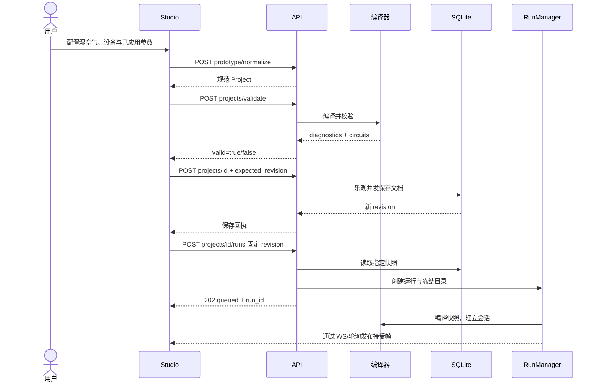
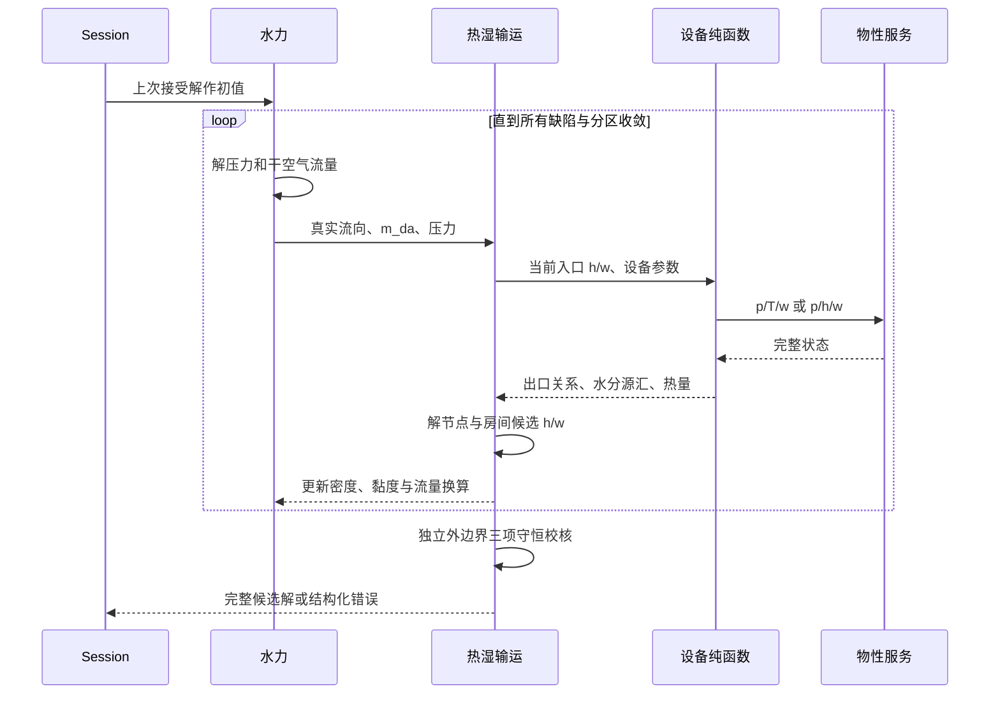
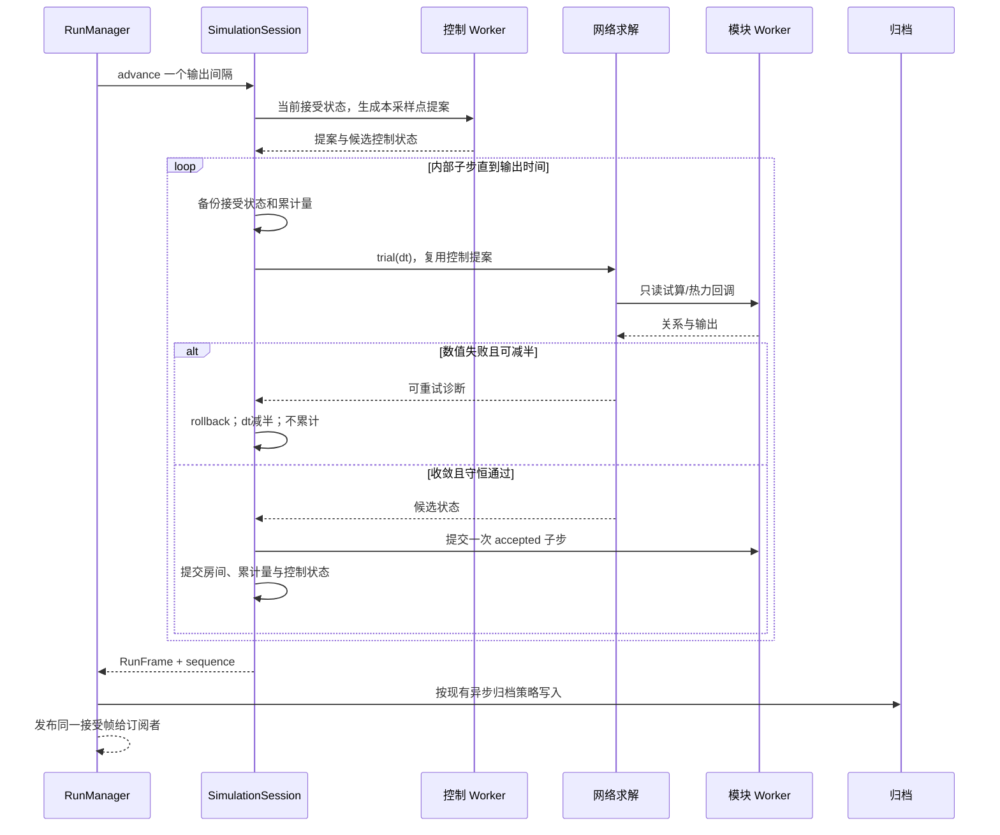
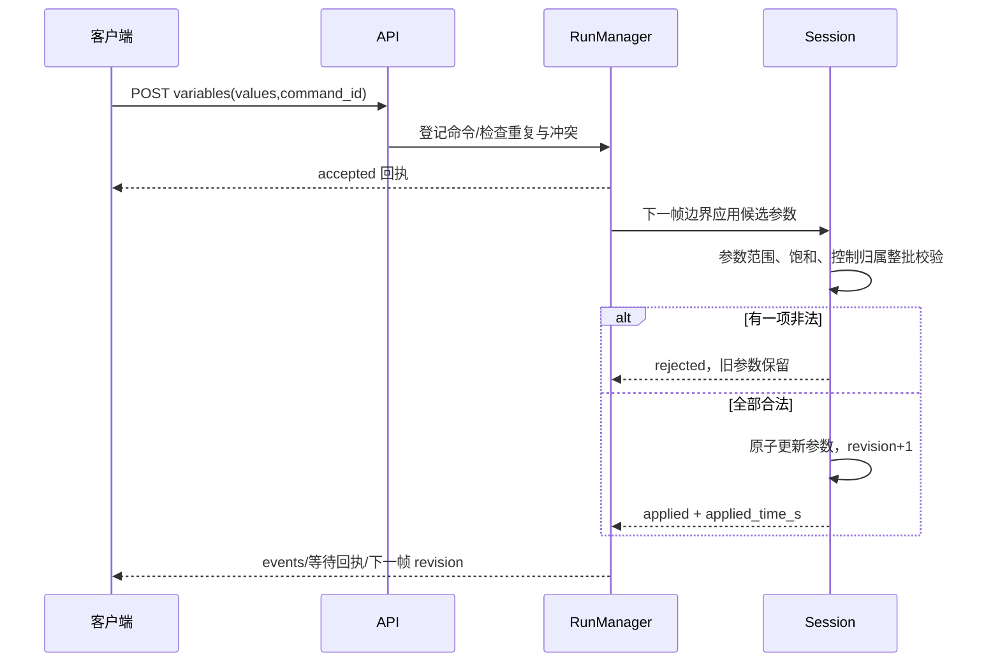
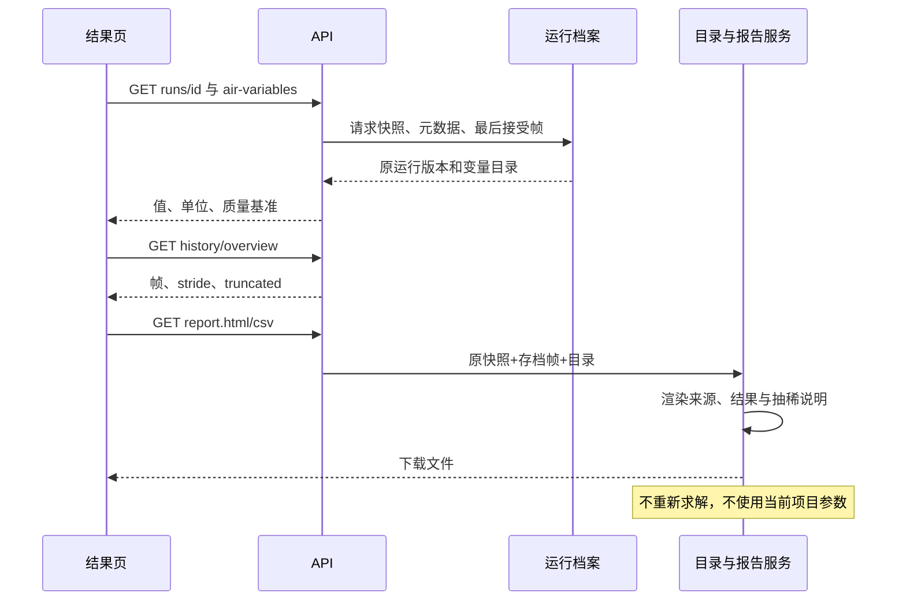
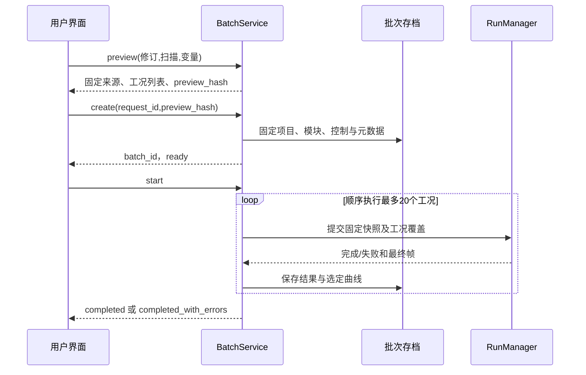

# 04 接口定义、错误语义与时序图

基址默认 `http://127.0.0.1:8798`；JSON 使用 UTF-8。标记“现有扩展”的路径已存在，但风侧完整行为仍需实施；标记“新增”的路径当前不可假定存在。

## 1. 接口清单

| 方法/路径（均以 /api/v1 开头） | 状态 | 请求 | 成功响应/用途 |
| --- | --- | --- | --- |
| GET `/health` | 现有扩展 | 无 | 200 HealthResponse，新增细分风侧能力 |
| GET `/catalog` | 现有扩展 | 无 | 200 CatalogResponse，新内置设备和单位 |
| GET `/modules` | 现有扩展 | 无 | 200 ModuleCatalogResponse，SDK 0.6.0 包 |
| GET `/examples/{name}` | 现有扩展 | 新名称见 06 | 200 完整规范 Project |
| POST `/prototype/normalize` | 现有扩展 | 原型导出对象 | 200 Project，保留 solverOptions |
| POST `/projects/validate` | 现有扩展 | Project | 200 ValidationResponse；语义失败 valid=false |
| POST `/solve` | 现有扩展 | Project | 200 RunFrame；无持久 run_id |
| POST `/runs` | 现有扩展 | RunRequest | 201 RunCreateResponse，同步运行 |
| POST `/runs?background=true` | 现有扩展 | RunRequest | 202 RunStatus，异步运行 |
| POST `/projects/{project_id}/runs` | 现有扩展 | SavedProjectRunRequest | 202 固定保存修订后后台运行 |
| GET `/runs/{run_id}` | 现有扩展 | 无 | 200 RunRecordResponse，新增 air_metadata |
| GET `/runs/{run_id}/variables` | 现有扩展 | keys 查询串 | 200 VariableValues |
| POST `/runs/{run_id}/variables` | 现有扩展 | VariableWrite | 200 RunStatus+回执 |
| POST `/runs/{run_id}/command` | 现有复用 | RunCommand | 200 RunStatus+回执 |
| GET `/runs/{run_id}/history` | 现有复用 | offset、limit | 200 分页 RunFrame |
| GET `/runs/{run_id}/overview` | 现有复用 | 无 | 200 抽稀曲线 |
| WS `/runs/{run_id}/stream` | 现有扩展 | keys、interval_ms | frame/end/error 消息 |
| GET `/runs/{run_id}/report.csv` | 现有扩展 | 无 | 200 风侧 CSV；仍保留冷库报告分派 |
| GET `/runs/{run_id}/report.html` | 现有扩展 | 无 | 200 风侧 HTML |
| POST `/air/properties` | **新增** | MoistAirQuery | 200 MoistAirQueryResponse |
| GET `/air/psychrometric-grid` | **新增** | 压力、T 范围、w 上限 | 200 状态图背景线数据 |
| POST `/air/variables/preview` | **新增** | Project | 200 AirVariableCatalogResponse；只编译发现变量，不求解/启动 Worker |
| GET `/runs/{run_id}/air-variables` | **新增** | 无 | 200 运行冻结的变量目录 |
| POST `/projects/{project_id}/batches/preview` | 现有扩展 | BatchPlanRequest | 200 固定快照与 preview_hash |
| POST `/projects/{project_id}/batches` | 现有扩展 | BatchCreateRequest | 201 批次详情 |
| POST `/batches/{batch_id}/start` | 现有复用 | 无 | 200 批次状态 |

保存项目仍使用现有 `POST /projects/{project_id}`，请求为 `ProjectSaveRequest`。它保存的是带画布的 ProjectDocument，不是把规范 Project 直接放进 document.project。规范 Project 可以直接运行；需要进入 Studio 项目存档时必须走既有规范→原型映射。

## 2. 认证与错误包络

沿用当前 read/control 令牌：GET/WS 要 read，POST 要 control；因此新的只读 POST 物性查询和变量预览也要求 control，不默默修改全局授权规则。health 保持公开。浏览器 WS 使用既有 `fluidnet.bearer.<token>` 子协议；新接口不把令牌写进查询参数或日志。

HTTP 错误包络保持 `{"detail": ...}`。Pydantic 错误仍为 detail 数组；业务错误为 `ErrorDetail`；兼容旧路径的字符串错误，前端需统一呈现。

```json
{
  "detail": {
    "code": "AIR_HUMIDITY_SUPERSATURATED",
    "message": "B1 的边界含湿量超过当前温度和压力下的饱和值",
    "severity": "error",
    "instance_id": "B1",
    "field": "humidity_ratio_kg_kg",
    "diagnostics": [],
    "keys": []
  }
}
```

路由 schema 错误返回 422；新物性/预览接口的语义错误也为 422。现有 `/projects/validate` 的业务校验失败以 200+valid=false 返回，不改成异常。

异步运行创建 202 只表示入队，求解失败通过运行 status=failed、frame.valid=false、diagnostics 返回，不能事后改创建请求的 HTTP 状态。现有 POST variables 把运行命令语义错误映射为 409，本轮保留；请求体类型错误仍为 422。`command_status=accepted` 不表示 applied。

## 3. 新增物性查询

### 3.1 MoistAirQuery

采用 `input_mode` 判别联合类型，非本模式字段必须缺省，不能发送多个独立湿度定义。

| 字段 | 类型 | 默认/必填 | 约束 |
| --- | --- | --- | --- |
| `input_mode` | ptw/ptrh/phw | 必填 | 确定下列字段组合 |
| `pressure_pa` | float | 必填 | 60000–120000 |
| `temperature_k` | float | ptw/ptrh 必填 | 253.15–333.15；phw 禁止 |
| `humidity_ratio_kg_kg` | float | ptw/phw 必填 | 0–0.05；ptrh 禁止 |
| `relative_humidity` | float | ptrh 必填 | [0,1]；其他模式禁止 |
| `enthalpy_j_kg_dry_air` | float | phw 必填 | 有限值且反算落入包络；其他模式禁止 |

响应 `MoistAirQueryResponse`：`contract_version:1`、`property_backend:"coolprop_ha"`、`property_version:string`、`state:FluidState`、`diagnostics:Diagnostic[]=[]`。state 无端口流量，不给随意的质量流量默认值。

```http
POST /api/v1/air/properties
Content-Type: application/json

{
  "input_mode": "ptrh",
  "pressure_pa": 101325,
  "temperature_k": 299.15,
  "relative_humidity": 0.5
}
```

同一入口既供参数面板换算，也供第三方查询。禁止前端另写 Magnus 公式而产生第二套状态。

### 3.2 状态图背景网格

GET `/air/psychrometric-grid` 查询参数：

| 字段 | 类型 | 默认 | 范围 |
| --- | --- | ---: | --- |
| `pressure_pa` | float | 101325 | 60000–120000 |
| `temperature_min_k` | float | 273.15 | 253.15–333.15 |
| `temperature_max_k` | float | 323.15 | 大于 min，≤333.15 |
| `humidity_max_kg_kg` | float | 0.03 | (0,0.05] |

响应字段：`contract_version:1`、`pressure_pa`、`temperature_min_k`、`temperature_max_k`、`humidity_max_kg_kg`、`lines:PsychrometricLine[]`、`diagnostics:Diagnostic[]`。每条线含 `relative_humidity:float` 和 `segments:list[list[PsychrometricPoint]]`，点只有 `temperature_k:float`、`humidity_ratio_kg_kg:float`。

固定生成 RH=0.1…1.0 共 10 条线，每条最多 161 个等温采样点；超出 w 上限或物性包络的点裁掉并分段，禁止跨缺失段连线。服务器按完整输入+物性版本缓存，客户端只绘图。实际运行点始终带实际压力；与图参考压力差超过 1000 Pa 时显示提示，不把不同压力下的点当作同一条湿空气过程线。

## 4. 运行请求逐字段

两种入口复用现有 RunOptions：

| 字段 | 类型 | 默认/限制 | 说明 |
| --- | --- | --- | --- |
| `project` | Project | RunRequest 必填 | SavedProjectRunRequest 中禁止；由存储读取 |
| `project_revision` | int/null | ≥1 | 直接运行来源标记，不代替服务端读取已保存修订 |
| `revision` | int/null | 保存项目入口专用，≥1 | null 使用最新已保存修订；响应快照记实际修订 |
| `mode` | steady/dynamic | steady | 含房间也支持真实稳态平衡 |
| `duration_s` | float/null | 60，(0,604800] | null 仅后台动态持续运行 |
| `dt_s` | float | 0.1，(0,60] | 发布帧间隔/目标步长，内部可减半 |
| `selected_variables` | string[]/null | 最多 64 | 界面观察变量 |
| `scenario_id` | string/null | null | 应用已定义工况覆盖 |
| `history` | full/trend | full | trend 非关键帧只保留指定量和状态 |
| `trend_variables` | string[] | []，最多 256 | 全程概览需要的变量 |
| `execution_mode` | fast/realtime | fast | 后台调度模式 |
| `speed_ratio` | float | 1，(0,100] | 实时模式速度倍率 |
| `start_paused` | bool | false | 创建后暂停，便于接入订阅 |
| `history_window` | int | 2001，10–20001 | 有界历史窗口 |

同步动态最多 2001 帧；长运行使用 background。新风侧累计量属于 state.*，即使 trend 模式也保留最终精确累计值。

```json
{
  "revision": 7,
  "mode": "dynamic",
  "duration_s": 3600,
  "dt_s": 5,
  "history": "trend",
  "trend_variables": [
    "C1.condensate_kg_s",
    "C1.state.condensate_kg",
    "R1.state.temperature_k",
    "R1.state.relative_humidity"
  ],
  "execution_mode": "fast",
  "start_paused": false,
  "history_window": 2001
}
```

上例用于 POST `/projects/ahu-room/runs`。设备 id 必须存在于该修订；示意 id 不能直接用于任意项目。

## 5. 帧、变量与命令

RunFrame 继续使用 `status, valid, time_s, variables, diagnostics, metrics, solve_counters, solve_summary, full, sequence, parameter_revision`。新增字段放在 02 指定的变量/指标键；不另发一个与主帧时间不一致的湿空气结果包。

GET `/runs/{id}/variables?keys=C1.condensate_kg_s,R1.state.relative_humidity` 返回：

```json
{
  "run_id": "run-example",
  "status": "running",
  "time_s": 120,
  "sequence": 24,
  "parameter_revision": 0,
  "values": {
    "C1.condensate_kg_s": 0.0012,
    "R1.state.relative_humidity": 0.55
  }
}
```

以上数值仅说明响应结构，不是本次计算结果。未知键 422 VARIABLE_UNKNOWN；还没有可读帧且指定 keys 时 409 NO_FRAME。返回 null 与未知键不同，前端应区分“不适用”和“键不存在”。

运行写入 `VariableWrite` 现有字段：`values:dict` 必填 1–256 项，`command_id:string|null` 最多 96 字符且首字符字母数字，`wait_s:float=0` 范围 0–10。示例：

```json
{
  "command_id": "air-adjust-001",
  "values": {
    "C1.param.coil_surface_temperature_k": 284.15,
    "H1.param.moisture_addition_kg_kg": 0.001
  },
  "wait_s": 2
}
```

写入只允许表中 R 参数。整批验证后在同一帧边界生效；任何一个参数非法、被控制器占用或非 runtime，整批拒绝。既有回执缓存有界（最近 1000 条），不能把 command_id 宣称为跨重启永久幂等键。客户端在不确定时查询 events/变量 revision，避免无限重发。

RunCommand 字段沿用 `action, instance_id, parameter_id, value, values, command_id, controller_id`；action=pause/resume/step/stop 只需 action 和可选 command_id。湿空气读数通过参数控制，不开放直接修改 h/w 状态的命令。

## 6. 历史、WS 与报告

history：offset≥0，limit 默认 2001、范围 1–2001；响应 `rows,total_rows,offset,first_offset,truncated`。偏移为绝对帧号。truncated=true 时不能继续假设拥有全程原始帧；overview 返回 `rows,stride,total_rows`。

WS 查询 `keys` 为逗号分隔，`interval_ms` 默认 50，服务端夹到 10–5000 ms。成功消息与 VariableValues 对齐，但不含 run_id：

```json
{"type":"frame","status":"running","time_s":120,"sequence":24,"parameter_revision":0,"values":{"C1.condensate_kg_s":0.0012}}
```

结束消息 `{"type":"end","status":"completed"}`；错误消息带 type=error、code，未知变量另有 keys。慢客户端可跳帧，sequence 能识别缺口；WS 不是完整历史传输通道。订阅依赖后台运行，不承诺为同步/已退出内存的归档重放 WS。关闭码保持 4401/4404/4422。

风侧报告只允许终态且至少有一帧已接受解。failed/interrupted 可导出部分报告，但标题、有效区间和失败原因必须醒目。没有接受帧返回 409 NO_FRAME；运行未结束返回 409 RUN_NOT_TERMINAL（新增统一风侧错误，不改变其他历史路由）。

风侧 CSV 采用可检索长表，列固定为：

`record_type,run_id,project_revision,time_s,sequence,parameter_revision,instance_id,port_id,channel_id,variable_key,value,canonical_unit,mass_basis,sample_source`

`record_type` 为 value/metric；`sample_source` 为 history/overview/final。空值为空单元格，布尔为 true/false；采用 UTF-8 BOM、逗号分隔、RFC 风格引号转义。字符串以 =/+/-/@ 开头时做表格软件公式注入转义，数值负号保留数值语义。

HTML 内容：来源版本与假设→拓扑设备清单→风量分配→风机工作点→热湿状态→盘管与水耗→房间时序→残差与诊断→抽稀说明。所有值来自存档，不临时重新求解。用户名称/诊断文本做 HTML 转义，不加载外链脚本。

## 7. 错误码清单（拟新增或扩展）

| code | 触发 | 用户处理 |
| --- | --- | --- |
| `MOIST_AIR_FLUID_REQUIRED` | 非 Air/gas 或湿空气回路混入液体 | 修正工质/分开项目 |
| `MOIST_AIR_THERMAL_REQUIRED` | moist_air=true 且 thermal=false | 开启热力 |
| `MOIST_AIR_COUPLING_REQUIRED` | 湿空气使用 reference | 改 node |
| `MOIST_AIR_REQUIRED` | 湿设备放入干网络 | 开启并配置湿空气 |
| `AIR_CONTRACT_VERSION_REQUIRED` | moist_air=true 但缺少新版 options/版本声明 | 显式迁移并保存新修订 |
| `AIR_PROPERTY_RANGE` / `AIR_PROPERTY_FAILURE` | 越包络/库调用失败 | 检查 p/T/w，保留原始诊断 |
| `AIR_HUMIDITY_SUPERSATURATED` | 边界/普通流股过饱和 | 降湿或修正热过程 |
| `BOUNDARY_HUMIDITY_CONFLICT` | 同节点边界 w 冲突 | 合并一致边界 |
| `MOISTURE_REFERENCE_MISSING` | 无湿度参考的闭环 | 增加物理边界/房间状态 |
| `AIR_STATE_UNDERDETERMINED` | 零流量隔离节点无初态 | 补初态或拓扑 |
| `AIR_TRANSPORT_NOT_CONVERGED` | 热湿迭代超限 | 检查设备与负荷，允许子步重试 |
| `AIR_MOISTURE_IMBALANCE` / `THERMAL_ENERGY_IMBALANCE` | 独立账本不闭合 | 定位源汇/模型，不把结果标有效 |
| `AIR_FLOW_DIRECTION_UNSUPPORTED` | 单向设备反流 | 调整拓扑/风机/边界 |
| `AIR_VELOCITY_UNSUPPORTED` | 速度超过 100 m/s | 降流量/增截面/另选模型 |
| `COIL_FROST_UNSUPPORTED` | ADP<273.15 K | 提高温度或另立结霜模型 |
| `HUMIDIFIER_SATURATION_LIMIT` | error 策略请求超过饱和 | 降加湿量或显式 limit |
| `AIR_ROOM_NO_STEADY_STATE` | 房间无可行稳态 | 动态运行/补排湿能力 |
| `TOWER_OPERATING_POINT_INFEASIBLE` | 无可行冷却根 | 调整水温、空气/效能 |
| `MODULE_AIR_CAPABILITY_REQUIRED` | 旧模块未声明湿空气能力 | 升级兼容包 |
| `MODULE_AIR_CAPABILITY_MISMATCH` | 透传模块改变水分 | 修正模块 |
| `AIR_OPTIMIZATION_UNSUPPORTED` | 选择尚未适配的数值优化 | 关闭该优化 |
| `AIR_METADATA_UNAVAILABLE` | 旧运行没有风侧目录 | 显示原始结果或新建运行，不伪造元数据 |

warning 另含 `HUMIDIFIER_LIMITED`、`AIR_HIGH_VELOCITY`（>30 m/s）、`TOWER_CONCENTRATION_LIMITED`。错误必须尽可能填写 instance_id、field、channel_id、time_s；新代码不用大段自然语言代替稳定 code。

## 8. 时序图

### 8.1 建模、保存与运行



### 8.2 一次热湿联合求解



### 8.3 动态子步、拒绝与提交



### 8.4 参数整批应用



### 8.5 历史报告与结果页



### 8.6 批量工况



## 9. 兼容与接入约束

新接口统一在 `air_api.py` 注册；必须检查路径注册顺序，不让静态路径被项目 id 路由吞掉。新 DTO 登记到合同生成清单，错误包络也进入 OpenAPI。

前端缓存键至少包含 run_id、contract_version、project_snapshot_hash；同名项目重跑不能复用上一次目录。浏览器切换运行应中止旧请求/订阅，禁止迟到响应覆盖新选中运行。

外部客户端先读 health 能力，再用规范 Project 或保存项目运行入口；不存在的功能不能靠重试继续。与本轮无关的 REST 路径、事件保留、运行保留上限和令牌持久化行为保持现有合同。
