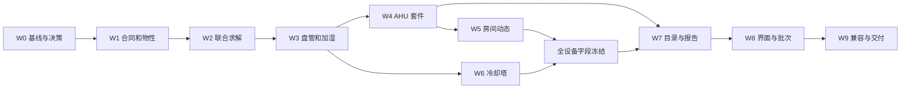

# 05 实施任务、迁移与验收矩阵

本文件是后续实施清单，不是已经执行的任务记录。用户本轮要求不运行测试；下面的测试名称和门槛用于未来实施验收，本轮未创建或运行这些测试。

## 1. 顺序与依赖

每个包都有可审查的代码、合同和证据；需要拆分时按目标拆分，不按任意行数拆分。不得先把全部 health 能力置 true 再补功能。

## 2. 逐包任务

### W0：基线、现有 Phase 2a 与决策（2–3 人日）

- [ ] 记录当前 HEAD、工作区差异和未跟踪文件；保留用户/其他会话改动，不自动 stash、reset 或提交。
- [ ] 将本套文档的 ADR、参数默认值、符号、反流/饱和策略作为一套实现合同。
- [ ] 修复 `branch_humidity_out` 按 n 分配却按 m 索引的问题；节点和支路数组分别命名。
- [ ] 相对湿度反算改为统一服务；w=0 时露点使用 null；删除无条件 RH/w 夹取。
- [ ] 修复 `_fluid_port`、`_node_ports`、module_phases、RPC/SDK 各路径的字段遗漏。
- [ ] 将一次性 wet 判定改为依赖当前入口状态的迭代分区。
- [ ] 重新设计水分账：独立边界输入输出、源汇、存储；替换设备公式自洽但不能校验全网的残差。
- [ ] 将“湿空气放宽能量容差至 1%”登记为必须移除项，完成基准改造后移除。

输出：基线记录、缺陷对应变更点、合同定稿。出口 G0 不要求在此包就实现所有设备。

### W1：物性、状态与单位（3–4 人日）

文件：`air_models.py`、`models.py`、`moist_air.py`、`fn_sdk/`、`module_contracts.py`、`scripts/generate_contracts.py`。

- [ ] 定义 MoistAirOptions 与状态字段；干空气/混合物/水的质量单位均明确。
- [ ] 实现 `state_ptw/state_phw/humidity_from_rh/saturated_state`，统一产品包络与错误转换。
- [ ] 让通用 enthalpy/cp 保持混合物基准，新增显式 dry_air 字段。
- [ ] 注册 SDK 0.6.0、air.properties.v1、air.pass_through.v1；历史版本能力集合不改。
- [ ] 新 RPC 字段仅向协商成功的新 Worker 发送；旧 Worker 请求格式保持可解析。
- [ ] 确认 UnitSpec 的 %、g/kg、kJ/kg、m³/h 换算双向一致。
- [ ] 注册新 DTO 的 Schema；生成脚本执行会触发参考求解，应在允许运行验证的实施任务中执行。

出口：状态往返、单位、非法输入与旧协议边界完整；所有后续设备只能用统一物性入口。

### W2：水力与热湿联合求解（5–7 人日）

文件：`compiler.py`、`air_compile.py`、`air_transport.py`、`solver.py`、`thermal.py`、`hydraulic_derivatives.py`。

- [ ] 编译时验证 Air/gas、thermal/node 组合，构造 n/m 分离数据。
- [ ] 引入湿空气 m_da 连续性与支路实际总质量/体积流量映射。
- [ ] 明确所有压损、风机曲线、管道 Re、Jacobian 的输入基准。
- [ ] 实现流向改变后的上游选择与节点混合；压力边界区分流入状态和流出流股。
- [ ] 引入 h/w 联合固定点迭代，检查未松弛缺陷与设备状态稳定。
- [ ] 对 reference 模式、欠约束闭环、停滞节点、无效优化设置给出结构化错误。
- [ ] 输出干空气/水分/能量三个独立残差；不同网络大小采用绝对+相对尺度。
- [ ] 将湿空气优化开关逐项适配；未适配前明确拒绝请求，不能只沿用旧 Jacobian。

出口 G1：单支路、并联 m>n、多入口混合、反向透传、湿度闭环与零流量边界行为均符合合同。

### W3：表冷器与加湿器（4–6 人日）

文件：`air_devices.py`、`catalog.py`、`thermal.py`、`air_transport.py`、`simulation.py`。

- [ ] 表冷器用干/湿两套关系，湿区在 h/w 空间混合；按当前迭代入口判断。
- [ ] 区分空气焓降、冷源负荷、凝水携出焓；显/潜热分解固定。
- [ ] 加湿器实现等焓与等温；请求量/实际量/限幅明确分开。
- [ ] 无流量、BF=0/1、无冷却、露点临界、反流与低于冰点分别处理。
- [ ] 动态累计水量与能量只在接受子步提交；重试不累加。
- [ ] 参数运行修改允许整批校验，热力模型不得悄悄改变结构参数。

出口：完整气侧守恒；禁止用“减少总质量但入口出口仍同值”的结果蒙混通过。

### W4：AHU 套件与官方模块（3–4 人日）

文件：`catalog.py`、`air_compile.py`、官方风机/风阀/风口/管件新版本、`examples.py`、`bridge.py`。

- [ ] 混合箱三端口同压节点与方向校验；过滤器清洁/污堵曲线。
- [ ] 再热器使用原 `heat_input_w` 参数；湿空气 h_da 与 Q/m_da 一致。
- [ ] 风机以实际体积流量查曲线；state/reference 密度模式明确可见。
- [ ] 官方包声明 SDK 湿空气能力，版本和哈希重新生成；旧引用不更新。
- [ ] 提供 `air-mixing`、`ahu-wet` 规范示例；示例完整固定模块定义。
- [ ] 审查 module-per-phase、批量 Worker 和模块验证台是否都使用同一质量基准。

出口：新风+回风→混合→过滤→表冷→再热/加湿→送风的链路可计算、保存和复算。

### W5：房间动态（4–6 人日）

文件：`air_room.py`、`compiler.py`、`simulation.py`、`catalog.py`、`air_variables.py`、示例。

- [ ] 房间两个端口合并压力节点；新增状态登记，避免被普通 channels coverage 拒绝。
- [ ] 初始化有效 M_da、h、w、E；固定存量假设输出到报告。
- [ ] 实现隐式热湿存储方程，围护/渗透/显热/散湿源分别记账。
- [ ] 稳态求真实平衡；不可能的稳态明确失败。
- [ ] 房间状态加入 trial/accept/rollback、参数事务和错误保留路径。
- [ ] 负荷阶跃通过既有控制脚本/命令输入，不借用冷库专属 events。
- [ ] 给 `ahu-room` 示例配置实际送回风和室外边界，避免风管新风与 infiltration 重复计入。

出口 G2 的房间部分：步长缩小时结果呈预期收敛；累计水量与最终存量闭合；子步拒绝后累计量不重复。

### W6：冷却塔水耗（4–6 人日）

文件：`cooling_tower_moist.py`、`catalog.py`、`thermal.py`、`simulation.py`、示例。

- [ ] 新 ID `cooling_tower_moist`，不替换旧干模型。
- [ ] 规定空气流股，接触效能构造 h/w；有界求解出水温度。
- [ ] 计算蒸发、飘水、排污、补水、实际浓缩倍数。
- [ ] 水侧进出循环量相等，补排水能量和空气增湿能量进入账本。
- [ ] 标明当前没有空气端口和风管联立；水侧仅 Water/liquid。
- [ ] 低风量、零水量、无法排热、目标浓缩倍数不可达分别处理。
- [ ] 动态累计四项水耗和排热量，保持子步事务一致。

出口 G2 的塔部分：独立水账、能量账、工况可行性与新旧模型差异可解释。

### W7：变量目录、报告和归档（3–4 人日）

文件：`air_variables.py`、`air_report.py`、`air_api.py`、`api.py`、`storage.py`、`jobs.py`、`batches.py`。

- [ ] 实现预览变量目录与运行冻结目录；不能依靠运行后猜字段名。
- [ ] 增加物性查询、状态图网格接口，认证保持现有 read/control 规则。
- [ ] 固定 air_metadata、物性版本、项目摘要和假设；事务保存。
- [ ] 风侧报告分派兼容已有冷库报告；对归档输出不重求解。
- [ ] history 裁剪后保留累计量，报告正确标注 overview 与部分失败结果。
- [ ] 数值、单位、布尔/null、字符串转义在 JSON/CSV/HTML 一致。
- [ ] 记录新增路径的状态码、请求/响应 schema 和错误样例。

出口 G3 的数据部分：REST、WS、帧、报告来自相同 sequence/parameter_revision；旧记录缺字段时显式降级。

### W8：界面、批量与结果过期（4–6 人日）

文件：`frontend/air-side.js`、`studio.js`、`engine-client.js`、`project-services.js`、`scenario-batches.js`、`index.html`。

- [ ] 项目配置湿空气模式并显式同步 thermal/node；RH 输入转换成 w 草稿。
- [ ] 设备属性按类型渲染，unknown enum 不回退成默认值。
- [ ] 风量表、状态点、盘管/水耗/房间指标按实际实例生成。
- [ ] 输出字段显示质量基准与单位；无定义值显示“—”，过期结果显示来源修订。
- [ ] 选择不同运行时中止旧请求；重命名/删除/撤销后更新绑定。
- [ ] 批次可扫描 ADP、BF、加湿量、过滤器污堵、房间负荷等合法数值参数。
- [ ] 批次上限仍为 20 工况、16 观察变量；最多 4 条同变量曲线。
- [ ] 全部页面按 1920×1080 验收；不增加已取消的其他分辨率适配工作。

出口 G3 的 UI 部分：保存→重载→运行→历史→报告→比较链路完整，不能只交静态截图。

### W9：迁移与交付（3–4 人日）

- [ ] 按下表完成旧干项目、当前湿空气草稿、旧模块、旧运行的迁移策略。
- [ ] 在届时用户允许的验证范围内执行对应验收；未执行项目记为未验证，不填通过。
- [ ] 同步合同、API、README、ROADMAP、架构和设备文档。
- [ ] 每个 health 能力对应真实完成门槛；把开发草稿能力位与已交付状态区分。
- [ ] 形成验收记录：命令、环境、输入快照、输出、独立对照、容差、已知限制。
- [ ] 提交/合并/发布只有在后续任务授权范围内进行；本计划本身不执行代码提交或发版。

## 3. 迁移矩阵

| 输入对象 | 读取/转换策略 | 禁止行为 |
| --- | --- | --- |
| 旧干工质 Project 缺 moist_air | 默认 false；不写新字段也能读取 | 自动变成湿空气 |
| Phase 2a/草稿 moist_air=true、无 options | 标为旧湿空气合同；导入时生成迁移预览，补 options 并明确切 node/焓基准 | 静默改动历史计算结果 |
| 历史湿空气运行存档 | 原帧原样读取，air_metadata 缺失提示旧语义；需要新结果时新建运行 | 对历史 h/m 数值重新解释或乘系数后覆盖 |
| 旧 source 定义没有 w 参数 | 旧项目继续干工况；升级湿空气需新目录版本/补齐快照并验证 | 在不改 definition_hash 的情况下加参数 |
| 旧 Python 模块 | 干工况仍可用；湿工况提示升级到声明能力的新版本 | 以模块名称/文件路径自动判定兼容 |
| 原 cooling_tower | 原模型与变量保留；用户明确选择新 ID | 自动替换设备物理模型 |
| 旧房间/冷库 thermal/refrigeration 域 | 继续原会话；air_room 是新的 fluid 域设备 | 把旧房间加 w 字段就当新热湿房间 |
| 旧数据库 | 新元数据字段可空，迁移写事务；读取旧行允许 null | 删除旧运行、重写所有快照 |
| 新项目发给旧服务 | capability 检查提示版本不支持；导出保留原字段 | 删除未知字段后假装同一项目可以运行 |

现有升级预览接口主要面向模块，不能宣称它已处理求解器物理语义迁移。湿空气草稿转换实现为 `migrations.py` 中显式纯函数，由导入预览调用；只有用户在页面确认转换后写入新项目修订，原文档/旧修订保留。批量转换前生成可下载原始文档备份。

## 4. 验收用例矩阵

以下为目标，不是测试执行记录。数值公式对照不得直接调用被测函数算 expected。所有算例保存完整规范 Project、物性版本、质量基准和单位。

| ID | 场景 | 核心断言/门槛 |
| --- | --- | --- |
| A01 | ptw→phw 往返 | T 误差≤1e-5 K，w≤1e-10；独立输入网格 |
| A02 | RH→w→RH | RH 绝对误差≤1e-6，含 0/0.5/1 边界 |
| A03 | w=0 | RH=0、露点 null，无 Infinity/NaN |
| A04 | 非法状态 | 越包络、超饱和、未知模式全部给明确错误码 |
| A05 | 单位往返 | °C/K、%/1、g/kg→kg/kg、m³/h→m³/s 相对误差≤1e-12 |
| N01 | 单支路透传 | 入口出口 m_da/w/h（无热源时）守恒，m_total=m_da(1+w) |
| N02 | m>n 并联支路 | 无索引越界，支路数组与输出映射完整 |
| N03 | 两路不同 w 混合 | 干空气加权结果，不能按总湿空气权重误算 |
| N04 | 反向管道/过滤器 | 上游状态切换，压损/流量符号一致 |
| N05 | 边界吸收 | 出口账本使用到达流股而不是边界配置 w |
| N06 | 闭环与孤立节点 | 有房间状态可动态；无湿度参考明确失败 |
| N07 | 三项守恒 | 每节点干空气残差与全局水/能量账满足 02 容差 |
| N08 | node 外耦合 | 密度、T、w 的未松弛缺陷同时满足门槛 |
| C01 | 干盘管 | w 不变、凝水=0、latent=0 |
| C02 | 湿盘管 | h/w 旁通混合一致，凝水=m_daΔw；冷量加凝水焓=空气焓降 |
| C03 | 混合/加湿后再进盘管 | wet 判定随实际入口改变，不能固定初始边界判定 |
| C04 | BF=0/1、无冷却、零流量 | 出口与极限行为正确；SHR 合法或 null |
| C05 | 反流/结霜区 | 明确不支持，不返回有效伪结果 |
| H01 | 等焓加湿 | h_da 不变，T 下降，实际水分增加可对账 |
| H02 | 等温加湿 | T 不变，所需补热等于气体焓增加 |
| H03 | 饱和限幅 | limit 输出实际值与 limited；error 拒绝，w/T/热量同步 |
| U01 | AHU 全链路 | 混合→表冷→再热，端口状态与全网账一致 |
| U02 | 风机工作点 | 新版模块以实际体积流量满足曲线；干工况兼容容差沿原验收 |
| R01 | 无通风恒定散湿动态 | w(t)=w0+G*t/M_da（未达饱和前），水量误差≤1e-8 kg 或 1e-6 相对 |
| R02 | 固定送风湿负荷 | 对独立一阶模型稳态/时间常数；减半 dt 误差呈一阶下降 |
| R03 | 房间热负荷/渗透 | 每项能量与水分源可单独开关对照，无双计 |
| R04 | 强制子步拒绝 | 重试前后状态、控制、累计量与单次接受路径一致 |
| R05 | 不存在稳态 | 封闭持续散湿房间明确失败，历史保留 |
| T01 | 冷却塔典型工况 | M=E+D+B；所有流股能量闭合；水温与湿球边界合理 |
| T02 | COC/飘水变化 | B 公式与实际浓缩倍数一致，不输出负排污 |
| T03 | 零流/不可行根 | 零流旁通、不可行根明确失败 |
| T04 | 原塔对照 | 在纯显热近似适用情形解释差异；不要求所有工况数值相同 |
| P01 | 新旧 SDK | 新字段四阶段与批量路径齐全；旧 Worker 不受未知字段影响 |
| P02 | 参数写入 | 全部应用或全部拒绝；parameter_revision、回执和帧同步 |
| P03 | 控制单写入者 | 脚本/PID/外部写冲突处理与原行为一致 |
| I01 | REST/WS/报告一致 | 同一 sequence 数值相同；显示只作单位转换 |
| I02 | 旧档案/重启 | 不重算、不改变旧语义；新运行目录可读，旧运行明确缺元数据 |
| I03 | 历史抽稀 | 累计量从最终接受状态，峰值若仅概览则明确标抽样峰值 |
| I04 | 批量工况 | 固定修订/模块/控制；20/16 上限、取消、部分失败保持原规则 |
| F01 | 1920×1080 | 参数、表格、图、图例/单位可读，无遮挡 |
| F02 | 改参数/拓扑/模块 | 旧结果正确过期；删除/撤销/重命名绑定正确 |
| F03 | 保存/导入/重载 | solverOptions、w、airSideView 与模块固定快照不丢失 |
| F04 | 异步切换运行 | 旧请求/WS 不能覆盖新运行结果 |

如实际数值门槛不可达，应先定位模型/算法/尺度，记录证据后修订设计；不能通过扩大容差绕过守恒。模型与独立教材/工程近似的偏差单独报告，不等同于数值守恒误差。

## 5. 拟新增验证文件（后续任务执行）

| 文件 | 覆盖 |
| --- | --- |
| `tests/test_moist_air_properties.py` | A01–A05 |
| `tests/test_moist_air_transport.py` | N01–N08 |
| `tests/test_air_devices.py` | C/H/U 类 |
| `tests/test_air_room.py` | R01–R05 |
| `tests/test_cooling_tower_moist.py` | T01–T04 |
| `tests/test_air_module_protocol.py` | P01–P03 |
| `tests/test_air_api_reports.py` | I01–I03 |
| `tests/test_air_migrations.py` | 旧项目、旧模块、旧运行 |
| `tests/browser-air-side.mjs` | F01–F04 |
| 既有批次与 SDK 测试文件 | I04 与新增能力协商 |

已随 `b6bca53` 提交的 `test_moist_air_phase2.py` 作为现有覆盖保留，按覆盖内容迁入上述文件；不因拆分丢掉既有断言。需要拓宽测试时须有新改动、失败或未解风险支撑，避免反复全量运行。

## 6. 风险与处理

| 风险 | 提前动作 | 阶段出口 |
| --- | --- | --- |
| 干/湿质量基准泄漏进旧路径 | 单一转换模块，公共变量语义固定 | W2 旧/新模式对照 |
| 干湿切换引起振荡 | 当前迭代分区、有界松弛、分区稳定门槛 | W3 临界/串联工况 |
| 房间与水箱/控制事务交错 | 统一 accepted state 与候选状态，拒绝时整体回滚 | W5 拒绝子步用例 |
| 历史模块严格解析失败 | 能力协商与旧协议字段白名单 | W1/W4 RPC 覆盖 |
| 文档宣称功能大于模型边界 | 报告记录外部冷源/有效存量/教学塔假设 | W7/W9 文档对账 |
| 大量物性查询拖慢求解 | 有界缓存、固定点诊断计数、减少重复状态构造 | W2/W7 记录调用量，不提前承诺耗时 |
| 并行会话覆盖文件 | 开始/结束记录差异，只提交自己负责变更 | 每工作包 |

## 7. 最终交付清单

- [ ] 后端完整实现及所有新增字段契约。
- [ ] 6 个规范示例，全部具有输入来源、适用边界、独立判定依据。
- [ ] 新 SDK 官方模块版本，旧版本读取与运行兼容。
- [ ] 4 个新增端点、现有运行/报告扩展及 OpenAPI。
- [ ] 1920×1080 参数/结果界面、变量目录、CSV/HTML 与批量比较。
- [ ] 可复现运行快照、物性版本、状态累计量、迁移记录。
- [ ] 对照本矩阵的验收结果和未验证项；不把未运行写为通过。
- [ ] README、ROADMAP、API、ALGORITHM、架构图同步；当前计划中已取消事项保持取消。
