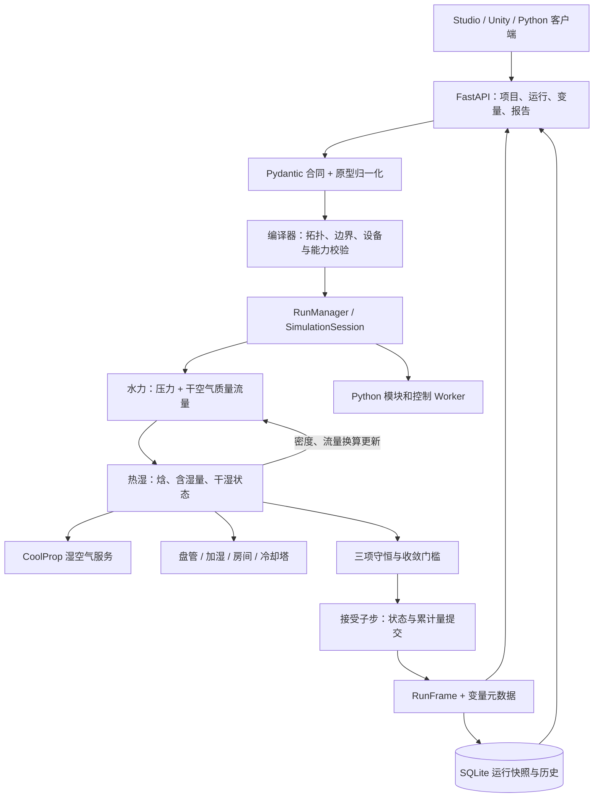

# FluidNet 后续开发完整设计与实施计划

版本：设计草案 1.0　日期：2026-10-28　状态：待实施的技术方案

源码基线：`codex/development-consistency`。开始阅读时为 `614a6bb` 加本地湿空气修改；编写期间仓库新增 `b6bca53`（Phase 2a），交付前已静态复核该提交。本次仅编写设计文档，没有运行测试、求解器或合同生成脚本。文中验收数值均为拟定门槛，不是本次实测结果。

## 1. 交付目标与阅读顺序

本计划把现有风侧 Phase 2 与结果视图落实到字段、文件、函数、接口、时序和验收用例。完成后能够创建并保存风系统，求解新回风混合、表冷除湿、加湿、再热、房间热湿响应和冷却塔水耗，查看同一运行快照对应的表格、曲线、报告与批量方案比较。

| 文档 | 解决的问题 |
| --- | --- |
| [01 架构设计](01-architecture.md) | 组件边界、文件职责、进程关系、内部接口、状态归属 |
| [02 字段与合同](02-contracts.md) | 每个新增/变更字段的类型、单位、默认值、范围、可写性、序列化规则 |
| [03 算法与设备模型](03-numerics.md) | 干空气/湿空气口径、混合与输运、盘管、加湿器、房间、冷却塔、收敛与守恒 |
| [04 HTTP、WebSocket 与时序](04-api-and-sequences.md) | 现有接口复用、新增接口、请求响应示例、错误码、六张时序图 |
| [05 实施与验收](05-implementation.md) | 工作包、依赖、文件清单、迁移、验收矩阵、工期、完成条件 |
| [06 示例与前端行为](06-examples-and-ui.md) | 完整最小 Project、运行/写变量/批量示例、页面布局、字段映射、过期规则 |
| [JSON 示例文件](samples/README.md) | 可直接复制的规范项目、三类设备实例、批次预览请求；均为目标合同样例 |

推荐顺序：负责人先读本页和 05；后端先读 01→02→03→04；前端与 Unity 接入读 02→04→06。只有 05 中的门槛全部满足，相应阶段才能从“开发中”改为“完成”。

## 2. 范围

### 2.1 本轮纳入

1. 收口当前 Phase 2a 基础实现：数组、状态传递、换算、质量基准、边界与守恒缺口。
2. 湿空气物性统一入口，`p/T/w` 与 `p/h_da/w` 两种状态构造。
3. 干空气质量守恒、湿度与焓联合迭代、真实湿空气体积流量与压力损失。
4. 旁通系数表冷器、等焓/等温加湿器、混合箱、过滤器；复用风阀、风管、风机、再热器。
5. 单区房间热湿状态、显热/散湿/平衡渗透负荷和动态账本。
6. 新的湿空气冷却塔教学模型及蒸发、飘水、排污、补水计算。
7. 变量元数据、运行报告、1920×1080 风系统结果页面、批量方案比较。
8. 规范 Project、原型导入导出、模块版本、历史运行、外部客户端的一致性。

本计划包含结果视图 A（变量）、B（报告）、C（Studio 面板），消除旧计划“包含结果视图”与“C 层待定”的歧义；这是本详细方案的推荐交付范围，不表示 C 层已经实现。

### 2.2 边界

既有水系统、冷库 A/B、双盘管热耦合继续作为兼容对象。当前湿表冷器使用规定盘管表面温度，表示外部冷源；本轮不把它接成冷水侧/制冷剂侧双流体真实盘管。完整“制冷站→冷水→湿盘管”能量耦合另立后续专项，不能用外部冷源模型宣称已经实现。

VAV/静压策略与课程产品封装保留为后续候选；打包发版、24 小时稳定性专项、现场校核、变量别名等已取消任务不恢复。完整可压缩流、水锤、雾滴输运、结霜/融霜、CFD 不在本轮。房间凝水由盘管承担，不增加墙面结露储液模型。

## 3. 当前能力和计划能力

| 项目 | 静态核对到的状态 | 本计划动作 |
| --- | --- | --- |
| 干工况风管、风阀、风口、风机联立 | `614a6bb` 已提交；历史验收见原文档 | 保留并补湿工况适配 |
| `SolverOptions.moist_air`、状态含湿量 | `b6bca53` 已提交基础实现 | 固定语义、补完整状态字段 |
| 表冷器与加湿器 | `b6bca53` 已有目录与求解分支 | 修正守恒、边界、干湿切换与饱和限制 |
| `health.capabilities.moist_air` | `b6bca53` 已设置能力位 | 增加细分能力和合同版本，完成门槛后开放 |
| HTTP/WS 读写、项目快照、批次 | 已有通用实现 | 复用；增加风侧变量元数据 |
| 风侧报告 | 现有报告入口只接受冷库/制冷站 | 增加风侧分派和统一数据来源 |
| 房间湿状态、冷却塔水耗 | 未发现完整实现 | 新增 |
| 风侧专用结果页 | 未发现完整实现 | 新增，复用已有图表/修订机制 |

编写期间的 Phase 2a 提交由其他工作产生，不属于本次文档任务。其[验收说明](../AIR_SIDE_PHASE2A_ACCEPTANCE.md)保留原有事实；本计划增加的质量基准、完整设备链路和合同要求不能据此视为已经通过。实施开始时仍须重新记录 HEAD 和差异。

## 4. 必须先固定的设计决定

| 编号 | 决定 | 原因与影响 |
| --- | --- | --- |
| ADR-01 | 湿空气内部连续性未知量为干空气质量流量 `m_da` | 加湿/除湿改变水蒸气质量，干空气本身守恒 |
| ADR-02 | 公共 `mass_flow_kg_s` 仍表示当地湿空气总质量流量；新增显式干空气流量 | 避免同名字段在水系统与风系统中暗中换基准 |
| ADR-03 | 公共 `enthalpy_j_kg` 按混合物质量；新增 `enthalpy_j_kg_dry_air` | 与现有通用端口合同保持质量基准一致 |
| ADR-04 | 正式路径使用 CoolProp 湿空气服务 | 当前 Magnus 近似只能留作独立教学参考；禁止静默回退 |
| ADR-05 | 湿空气模式强制 `thermal=true`、`property_coupling=node` | 水分变化会影响真实体积流量、密度与设备工作点 |
| ADR-06 | 湿空气仍属于 `fluid` 执行域 | 复用编译器、RunManager、SimulationSession、事务与归档 |
| ADR-07 | 新房间状态在接受子步后提交 | 求解迭代和失败重试不能重复累计水分/能量 |
| ADR-08 | Python 模块通过 SDK 0.6.0 的能力协商接入 | 旧模块没有声明质量基准，不能静默用于湿空气 |
| ADR-09 | 新设备/新语义发布新模块版本；旧快照不重写 | 运行可复现、模块哈希和历史项目一致 |
| ADR-10 | 报告和 UI 只消费已接受帧及运行快照 | 避免前端重算、当前目录变化污染历史结果 |

这些决定构成一套完整的推荐实现，不是待开发者任选的多个备选。若更改 ADR-01/02/03，必须同步修改算法、SDK、变量、示例与验收，不能只改一个函数。

## 5. 总体架构

## 6. 交付阶段和估算

估算对象是从当前 Phase 2a 基础实现到本计划全部交付的**剩余工作**，不重复计算已完成 Phase 0/1 或已经存在的 Phase 2a 基础代码。按一名熟悉项目的开发者估算，包含实施阶段的定向验证；本次计划编写不执行这些验证。

| 工作包 | 内容 | 人日 | 前置 |
| --- | --- | --- | --- |
| W0 | 基线、Phase 2a 缺陷与字段决策收口 | 2–3 | 无 |
| W1 | 状态/单位/物性与合同 | 3–4 | W0 |
| W2 | 干空气流量、水力与热湿联合求解 | 5–7 | W1 |
| W3 | 表冷器、加湿器、守恒账本 | 4–6 | W2 |
| W4 | AHU 套件、风机 SDK 适配与示例 | 3–4 | W3 |
| W5 | 房间热湿动态与事务 | 4–6 | W4 |
| W6 | 冷却塔蒸发/水耗模型 | 4–6 | W2、W3 |
| W7 | 变量目录、报告、归档元数据 | 3–4 | W4；全部字段收口依赖 W5/W6 |
| W8 | 1080p 结果视图与批量工况 | 4–6 | W7 |
| W9 | 迁移、跨路径一致性与交付文档 | 3–4 | W5–W8 |
| 合计 | 基础估算 | **35–50** | — |
| 含 20% 预留 | 主要用于数值耦合与旧模块适配 | **42–60** | 约 8.4–12 个工作周 |

这比原粗计划增加了质量基准改造、模块兼容、可用接口和完整 C 层工作量。起始日期不预设，不把相对工期当日历承诺。多名开发者可以在合同冻结后分工，但 W2/W3 是关键路径；本次未启动并行代理或编码任务。

## 7. 阶段出口

- G0：质量基准、状态字段、原型映射、SDK 协商、错误码定稿，当前缺陷有明确处理任务。
- G1：湿空气单支路、并联、回流、混合网络收敛，干空气/水分/能量三账独立闭合。
- G2：完整 AHU 和房间工况成立；冷却塔水耗可解释；旧项目默认行为保持兼容。
- G3：REST、WS、变量目录、CSV/HTML、UI 同一帧一致；重启后历史快照可读。
- G4：验收矩阵有真实证据，所有未覆盖能力明确列出；才开放相应 health 能力位。

## 8. 本计划如何使用

每个工作包按 05 中的清单交付一个可审查变更。先完成 W0/W1，再扩展设备；不要把“文档已定义”“字段已出现在 OpenAPI”“API 返回 true”当成物理能力已完成。当前用户要求不运行测试，本轮只交付文档，后续实施时的验证范围由届时任务约束决定。

依据：[原风侧计划](../AIR_SIDE_DEVELOPMENT_PLAN.md)、[现有架构](../ARCHITECTURE_AND_SEQUENCE.md)、[路线图](../ROADMAP.md)、[现有 API](../API.md)，以及本次静态阅读的源码。字段与路由的现状/拟新增标记以本套文档为准。
