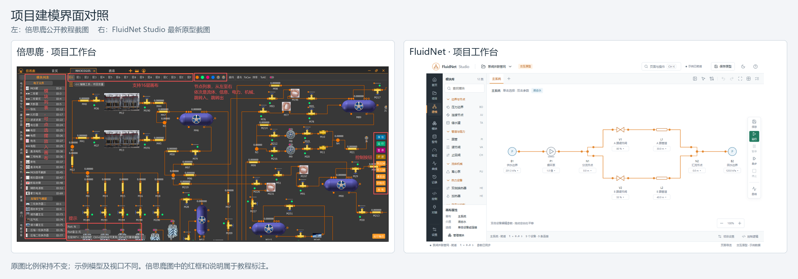

**FluidNet 最新原型与倍思鹿界面对比建议 · 2026-10-10**

建议保留目前原型的视觉风格、中文参数和对象分工，下一轮重点改善同屏调参与观察、工作台空间利用，以及大量变量的编辑效率。倍思鹿值得借鉴的是围绕工程任务组织操作的方式。

本次比对对象为 [FluidNet Studio 全页面原型](../visualizations/fluidnet-studio-prototype.html)，构建时间为 2026-10-09 20:50；已查看的主要截图生成于该次构建之后，并核对了对应源码。倍思鹿依据项目中保存的官方教程正文及配图。浏览器连接本次返回认证不可用，因此没有重新进行实机点击、计时或可用性测试；以下区分截图观察、源码发现与设计建议。参考图的红框、箭头及大段红字是教程标注，不计入产品本身的视觉评价。两边示例规模、分辨率不同，不直接据此比较容量或性能。

| 对比点 | 倍思鹿教程中呈现的界面 | 最新原型的表现 | 建议 |
| --- | --- | --- | --- |
| 页面组织 | 项目标签、模块列表和工作画布集中；参数及曲线可通过独立窗口查看。 | 首页、建模、模块、型号、验证、曲线等分页面组织，对象分工更明确；全局侧栏有 11 个常驻入口。 | 保留全部能力，按“项目建模、模块开发、结果分析”组织常用工作区，让低频入口逐级展开。 |
| 工作台空间 | 项目标签与工具条紧凑，模块列表直接邻接画布。 | 品牌顶栏、全局侧栏、模块库、画布栏、画布状态及全局状态同时存在；顶部和画布右侧都有保存入口。 | 增加专注建模布局，合并重复状态信息，让模块库和属性面板真正可收起。 |
| 设备与管线视觉 | 较多设备使用实物风格图片，以橙色管线和端口连接。 | 采用统一线条的工程符号，配合设备编号、中文名称和快捷参数，视觉更一致。 | 保留工程符号；允许模块作者设置设备图标，增加流向及缩放时的标签层级。是否使用设备图片应由模型用途决定。 |
| 设备参数 | 教程既展示完整变量窗口，也展示项目上的重点变量与快捷调节。 | 设备窗优先显示型号、开度、Kv 等常用参数，能区分当前值、草稿及待应用项。 | 保留这项改进。增加右侧停靠选项，常用单参数调整可在字段附近明确应用；型号或批量替换继续展示差异。 |
| 模块开发 | 绘制、变量、型号、代码、设计函数等集中在模块窗口内，并可进行模块运行。 | 完整编辑器与项目实例分开，8 个页签结构清楚；独立测试进入另一页面。 | 保留完整编辑器；提供可展开的测试面板，让变量、代码和测试结果能够并排对照。 |
| 变量与库值 | 技术变量名和多组数值构成紧凑表格；单位多依赖备注或教程解释。 | 中文名称、标识、单位、差异及应用方向更直观；但双行标签和较大行距使首屏记录偏少。 | 提供标准/紧凑两种密度，按入口、出口、参数和系统变量分组；变量值页补“仅常用”“仅差异”筛选。保留已有搜索、固定表头/首列和三组对照。 |
| 型号管理 | 模块窗口内以参数表和命名型号组织复用。 | 独立型号库展示模块归属、主要参数、来源版本和版本记录，并区分插入新设备与应用已有设备。 | 保留版本及显式应用规则；从项目设备打开型号详情后，应方便返回原设备和原画布位置。 |
| 曲线与调试 | 教程展示曲线窗口与画布并排，能够同时观察系统和波形。 | 曲线来源、单位和运行记录更明确；曲线在独立页面，切换后设备参数窗隐藏。 | 优先增加底部或右侧曲线停靠区，并保留独立大图页面。调整参数、应用和观察结果应能在同一屏完成。 |

**最值得先做的三项调整：**

1. **同屏完成调参和观察。** 工作台采用“左侧模块库—中央画布—右侧可停靠参数—底部可展开曲线/事件”的结构。侧栏和底栏默认按需打开，并能收起。设备浮窗继续保留，用于多设备对照。参数应用时刻在曲线上显示事件标记，能够对应到具体设备和变化值。
2. **减少界面框架的占用。** 建模时突出项目、当前画布和运行状态；合并两级状态栏的重复内容，明确一个主要保存入口，运行按钮保持固定位置。优先在 1366×768 下检查画布、参数底部操作和曲线读数能否同时看到。
3. **让变量表适合连续编辑。** 当前 1366×768 的变量值截图首屏约有 5 条完整记录。通过减少纵向留白、单行列布局和分组折叠提高密度，避免继续缩小数字。建议紧凑模式先以同视口可见约 10–12 行为设计目标，再用真实变量集验证；保留中文名、单位和可查看的完整精度。

后续再完善工程操作：已有右键旋转，可补 R / Shift+R 快捷键；已有端口中文提示，可补按真实通路关系的悬停高亮；完善多选、对齐和连线转折点编辑。涉及双侧换热器时，视觉提示必须清楚区分两条互不连通的流路。

**源码核对中发现的一个具体遗漏：**

桌面工作台的“模块库开关”会切换 `show-library` 状态，但控制模块库显隐的对应 CSS 只出现在最大宽度 500 px 的规则中；桌面仍固定保留 178 px 模块库。建议把桌面收起与展开效果补齐。这是源码核对结论，尚未通过本轮实机点击复现。位置：[按钮定义](../visualizations/studio/app.js#L64)、[动作处理](../visualizations/studio/runtime.js#L574)、[桌面布局](../visualizations/studio/styles.css#L177)、[窄屏规则](../visualizations/studio/styles.css#L420)。

曲线同屏问题也有源码依据：[设备浮窗](../visualizations/studio/runtime.js#L180)仅在建模页面渲染，[曲线页](../visualizations/studio/app.js#L86)使用独立页面布局；因此增加可停靠曲线是对当前交互结构的补充。

**已经完成、应当保留的部分：**

- 项目设备默认显示常用参数；完整模块定义有独立入口。
- 保存草稿、待应用参数及型号版本已区分；库值到当前值的方向可直接看懂。
- 变量行显示中文含义与单位；`VOLUME` 已标注为密度 kg/m³。
- 已有明确的内部通路设置、命名型号、独立测试、变量曲线及运行任务入口。
- 已有浅色/深色主题、设备多窗口、移动、缩放、置顶、收起和位置恢复。

这些是相对上一版大画布的进展。2026-10-09 的旧交互评审针对 `fluidnet-canvas-workbench.html`，其中已解决的问题不应重新列为本轮待办。

建议下一轮用同一个任务验收：在泵阀并联管网选择 V1，将开度从 80% 改为 65%，看见待应用状态，明确应用，运行或单步，同时观察 A/B 两支路流量并定位应用时刻。全程保留原画布位置，能够判断设备、单位、参数生效状态和结果来源。再以多设备及多变量场景验证紧凑布局，避免只针对默认小示例优化。

截图和来源：

- 原型：[建模](../../.cache/studio-prototype-qa/workbench-1366.png)、[设备参数](../../.cache/studio-prototype-qa/device-parameters.png)、[模块绘制](../../.cache/studio-prototype-qa/editor-drawing.png)、[变量值](../../.cache/studio-prototype-qa/editor-values.png)、[型号库](../../.cache/studio-prototype-qa/models-1366.png)、[曲线](../../.cache/studio-prototype-qa/curves-with-data.png)、[独立测试](../../.cache/studio-prototype-qa/bench-1366.png)。
- 倍思鹿：[项目布局原图](../../tmp/reference-review/client-window-study/project-layout.png)、[模块编辑](../../.cache/baselu-review-20261009/images/module-editor.png)、[变量属性](../../.cache/baselu-review-20261009/images/variable-controls.png)、[库值](../../.cache/baselu-review-20261009/images/refprop-bank.png)、[型号](../../.cache/baselu-review-20261009/images/model-library.png)、[画布与曲线并排](../../tmp/reference-review/baselu-curves.png)。
- 官方教程：[整体介绍与入门](https://www.baselu.cn/article?id=moqz46qyu3mb)、[算法模块](https://www.baselu.cn/article?id=moqzjiw0iw9j)、[曲线](https://www.baselu.cn/article?id=moqzuqg1p5qi)、[设备型号](https://www.baselu.cn/article?id=moqzy16vv1nj)、[快捷操作](https://www.baselu.cn/article?id=moqzynnh1lh6)、[产品化界面改进](https://www.baselu.cn/article?id=moqzzfwaj4jm)。

以上仅评价界面与操作设计；原型计算、编译和外部对接仍使用示例数据，不能据此判断实际求解能力或性能。本轮产物是评审记录与对照图，未修改原型功能。
