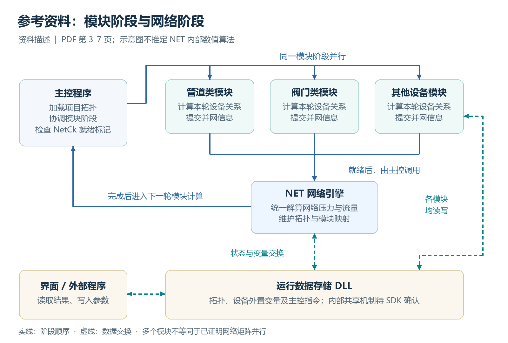
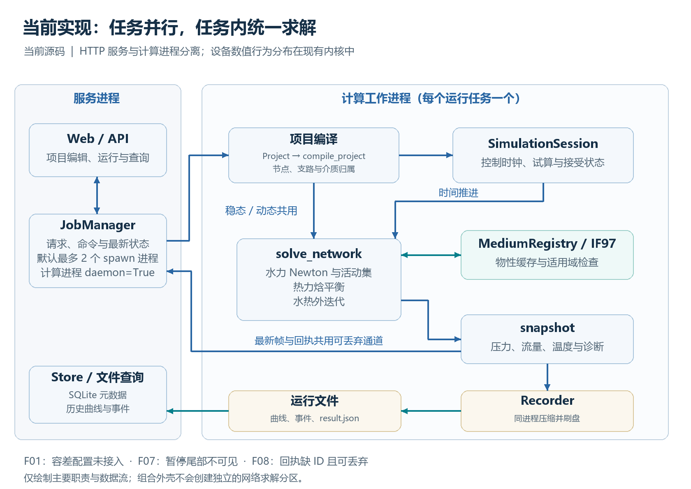
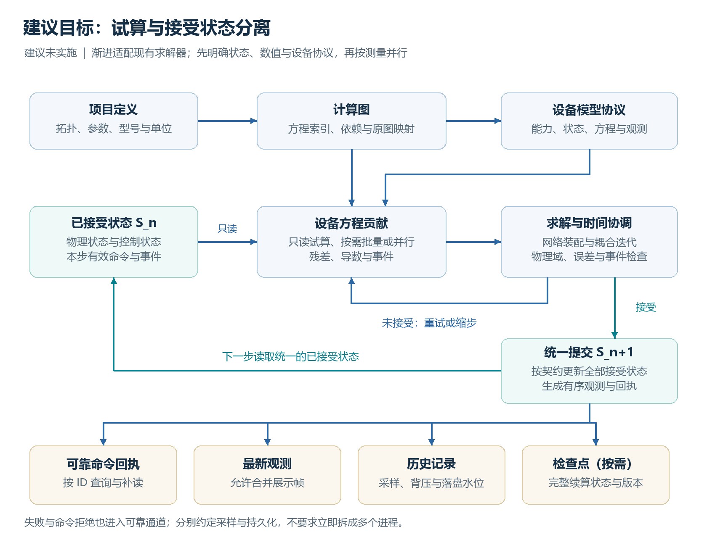

# FluidNet Studio 算法与架构评审报告

网页教程、流体网络算法说明与当前源码的对照分析

报告日期：2026 年 10 月 9 日  
评审版本：FluidNet Studio 0.2.0  
代码基线：1b846cd16c6cac2ee7c5373445a905a7468e6fee  
评审方式：资料阅读、架构图检查、静态源码追踪、隔离行为复核及后端回归  
交付范围：技术判断、差距清单、目标架构、实施顺序、验收设计与可复核证据  
报告状态：本轮评审完成；建议尚未实施

## 1. 主要结论与当前决策

**现有项目已经具备可运行的液态水网络计算内核。下一阶段应保留已有水力、热力和慢动态能力，优先统一数值判据、设备模型接口及运行状态语义，再增加单项目内部的并行调度。** 直接按界面分组拆分网络、简单增加进程数，不能替代这些工作。[C02-C07]

本次评审形成七项主要判断：

1. 参考资料最有价值的是职责划分：项目拓扑被转换为计算结构，设备提供局部物理关系，网络统一计算压力和流量，调度器控制计算阶段，运行数据层连接算法与外部应用。PDF 对这些关系有明确描述。[P，第 3-7 页]
2. 当前求解器采用压力与质量流量联立的稀疏 Newton 方法，配合物性外迭代、止回阀状态切换、水热耦合和慢动态推进。它已有真实的数值方法基础，适合渐进演进。[C03-C06]
3. 当前“两个任务并行”属于独立运行之间的并行。PDF 描述的重点还包括同一项目内设备模块的并行和同步，两者不能作为同一完成项。[P，第 3-4 页；C07]
4. 目前的组合设备是平铺物理网络上的封装、接口映射和型号复用。它没有形成可独立加载算法、声明状态量与方程贡献的通用设备模型协议。[C01-C02、C10]
5. 从静态代码已能确认：四个质量/压力容差配置没有进入求解判据；曲线压缩写盘仍发生在计算进程内；工作进程的 daemon 属性约束了后续嵌套多进程设计。这些应进入下一阶段的明确工作清单。[C01、C03、C07-C08；O04]
6. PDF 和教程不足以确定 NET 内部的离散格式、线性代数实现及稳定性细节。因此可以借鉴结构，不能据此声称已经复现其求解器，也不能得出双方精度或速度的高低结论。[P；B03]
7. 本轮补充复核确认：暂停期间未刷盘的曲线尾部不会因时间流逝自动进入历史查询；普通运行下的命令错误在 REST 状态和 WebSocket 中都没有 command_id；队列拥塞时回执还可能被丢弃。应先修正这些可观察行为，再扩大并行规模。[C07-C09；R02、R03、R05]

建议的技术推进顺序为：**数值契约与状态一致性 → 设备模型协议 → 运行数据通道 → 有测量依据的并行化 → 新物理模型。** 强制流量、封闭管段和可压缩流体分别作为物理能力增量管理。

本轮重新执行了 **42 项后端回归，全部通过**，并完成 **5 组隔离复核**。其中 R01、R05 使用原有求解器或真实接口；R02 使用可控时钟；R03、R04 使用队列拥塞或物理试算失败注入。后三者说明相应条件下的行为，不能推断生产环境中的发生频率。没有运行外部引擎对照、大规模性能测试或重新验收便携包；10 项浏览器测试与 12 项便携检查仍是上一轮记录。详细结果见第 14 节，来源见第 16 节。

建议先安排的事项是 F01（容差契约）、F07（暂停后的曲线尾部）和 F08（可关联、可靠的命令回执）；F04（控制与物理状态的提交边界）与这些工作一起明确。其余条目按设备扩展和性能目标逐步推进。

## 2. 评审范围、证据等级与阅读方法

### 2.1 本次实际阅读的材料

| 类别 | 实际阅读范围 | 用途 |
| --- | --- | --- |
| 本地 PDF | 全部 8 页正文，重点检查第 3-7 页架构、调用和数组截图 | 确定参考系统的职责分工与接口语义 |
| Baselu 网页 | 教程 1、2、3、5、6、7、9、11，《整体介绍》《产品化改进》 | 补充设备编写、物性、并网、部署、数据与调试流程 |
| 当前计算源码 | models、compiler、hydraulics、thermal、solver、simulation、media、jobs | 判断真实方程、迭代和执行边界 |
| 当前平台源码 | storage、modules、api、catalog，以及命令行入口 | 判断模型复用、持久化与对外接口 |
| 验证资料 | 测试源码、历史验收记录；本轮 42 项后端回归和 R01-R05 隔离复核 | 区分既有覆盖、已复核行为与待验收能力 |
| 方法参考 | EPA EPANET、SUNDIALS IDA、CoolProp、Python、FMI 官方资料 | 支撑未来方案的选择；不作为当前实现完成的证据 |

网页是动态页面，正文通过该网站公开文章接口读取。报告引用保留文章标题与 ID；文章中出现的版本或性能描述只代表该篇材料的陈述，未据此推定网站全部内容对应同一软件版本。完整来源索引见第 16 节。

### 2.2 五类结论必须区分

| 标记 | 含义 | 例子 |
| --- | --- | --- |
| 资料陈述 | PDF 或官方文章明确写出，但本次未独立验证 | 小项目约 200 次迭代/秒 |
| 源码事实 | 当前基线代码直接显示的行为 | 求解过程使用固定的缩放残差阈值 |
| 复核观察 | 在第 14 节说明的输入、环境或故障注入条件下实际观察到 | 命令错误通过状态接口返回时缺少命令 ID |
| 分析判断 | 由代码或架构关系推导出的影响 | 同步压缩写盘可能增加步长耗时抖动 |
| 设计建议 | 下一阶段可采用的方案 | 将历史记录交给独立记录器并设定背压规则 |

### 2.3 本次结论的边界

未取得参考 NET 引擎源码、完整 SDK、同工况对照输出、硬件性能记录或接口 ABI 文件。教程提到 pipe 通讯，但不足以确定各数据接口的内部共享机制及一致性协议。未进行用户正式项目迁移，未修改求解器或界面代码。补充验证使用内置示例和独立临时工作区；业务正确性的结论限于实际覆盖的算例。

项目状态文档末尾仍写有“没有 Git 仓库”，但本次已确认存在 Git，当前基线如封面所示。该文档中的功能和验收记录可作为历史记录使用，仓库状态应以实际检查为准。[C12]

## 3. 参考资料描述的算法与执行架构

### 3.1 整体分工



PDF 将执行系统分为主控程序、设备模块程序、运行数据存储 DLL 和 NET 网络计算 DLL。主控接收组网信息并建立运行环境；模块计算完成后，主控调用网络计算，再进入下一轮模块计算。外部界面通过数据接口读取结果和写入参数。[P，第 3-4 页]

这一结构允许设备算法与项目拓扑分开演进：项目主要描述实例及连接关系，设备实现负责其局部规律，网络引擎负责让全局约束同时成立。这里的“解析运行”主要指项目拓扑的加载与组装；教程 1 和 11 仍要求编译用户编写的设备算法。[B01、B11]

### 3.2 设备模块与全网求解的交界

教程 3 展示的管道流程是：处理实际流向与端口焓值、调用物性、计算支路特性，再通过并网函数提交给网络。公开接口覆盖管道、泵、阀、压缩机及止回阀等类型。[B03]

由这些接口可以确认设备与网络存在物理契约，但不能仅凭函数名称还原网络内部方程。流通能力系数、惯性系数、密度、泵压升等量的单位、符号、更新时间和有效范围，都需要完整接口文档支持。

一个适合当前项目采用的解释是：设备负责回答“给定端口状态与流量时，压降、换热、功率和状态变化是什么”；全网负责回答“什么压力与流量能让全部设备关系和节点守恒共同成立”。这是本报告建议的接口方向，不是对未公开 NET 源码的断言。

### 3.3 多线程、多进程与同步

PDF 标题使用“多线程”，结构图却显示多个模块 EXE；主控示例通过 NetCk 检查模块是否完成，再调用网络求解。教程 11 也展示模块独立进程。[P，第 3-4 页；B11]

因此应将其准确理解为“具有阶段同步的模块并行执行”。现有公开材料不足以确定每个 EXE 内部是否还有线程池，也不能证明网络矩阵求解本身已经分布到多个核心。

PDF 还提出轻量模块合并处理、重型模块单独处理。这提示并行任务应按计算量与依赖设计，而不宜机械地为每一个界面元件启动一个进程。[P，第 1 页]

### 3.4 拓扑的三个不同概念

| 概念 | PDF 中的含义 | 对当前设计的启发 |
| --- | --- | --- |
| 模块与通路 | 设备实例，以及设备内部某一条流动通道 | 一个设备可能贡献多条通路 |
| 计算支路 | 多个设备通路串联组成的路径 | 可建立串联压缩后的计算图 |
| 节点与压力源点 | 支路交汇位置，或由容积/边界提供压力的位置 | 需要与端口、界面分组明确区分 |

PDF 示例数组包括项目规模、支路信息、支路内成员和模块编号映射。文中提到同时 10 个项目、1110 个支路槽位、每支路 55 个串联单元和单项目 40000 个模块槽位。这些是该说明中的容量配置，不能直接当作经性能验证的规模，更不应直接复制成新系统的固定上限。[P，第 5-7 页]

另外，第 5 页正文称“四个数组”，截图圈出的输入还包括 NodeCheckId，共五个；第 6-7 页正文只逐项说明其中四个。截图不是完整头文件，也无法据此确认 ABI。若未来接入原引擎，需取得字段定义、维度、编号起点、数据所有权和返回码等完整说明，不应按截图直接声明调用签名。

### 3.5 运行数据层的意义

PDF 的数据存储接口可按项目、模块和变量名读写标量及数组。教程 5、6 进一步展示后台独立运行与外部程序交换数据的方式。[P，第 7-8 页；B05、B06]

此处值得借鉴的是：变量命名、运行状态、控制命令和计算结果拥有统一入口。DLL 只是接口载体；多个进程加载同一个 DLL，并不自动意味着它们共享同一份可变数据。共享方式与一致性协议仍需实现证据。

### 3.6 强制流量、可压缩性和封闭管段

PDF 陈述两类强制流量需求：设备内部强制输送，以及末端指定消耗；同时提出变密度长管道、调压相关稳定处理、两阀关闭后管段转为容积性质计算。[P，第 1-2 页]

这些能力分别涉及设备约束、节点边界、介质状态和储存状态，不能通过增加一个“介质名称”或统一的“流量输入框”一起完成。尤其是封闭管段，必须有能描述储质量与压力演变的状态方程。

### 3.7 物性接口与网络物理范围

教程 2 展示组分与质量分数输入，以及压力—焓值等状态计算；《整体介绍》同时注明两相流底层尚未完成。由此能确认材料提供了广泛物性接口，但不能推出任意气液混合网络已经具备完整求解能力。[B02、B00]

这一界限也适用于本项目：CoolProp 或其他库可以返回某种状态，仍需要对应的流动、换热、储存和事件模型配合。

### 3.8 性能陈述应怎样解读

PDF 写有小项目约 200 次/秒、大项目 30 次/秒以上及变量读写约 800 万次/秒的描述；后续网页又讨论电网高频运行、曲线刷新和调度资源占用。这些陈述的对象、版本和计量口径不同。[P，第 1、7 页；B07、BU]

本报告不将这些数字用作本项目的目标承诺。实际比较至少要说明：网络规模、设备复杂度、物性调用、非线性迭代数、时间步、误差标准、硬件、线程数、记录方式，以及是否包含界面和磁盘开销。

### 3.9 尚未公开、不能替资料补写的部分

公开材料没有完整说明 NET 的矩阵构造、非线性收敛准则、时间离散、雅可比处理、事件定位、可压缩管段离散和分区同步算法。本报告因此只复原可见的调用结构，不声称参考引擎采用 Newton、Hardy Cross、全局梯度法、某种 CFD 方法或其他特定数值内核。

## 4. 当前项目的实际分层



### 4.1 从项目到结果的链路

| 层次 | 主要代码 | 已有职责 |
| --- | --- | --- |
| 项目与工况 | models.py | 元件、连接、介质、组合、工况覆盖、求解选项 |
| 元件目录 | catalog.py | 端口、参数、单位、默认值和运行期间可调属性 |
| 拓扑编译 | compiler.py | 理想连接合并、回路归属、支路与边界建立 |
| 物性 | media.py | 单相液态水的压力—温度、压力—焓值查询 |
| 水力 | hydraulics.py | 局部设备规律、全网压力/流量联立求解 |
| 热力与耦合 | thermal.py、solver.py | 焓输运、换热、水热外迭代、结果组装 |
| 动态与控制 | simulation.py | 容积状态、管内热状态、控制周期、事件与内部步长 |
| 运行管理 | jobs.py | 计算进程、命令、状态、节奏控制 |
| 记录和项目库 | storage.py | SQLite 元数据、项目版本、结果文件、压缩曲线 |
| 型号与对外接口 | modules.py、api.py | 组合映射、型号版本、验证副本、HTTP/WebSocket |

这些分层已经提供了继续开发的基础。当前最明显的边界问题是：目录提供参数定义，而数值行为仍分布在水力、热力、动态和结果组装的多处类型判断中。新增一种真正不同的物理设备，往往需要修改多个核心文件。[C02-C06、C10-C11]

### 4.2 项目状态、运行状态与显示结果

当前至少存在三种不同数据：

1. 项目定义：可保存、版本化和应用工况的模型。
2. 运行状态：SimulationSession 中的水箱、管段热状态、控制器和热启动解。
3. 结果帧：将求解结果整理为可传给界面、写入文件和导出的字典。

这三种数据已有初步区分。运行时的项目副本与主画布编辑相互隔离，是应保留的设计；未来需要进一步定义它们的版本、生命周期和相互映射。[C01、C06-C09]

### 4.3 当前上限的真实含义

模型声明最多 1000 个元件、64 个记录变量、16 张画布；动态输入步长允许 0.001-60 秒，默认 0.1 秒；JobManager 默认允许两个运行任务并行。[C01、C07]

这些是配置和结构上限。1 ms 的可输入步长不代表每秒能实时完成 1000 步；1000 个元件也不代表已获得该规模的耗时或收敛保证。

## 5. 当前水力算法的详细分析

### 5.1 拓扑编译

编译器使用两套并查集：一套合并理想物理连接并形成压力节点，另一套追踪介质连通关系。换热器两侧的介质回路保持分离，而热力模型可以跨两侧耦合。端口重复使用、缺失、短接和介质冲突会被诊断。[C02]

当前 Branch 通常对应一个元件的一条内部通路；换热器和三通阀可贡献两条通路。它尚未将“管道—阀门—管道”等多个串联设备压缩为单一计算支路。

**评价：** 这种细粒度图易于追踪设备结果和错误位置。若以后做串联压缩，应保留设备级原图和结果回映射；同一界面组合可能包含分叉、容积和换热耦合，不能直接当作一条计算支路。

### 5.2 未知量与残差

以下方程由当前代码整理，用于说明实际算法。记 p 为非固定节点绝对压力，q 为支路质量流量，s 为节点质量注入。关联矩阵 A 对支路起点取 +1、终点取 -1。[C03]

    节点质量残差：r_m = A q - s
    支路压降残差：r_p = p_start - p_end - loss(q)
    未知量：x = [p_unknown, q]
    Newton 更新：J Δx = -r

固定压力节点不列入未知压力的质量平衡方程，其净供给流量由结果计算。关断支路使用 q = 0 约束代替压降方程。代码变量 energy 在此处代表缩放后的支路压差残差，并非热力能量残差。

在物性于本轮固定、设备损失可对 q 求导时，雅可比可写成：

    J = [ 0       A_u ]
        [ A_u^T  -D  ]

其中 D 为支路损失对质量流量的导数构成的对角部分。实际实现还包含未知量缩放、固定节点贡献和关断约束。每次求解将装配矩阵转换为 CSC 稀疏格式，再调用 spsolve。[C03]

### 5.3 设备水力关系

| 设备 | 当前关系或处理 | 应保留或明确的限制 |
| --- | --- | --- |
| 管道 | Darcy 压降、局部阻力与高差；层流使用线性关系 | 使用每支路代表性密度与黏度 |
| 摩阻 | 层流 64/Re；湍流迭代求 Colebrook；过渡区平滑连接 | 已提供相应导数，适合 Newton 装配 |
| 调节阀 | Kv、开度与质量流量形成二次压降关系 | 属液态水设备关系，不能直接用于可压缩气体 |
| 离心泵 | 扬程曲线 PCHIP 插值及转速缩放 | 迭代可作切线延伸；最终运行点检查曲线范围 |
| 止回阀 | 根据流向与压差更新开闭活动集 | 阈值固定，需要关注切换循环 |
| 定流量/需求 | 加入节点的质量源项或汇项 | 不是两端口压缩机或容积泵模型 |

以质量流量 q、横截面积 S 为记号，常见管道关系在当前实现中对应：

    Δp = (f L / D + K) q |q| / (2 ρ S²) + ρ g Δz

层流时沿程项化为与 q 成正比的关系。这里的 q 是 kg/s，而界面也可显示 m³/h；接入任何外部设备接口前必须显式换算，不能只匹配变量名称。[C03、C11]

### 5.4 非线性迭代与收敛

当前水力求解存在三层循环：压力—物性外迭代最多 12 次，止回阀活动集最多 24 次，内部 Newton 次数由 max_iterations 控制。Newton 使用残差平方和下降的回溯线搜索，并报告奇异矩阵、迭代超限和活动集循环等问题。[C03]

这是可解释、具有保护机制的求解路径。未来优化宜先定位物性、残差装配、稀疏求解与线搜索各自耗时，之后再决定批量计算或替换线性求解接口。

需要优先修正的是收敛契约：models.py 声明了 mass_atol、mass_rtol、pressure_atol、pressure_rtol，但当前水力判据未读取这四个配置，而使用固定的缩放无穷范数阈值 1e-10。接口允许设置这些量，却没有相应数值效果，是已确认的配置与实现不一致。[C01、C03]

建议分别检查质量与压力的物理残差，例如：

    |r_m,i| <= mass_atol + mass_rtol × S_m,i
    |r_p,j| <= pressure_atol + pressure_rtol × S_p,j

其中 S_m、S_p 是明确记录的参考尺度。具体默认值应在兼容现有结果的前提下确定，不应未经对照就直接放宽收敛条件。

### 5.5 物性更新与压力适用域

水力模块按支路两端平均压力和平均温度查询密度、黏度，再在本轮 Newton 中固定这些物性；下一层外迭代重新查询。这适合当前液态水的设计方向。[C03、C14]

扩展到可压缩气体时，密度对压力的敏感性、沿程状态变化和可能的临界流都需独立设计。仅将 IF97Water 换成另一个物性对象，不能完成这类扩展。

另一个需验证的边界是：线搜索主要约束残差下降，物性有效域检查发生在物性更新和最终检查阶段。对于接近相界或低压极限的工况，建议增加候选状态有效性处理，避免把物理越界与数学不收敛混为一类。[C03、C14]

### 5.6 与其他水网算法的关系

EPA EPANET 的官方算法文档可作为后续水力基准和算法阅读来源，但本项目代码不能直接称为“已经实现 EPANET 全局梯度法”。当前明确可见的是压力—流量联立的稀疏 Newton 装配。[C03；O01]

未来可以研究节点消元、稀疏模式重用或串联支路压缩。每一项都应验证设备状态切换、结果回映射和守恒，而不是仅比较矩阵尺寸。

## 6. 当前热力、慢动态与控制算法

### 6.1 热力变量与耦合

热力模块以节点比焓为主要未知量，根据实际流向选上游状态。它将管段换热、加热器、温度调节设备、泵功和换热器关系装配为焓平衡，再迭代更新物性。水力与热力在外层交替求解，直到温度与流量变化满足条件。[C04-C05]

换热器使用逆流形式的有效度—传热单元数关系，两侧水力回路独立，但热量交换相互耦合。由此可见：介质回路互不连通，不代表整个耦合问题可以完全独立并行。

### 6.2 管内热输运

动态管道将热状态分成若干单元，保存各单元焓值与固定单元质量。按代码可整理为带上游输运和环境换热的隐式更新：

    (M_cell/Δt + |q| + G_h) h_new
        = M_cell/Δt × h_old + |q| × h_upstream,new + G_h × h_env + 其他项

其中 G_h 由换热能力与比热换算而来。实际反向流动会反转单元遍历次序，接受状态后恢复存储方向。它描述管内热惯性与输运，不包含支路流量的惯性微分方程。[C04、C06]

### 6.3 容积设备

水箱状态保存质量、比焓与密度。质量由本步净流量更新，焓由流入流出和热量项更新；容积与网络在步内迭代，收敛后提交。[C06]

开式水箱以表面压力和液位静压形成边界。气垫蓄水罐使用气体体积的多变关系计算表面压力，但流动介质仍是水。该模型不能被描述为已具有通用气体网络、完整气体能量方程或封闭气液瞬态能力。[C03、C11、C14]

### 6.4 时间步、重试与精度

SimulationSession 会在控制事件边界分段；步内不收敛时减小试探步长；到达空箱或满箱边界时尝试逼近事件并暂停。[C06]

需要区分两种能力：当前具备“失败后缩步”的数值恢复机制，但未看到针对每个成功步的局部截断误差估计。因此目前不能称为具有严格误差控制的通用自适应积分器。

若将来需要更一般的微分—代数系统，可评估 SUNDIALS IDA 一类包含隐式积分、非线性求解和误差控制的工具；是否采用，应由所需物理模型和接口成本决定。[O02]

### 6.5 控制器与状态一致性

当前 PID 具备采样周期、输出限幅和积分处理，定时控制也能使时间推进对齐事件边界。控制计算在物理试探步之前执行，水箱及管道物理状态则在成功后提交。[C06]

R04 在第一次物理试算处注入连续失败后，物理时间仍为 0 s，管道与水箱状态不变；但 PID 的 next_time_s 已变为 0.1 s，泵转速比从 1 变为约 0.983608，最后有效帧中的控制输出仍为 1。当前失败任务会结束，这不等于已经复现了续算错误；它说明“接受状态原子性”的范围尚未覆盖全部控制状态。应明确控制更新属于当前时刻的已接受离散事件，还是需要随试算一起回滚，并让状态、事件和输出遵守同一约定。[R04]

### 6.6 热力判据的扩展问题

热力迭代将温度容差乘固定 3500，作为焓变化阈值；最终另做能量平衡检查。这个处理与当前水介质范围有关，但不宜直接成为未来多介质统一判据。[C04]

建议为温度、比焓、能量残差分别设置有单位的尺度或容差，使用实际状态对应的热容或直接温度差判断，并在结果中报告最终接受原因。

## 7. 能力与差距对照矩阵

本表的“参考材料”表示材料中的陈述；不等同于本次独立验证的能力。“缺口”也不意味着当前液态水版本违反原有范围，而是判断下一阶段工作量的依据。

| 维度 | 参考材料 | 当前项目 | 结论 |
| --- | --- | --- | --- |
| 项目加载 | 解析拓扑及模块映射 | Project、连接和介质编译 | 已有同类职责 |
| 计算图 | 支路可包含多个串联通路 | 通常一个设备通路对应一个 Branch | 粒度不同，可后续优化 |
| 设备规律 | 编译模块通过并网接口提交 | 内置类型分支实现 | 缺通用模型协议 |
| 全网联动 | NET 统一计算节点和流量 | 稀疏压力—流量求解 | 核心能力已存在 |
| 设备并行 | 模块计算阶段并行并同步 | 单任务内未实现这层调度 | 架构增量 |
| 多任务并行 | 支持多个项目运行 | 默认两个进程 | 已有，但不等同设备并行 |
| 物性 | 组分与多种状态接口 | 单相纯液态水 IF97 | 物性与流动模型均需扩展 |
| 两端口强制流量 | 压缩机等并网接口 | 仅节点指定流量和需求 | 尚缺设备约束 |
| 封闭管段 | 关阀后转为容积性质 | 无压力参考时诊断退出 | 尚缺储质量和压力状态 |
| 流动惯性 | 公开并网参数包含惯性系数 | 水力按每步平衡处理 | 不能据现状声称支持水锤 |
| 慢动态 | 材料描述模块循环与步进 | 水箱、管内热状态和控制 | 已实现明确子集 |
| 型号复用 | 参数型号、运行值交换 | 版本化型号与独立实例 | 平台能力已较完整 |
| 运行变量 | 统一变量读写层 | Session、结果帧、任务命令 | 尚需正式运行数据契约 |
| 曲线与界面 | 高频数据及显示解耦的陈述 | 约 0.1 秒推送间隔、分块记录 | 已部分解耦，写盘仍同步 |
| 重启 | PDF 未详细定义工况恢复 | 项目和历史持久化，活动任务标中断 | 不等同运行状态续算 |
| 外部算法 | DLL、EXE 等集成流程 | 尚无通用外部模型协议 | 可作为后续独立阶段 |

证据：P 第 1-8 页；B01-B03、B05-B07、B09；C01-C11、C14。

## 8. 评审发现、复核结果与优先级

优先级按下一阶段开发顺序划分：P0 为应先消除的契约不一致；P1 为现有交互修正及扩大算法能力前的基础；P2 为性能和通用化候选项。这里的 P0 是开发顺序，不是线上事故等级。R01-R05 是用于观察问题的复核，不计入“42 项产品回归通过”；尚未运行的验收均明确标为建议。

### 8.1 F01：质量与压力容差配置未生效

**性质：已确认的配置—实现不一致；优先级 P0。**

证据：models.py 第 132-135 行声明四个容差；源码检索显示它们没有在计算路径中被读取。hydraulics.py 第 268、284 行使用固定 1e-10 缩放阈值。[C01、C03]

复核：在内置并联网中，分别把四个字段调严和调宽，共 8 个单字段变体与默认配置比较；压力、流量和完整迭代历史均完全相同，每次 11 次迭代。相同输出本身不足以证明字段无效，结论以源码未读取这些字段为主要依据，运行结果作为佐证。[R01]

影响：调用方无法通过这些参数控制相应接受判据；不同量级网络的收敛要求也不够透明。

建议：建立唯一的收敛判据模块，区分缩放残差与物理残差，写入每次运行的实际配置和接受原因。

后续验收：为质量、压力和关闭支路的零流量约束分别构造位于两套容差之间的残差，验证接受/拒绝发生预期变化；默认配置保持已有参考精度；不同量级模型不会因外部显示单位变换改变物理判断。不要求每个普通算例在调整容差后都改变迭代次数。

### 8.2 F02：工作进程的 daemon 属性限制嵌套进程

**性质：已确认的架构约束；优先级 P1。**

证据：jobs.py 第 202 行创建计算进程时设置 daemon=True。Python multiprocessing 对此类进程创建子进程有明确限制。[C07；O04]

影响：未来直接在每个工作进程内部加入 multiprocessing.Pool 或同类进程池，可能因进程层级规则无法启动。此限制不等于所有 native 线程或外部进程调用都被禁止，也不表示当前两任务运行有错。

建议：选择由顶层管理共享工作池，或改为非 daemon 的受管理运行进程，并补齐子任务退出、取消与资源回收。先确定进程所有权，再实现设备并行。

后续验收：停止项目、服务退出和异常退出后，所有所属计算任务都有明确归宿；多个项目不会相互终止对方的工作进程。

### 8.3 F03：设备参数接口与数值模型接口尚未统一

**性质：已确认的扩展性缺口；优先级 P1。**

证据：目录、编译、水力、热力、动态和结果组装中均存在按类型判断；组合接口只映射端口和参数。[C02-C06、C10-C11]

影响：加入新设备需要了解并修改多处核心代码；设备独立验证、并行执行与外部模型接入难以复用同一个契约。

建议：先将现有管道、阀和泵迁移到统一模型协议，保留原求解器；协议覆盖残差、导数、状态量、事件和物性需求，详见第 9 节。

后续验收：新增一种遵守现有物理域的设备时，不需要修改中央求解器的设备类型分支。

### 8.4 F04：完整状态事务边界尚未定义

**性质：故障注入已观察到控制与物理状态提交边界不同；业务后果仍需按运行契约界定；优先级 P1。**

证据：物理状态在试探成功后提交；控制器和参数可在试探前更新。暂停、停止和命令记录由工作进程另一层管理。[C06-C07]

复核：R04 连续拒绝 10 次物理试算后，控制器与目标参数已更新，时间和物理状态仍在 0 s；最后有效帧保留旧控制输出。普通项目的自然失败频率未测量，也未声称现有失败任务可直接续算。[R04]

影响：新增带内部积分器或外部副作用的设备后，失败重试、回滚和命令重放可能读取不一致的状态。

建议：以“接受的时间点”为事务边界，区分输入命令、控制更新、试探状态、已接受状态和观测输出。设备试算不得自行发布结果、写外部设备或重复累积时间状态。

后续验收：同一接受状态出发的重试可重现；失败后能明确指出哪些状态保持、哪些命令已应用；单步仅发布约定数量的接受结果。

### 8.5 F05：内部缩步缺少独立的时间误差估计

**性质：已确认的能力边界；优先级 P1，随动态精度需求推进。**

证据：advance 中因 ConvergenceError 减半步长，未见成功步的局部截断误差估计。[C06]

影响：能够收敛不等于时间离散误差满足指定精度；较大步长仍可能平滑掉重要动态。

建议：先明确慢动态的精度目标，并做步长收敛研究；后续选择步长加密估计或适合 DAE 的积分器。保持非线性误差与时间误差两套独立指标。[O02]

### 8.6 F06：压缩记录位于计算关键路径

**性质：代码事实及潜在性能风险；优先级 P1。**

证据：每个公开推进结果调用 Recorder.append；append 发现已有 1000 行或距上次刷盘至少 2 秒时，同进程执行压缩写盘。这是追加时检查的阈值，不是独立定时器。未看到独立记录线程或记录进程。[C07-C08]

影响：磁盘、压缩和文件替换耗时可能形成步长尾延迟。当前数据是否足以造成可见卡顿，本次没有性能证据。

建议：先记录各阶段耗时；有需要时将压缩与落盘移出求解关键路径，并明确队列容量、丢弃策略和停止时的刷盘保证。

### 8.7 F07：历史曲线与最新帧具有不同的新鲜度

**性质：源码与可控时钟复核均确认的可见性缺口；优先级 P1，建议本阶段修正。**

证据：最新帧约每 0.1 秒尝试推送，而 history 读取的是已经落盘的曲线分块，没有合并 Recorder 当前内存中的尾部；每个 advance 返回后记录一次，内部细分步并非全部单独记录。[C07-C09]

复核：R02 追加一行后把时钟推进 10 秒，不再追加，历史查询仍为 0 行；显式 flush 后成为 1 行。暂停分支不调用 append 或 flush，因此暂停期间的尾部等待可以超过 2 秒，直到后续追加触发刷盘或正常终止刷盘。[R02]

影响：初始化、单步或暂停后，当前状态可能已有数据而曲线仍缺最新点；控制事件或内部缩步附近的细节也不一定在公开曲线采样中。

建议：给每类数据标注仿真时间、序号、采样策略和落盘水位；按需提供内存尾部与磁盘历史合并查询。记录“输出采样点”和“内部接受步”两种模式，不默认无限保存全部内部迭代。

### 8.8 F08：命令回执会丢弃，且实时状态未保留命令 ID

**性质：真实接口复核与拥塞注入均已确认；优先级 P1，建议本阶段修正。**

证据：jobs.py 第 28-36、83-89 行把普通帧、命令成功和命令错误放入同一个可丢弃通道。第 213-217 行消费消息时不保留 command_id，state 第 156-163 行也不返回它；WebSocket 发送的正是 state。命令事件另写入 events.json，可按 ID 补查。[C07、C09]

复核：R03 注入容量 16 且已满的输出队列，成功和失败回执均被丢弃，事件文件保留两条记录。R05 在没有拥塞注入的真实 HTTP/WebSocket 流程中，HTTP 202 返回 command_id，但之后的命令错误在两种状态接口中都没有这个 ID；事件查询保留该 ID。[R03、R05]

影响：调用方不能仅依靠实时状态把多个在途命令与各自结果一一对应；队列拥塞或最新帧覆盖错误时，还可能错过及时反馈。HTTP 的“已接收”应与工作进程的“已应用/已拒绝”明确区分。

建议：命令回执、终态和错误走可靠通道；展示帧允许合并为最新值。命令状态区分接收、应用、拒绝，带 command_id 和生效仿真时刻。

后续验收：连续发送多个有效、无效命令，逐条按 ID 得到结果；展示队列满、断开重连和暂停时回执仍能补读。初次 HTTP 202 不得作为参数已生效的依据。

### 8.9 F09：持久化结果不等于动态续算检查点

**性质：已确认的功能边界；优先级 P1/P2，按需求选择。**

证据：启动 Store 时把遗留活动运行标记为 interrupted；存储项目、请求、帧和曲线，但没有完整恢复 Session 的管段热分布、控制状态和求解历史的续算入口。[C06、C08]

建议：如果需要断点续算，单独定义版本化检查点；如果只需回看结果，继续明确“历史恢复”与“继续计算”的区别。不要把完整检查点和界面结果帧混用。

### 8.10 F10：性能优化尚缺阶段性测量

**性质：可见成本，未证明是瓶颈；优先级 P2。**

可见候选成本包括多层迭代中重复物性查询、曲线对象构造、稀疏结构装配、字典快照与深复制，以及同步记录。物性已有缓存，不能假定每次调用都会落到后端。[C03-C08、C14]

建议：先按编译、物性、设备规律、装配、线性解算、热力、快照、传输与记录分项计时；只优化占比高、可保持结果一致的部分。

### 8.11 F11：封闭管段、两端口强制流量属于独立物理增量

**性质：已确认的范围缺口；优先级随目标算例确定。**

当前无压力参考的隔离区域会报错，现有流量源是单端口节点边界。若下一阶段要模拟两阀关闭后的储压过程、容积泵或压缩机，必须增加状态或约束；不能用自动补一个定压边界来伪造封闭管段行为。[C03、C11；P，第 1-2 页]

### 8.12 F12：统一数值扩展需要消除隐式介质假设

**性质：已确认的扩展前提；优先级 P1。**

当前液态水范围明确，物性层也拒绝不支持的介质，这一点应保留。扩展时需要同时检查热力容差转换、平均密度支路、固定管段质量、容积能量记账和端口压力约定。[C03-C06、C14]

不能仅放开介质下拉项或扩大物性库名称。每新增一个物理域，应带有对应能力标记、适用范围、守恒验证和失败诊断。

## 9. 建议的目标架构与设备协议

### 9.1 分层目标



建议保持七个清晰层次：

1. **项目定义层**：保存用户模型、工况、型号版本、端口和单位。
2. **计算图层**：保存节点、设备通路、状态量、依赖和原图回映射。
3. **设备模型层**：声明能力并提供方程、导数和事件。
4. **求解协调层**：组装残差、管理耦合迭代、判断收敛。
5. **时间与调度层**：管理控制时钟、试探步、事件和任务执行。
6. **运行数据层**：管理接受状态、命令、观测快照和检查点。
7. **服务与持久化层**：对接界面、HTTP/WebSocket、项目库和历史文件。

这些是逻辑职责，初期无需拆成七个服务或进程。可以先用模块和明确的数据结构完成分层，再根据测量决定进程边界。

### 9.2 设备描述需要声明什么

| 项目 | 建议字段 | 目的 |
| --- | --- | --- |
| 身份 | type_id、model_version、参数 schema 版本 | 模型升级可追踪 |
| 端口 | 稳定 ID、物理域、通路、符号约定 | 编译器可建立连接与约束 |
| 参数 | 单位、范围、默认值、运行可调性 | 防止隐式单位与失效状态 |
| 状态 | 连续状态、离散状态、初始值、可恢复性 | 支持时间推进和回滚 |
| 能力 | 稳态、慢动态、反向流、介质与相态 | 阻止不适用模型进入求解 |
| 数值 | 残差、偏导、尺度、有效域 | 统一装配与收敛 |
| 依赖 | 读取哪些端口/信号，是否即时反馈 | 建立调度依赖图 |
| 执行 | 可重入性、批量能力、是否需要进程隔离 | 支持可靠的并行选择 |
| 结果 | 可观测变量、单位、标签 | 替代中心化结果类型判断 |

接口应先服务现有算法，不宜一开始就要求所有设备实现任意高阶 DAE。可以保留“代数两端口”“容积状态”“信号控制”几个明确的模型类别，之后逐步泛化。

### 9.3 建议的最小方法集合

以下为接口草案，不是已写入仓库的实现：

    describe() -> ModelDescriptor
    validate(parameters, medium_capabilities) -> Diagnostics
    initialize(parameters, boundary_state) -> InitialState
    evaluate(context, state_readonly) -> EquationContribution
    event_indicators(context, state) -> EventValues
    observe(context, accepted_state) -> ObservableValues
    serialize_state(accepted_state) -> CheckpointPart
    restore_state(checkpoint_part) -> AcceptedState

EquationContribution 可先提供现有算法需要的压降及对流量偏导、焓传递关系、源项和状态更新残差。以后再扩展到对端口压力、焓值、组分和状态量的偏导。

**试算约束：** evaluate 使用只读输入；对同一输入不重复推进内部时间；不直接修改公共接受状态，不做磁盘写入或外部设备控制。提交由协调器统一决定。

### 9.4 参数型号、组合模型和可执行模型的关系

应保留三种不同复用方式：

- 参数型号：复用同一种模型的一组参数。
- 组合模型：复用一组已知模型的连接与接口。
- 可执行模型：提供新的物理规律与状态。

当前版本已实现前两类的重要能力。第三类应通过正式模型协议加入，而不应把任意算法代码塞入现有参数字典或型号 JSON。[C10]

### 9.5 计算图与用户图双层保存

用户图应继续保留所有元件、端口和结果位置。编译图可以采用整数索引和连续数组，并在适用时压缩串联支路。每个计算节点、方程和状态都应能映射回元件或端口。

串联压缩仅在中间没有质量注入、独立储存状态或不可忽略耦合时使用。压缩后的局部损失与导数可求和，但设备内温度、压降、测点和反向状态仍需回算。含关闭阀或约束切换时，必须更新相关映射与求解结构。

## 10. 并行调度与时间协调

### 10.1 四个不同的时间或循环概念

| 概念 | 含义 | 应由谁管理 |
| --- | --- | --- |
| 物理时间步 Δt | 仿真时间从 t_n 到 t_n+1 | 时间推进器 |
| 步内迭代 k | 为同一个时间点寻找一致解 | 求解协调器 |
| 控制采样周期 | PID、定时逻辑或外部控制更新时刻 | 控制调度器 |
| 显示/记录频率 | 发布和保存已接受状态的节奏 | 观测及记录层 |

一次步内迭代不能被误当成物理时间前进；一次设备重算也不能重复积分设备内部状态。这是将参考资料的阶段循环用于现有动态框架时最需要明确的规则。

### 10.2 一次接受步的建议流程

    1. 读取最近已接受状态 S_n，选择目标时刻和事件边界。
    2. 暂存本步有效的命令与控制输入。
    3. 建立试探状态；令 k = 0。
    4. 根据依赖，批量或并行计算设备方程贡献。
    5. 等待本轮必要贡献完成，统一装配并求解网络。
    6. 更新热力、容积和耦合状态，检查物理域及残差。
    7. 未收敛：更新试探值并重复 4-6；必要时缩步或拒绝。
    8. 检查时间误差与事件；通过后统一提交 S_n+1。
    9. 发布可靠状态变更及可合并展示帧，异步记录。

此流程是建议架构。它不声称 PDF 的 NET 内部采用相同的非线性或时间积分方法。

### 10.3 并行化的合理顺序

| 候选层次 | 适用情况 | 建议 |
| --- | --- | --- |
| 独立项目/工况 | 参数扫描、工况比较 | 延续已有任务并行 |
| 完全独立子问题 | 没有质量、热量、信号即时耦合 | 由编译图识别 |
| 同轮设备规律 | 输入状态一致，输出贡献彼此独立 | 先批量，再按成本并行 |
| 耦合设备子系统 | 强依赖或不同时间尺度 | 明确通信步长与迭代 |
| 稀疏线性代数 | 线性求解确为主要耗时 | 测量后选择后端 |

不要按画布页面或组合外壳直接切网。水力分离的换热器两侧仍有热耦合，PID 也可能跨设备建立依赖；这些关系必须进入调度图。

### 10.4 线程、进程与批量的选择

轻量设备逐个派发的调度成本可能超过其计算量。建议先将同类设备参数整理为数组，再评估批量执行。对线程安全、可释放解释器锁的本地计算可评估线程；对需要隔离或不具备线程安全保证的外部模型可评估进程。

物性后端的重入性和实例所有权需要查证；不能在未确认时让多个工作线程共享一个可变物性对象。工作池应复用，避免每个时间步反复创建。

当前 spsolve 解决的是稀疏线性方程；仅使用这个函数不能推出单次解算已经充分利用多核。并行能力与所用后端、构建和问题规模相关，应通过测量确认。[O06]

### 10.5 收益估计与全机资源

并行规划应记录串行占比。例如，若可并行部分仅占单步耗时 40%，即使该部分瞬间完成，总加速上限也只有 1/0.6，约 1.67 倍。这只是计算示例，不是对本项目的性能测量。

建议建立全局 CPU 配额，限制“项目进程数 × 每项目工作线程数 × 数值库线程数”的叠加。评价平均耗时之外，还应观察 p95/p99 步长耗时、停止延迟、内存和队列积压。

## 11. 运行数据、记录与外部接口

### 11.1 将数据分成四条用途明确的通道

| 数据 | 主要要求 | 建议载体 |
| --- | --- | --- |
| 控制命令、错误、终态 | 可靠、可确认、可追踪 | 有序命令队列与回执 |
| 已接受的最新观测 | 低延迟，可合并旧帧 | 内存快照或有界队列 |
| 选定历史序列 | 采样明确、可补读 | 环形缓冲与异步分块存储 |
| 完整续算状态 | 版本一致、原子保存 | 检查点文件及模型标识 |

SQLite 继续适合项目、型号、索引和运行元数据。它不必承担所有设备每次迭代的变量交换。另一方面，PDF 中的高速数据 DLL 也不能直接替代项目版本和长期历史存储。[C08；P，第 7-8 页]

### 11.2 变量地址与数值存储

对外保留“项目/运行、元件、通路、变量”的可读地址；编译时映射为整数句柄和数组位置。避免热循环中反复拆分长字符串、扫描元件列表或创建大量小字典。

每个变量至少具备：单位、数据类型、形状、所属模型版本、读写权限、可修改阶段、有效性与更新时间。多值写入应支持同一仿真时刻原子应用，避免上游压力已改而温度仍是旧值的中间状态。

建议始终使用 Pa、K、kg/s、J/kg 等内部单位；外部使用 MPa、摄氏度或 kJ/kg 时由适配器明确转换。参考材料中的部分物性和泵接口使用的单位与当前代码不同。[B02-B03；C03、C14]

### 11.3 快照、序号与错误传播

观测帧建议带有 run_id、state_sequence、simulation_time、model_revision、validity 和 provenance。展示帧丢弃时，应能知道存在序号跳跃；命令确认不能因展示队列拥塞而静默丢失。

设备异常应转换为结构化诊断，包含元件、通路、状态输入、物理域、数值阶段和可采取的恢复方式。应避免把“模型物理域不适用”“方程无解”“线性求解失败”“达到时间误差上限”都压成“计算失败”。

### 11.4 记录与检查点

记录策略应允许指定采样周期、事件强制采样、关键变量集合与保存时长。记录器受限时，需要预先选择暂停计算、降低非关键记录或报错，而不是没有上限地积压内存。

例如 64 个 double 变量按 1000 Hz 增量采样，纯数值载荷约为 512000 字节/秒，尚未计入时间戳、元数据和协议成本。这个量与“每次重新读取完整历史窗口”的带宽是不同概念，性能指标应分别报告。

完整检查点建议保存物理状态、控制器状态、事件日程、有效参数、随机状态（如适用）、模型版本及编译图标识。热启动解可作为加速信息；是否必须恢复由求解器约定。一个供界面展示的结果帧通常不够完成续算。

### 11.5 外部模型与 FMI

短期先完成内部模型协议。确实存在 MATLAB、厂商设备模型或跨工具联合仿真需求时，再考虑适配外部 EXE、DLL 或 FMI。

FMI 官方规范区分 Model Exchange、Co-Simulation 和 Scheduled Execution，并对状态、时钟和生命周期作出约定；它可供接口设计参考，但采用 FMI 不会自动解决强耦合稳定性、步长选择和回滚问题。[O05]

## 12. 物理能力演进建议

### 12.1 第一类：两端口强制流量设备

现有 flow_boundary 是节点源项；两端口设备需要在入口与出口之间施加流量约束，由网络解出设备所需压差，并处理反向、启停、工作范围和功率。[C03、C11]

建议先实现有明确适用范围的理想定流量输送设备，再引入压差上限或性能曲线。压缩机还涉及入口密度、容积效率、压缩功和热状态，不应作为同一个简化元件直接泛化。

关键验收：全网质量守恒；给定流量下压差和功率定义一致；达到工作范围边界时有确定行为；与其他边界冲突时能指出过约束。

### 12.2 第二类：封闭管段与储压状态

两阀关闭后若要继续预测绝对压力，需要储质量、容积、温度/能量和可压缩性之间的关系。纯代数水力方程无法凭空确定封闭区域的绝对压力。

建议从集中参数容积开始：明确刚性或弹性容器、液体体积弹性模量、热膨胀、外界热交换和边界开关事件。重新连通时处理守恒和状态投影，避免无依据地重置压力。

关键验收：关闭与重新开启前后质量守恒；温度变化引起压力变化的方向正确；零流动下状态定义明确；事件时刻的能量记账与模型假设一致。

### 12.3 第三类：单相可压缩流体

建议将“单相气体稳态”与“气体动态”分别立项。稳态需要沿程变密度、压降模型和设备工作域；动态还需要质量、能量、必要的动量储存，以及合适的时间离散。

物性协议应提供一致的状态对、必要导数、组分与有效域。若出现临界流、强压比或高速工况，必须选择对应模型，不能无限外推低速管网规律。

关键验收：有明确适用域的解析或公开基准；压力、温度、质量流率的单位一致；状态方程与能量方程相容；逐级扩大复杂度。

### 12.4 第四类：水锤与两相流

这些能力需要不同层次的方程、离散和验证，应设为独立研发范围。现有热单元不能等同水力瞬态网格；物性返回气液质量比例也不能等同两相动量和传热模型。[C04、C06；B00]

若当前目标仍是暖通水系统运行和慢动态控制，优先把该范围内的数值一致性、设备复用和性能做好，再根据具体算例选择下一物理域。

## 13. 可实施的工作包与完成条件

### 13.1 推进顺序

以下为下一阶段实施建议，**本轮没有实现这些工作包**。完成一个工作包时，应同时交付行为说明、可运行示例及相应验收证据；不能仅以类名、接口文件或进程数增加判定完成。

| 顺序 | 工作包与对应发现 | 具体交付 | 完成条件 |
| --- | --- | --- | --- |
| W0 | 数值契约，F01 | 独立的质量、压力、关闭支路约束判据；可追踪的实际容差与接受原因 | 四个配置确实进入判据；临界残差案例可解释地接受/拒绝；默认算例精度未退化 |
| W1 | 当前交互和状态边界，F04/F07/F08 | 按 ID 查询命令结果；暂停/单步时可读取曲线尾部；控制事件与物理状态的提交约定 | 有效/无效命令都可关联并补查；暂停后最新采样点可见；故障重试和失败结果的状态含义一致 |
| W2 | 设备模型协议，F03 | 模型描述、能力、单位、方程贡献、状态与观测接口；先适配管道、阀和泵 | 三类设备及其组合结果保持一致；新增同类代数设备无需改中央类型分支；有反向流和关闭状态案例 |
| W3 | 运行数据与记录，F06/F09 | 区分命令、最新帧、历史与检查点；按测量决定是否异步记录 | 记录队列容量明确；正常停止刷盘完整；异常退出能识别未持久化范围；若实现续算，检查点含完整必要状态 |
| W4 | 性能测量与并行，F02/F10 | 分阶段计时、固定输入集、资源预算；仅对有收益的计算阶段并行 | 同一输入在不同调度下守恒、事件与结果一致；给出实际加速与成本；取消和退出后无所属任务遗留 |
| W5 | 新物理域，F11/F12 | 以明确算例选择两端口强制流量、封闭容积或单相气体之一 | 有独立方程和适用域；通过解析或外部参考；失败诊断可定位；通过前不宣称已支持该物理域 |

W0、W1 应先完成。W2 不需要等待复杂并行方案；W3 中的接口分工可以先确定，记录器是否拆进程由测量决定。W4 开始实现并行之前需要 W2 的只读试算约定和 W1 的状态语义。W5 应按具体使用需求逐项选择，避免把所有物理扩展捆成一次重写。

### 13.2 数值契约必须写清的细节

建议把每类残差的单位、绝对容差、相对容差、参考尺度和最终最大超差位置写入运行结果。参考尺度不能只用一个全局数值：节点质量守恒、开放支路压降和关闭支路的零流量约束具有不同物理含义。压力相对尺度应说明是否基于局部压降或约定参考压差，避免仅因绝对压力较高而放宽小压降设备的判据。

当前固定缩放阈值往往比声明的默认物理容差更严。接通配置时，不能直接把“迭代次数减少”视为改进；先比较参考解、物理残差、活动集状态和失败诊断，再决定默认值或兼容策略。水热外迭代的流量变化阈值、热力能量检查与动态步内收敛也应登记为各自的判据，不能用水力容差替代所有数值控制。[C03-C06]

### 13.3 命令和暂停行为的最小修正范围

一个命令应至少经历“已接收”以及“已应用/已拒绝”两类状态，并保留 command_id、运行 ID、生效仿真时刻和诊断。命令记录可以继续持久化到现有事件层，但实时接口需要按 ID 提供同样的含义；单个 last_error 字段不能充当多个命令的结果集合。

曲线尾部可以通过暂停时刷盘、定时刷盘或合并内存尾部实现可见，具体方案应服从停止保证和成本。即使采用暂停时刷盘，也仍需明确“最新帧时间”“历史最后采样时间”和“已落盘时间”的区别。初始化帧是否应出现在曲线中、一次外部单步是否包含多个内部接受步，也应写入接口约定。

### 13.4 迁移与回退

保留当前项目和型号 schema 的职责；运行时的数组、方程或检查点格式另行版本化。先通过适配器调用旧设备规律，再逐个迁移设备，避免同时更换拓扑、设备接口、线性求解器与时间积分器而失去对照基线。

每次迁移应保存同一输入的前后结果、容差、依赖版本和求解器版本。已有型号版本应用的原子性、外部接口重绑定、独立验证台和数据库备份规则应继续保留。正式数据升级仍需单独安排，评审使用的临时工作区不能作为用户数据迁移已完成的证据。[C10、C12-C13]

## 14. 本轮验证与后续验收设计

### 14.1 本轮实际执行结果

本轮输入来自仓库内置示例；代码基线为报告封面的 Git 提交。隔离复核脚本会记录 Python/平台信息、源码 SHA-256 和独立工作目录，原始记录见 [复核结果](evidence/review-probes.json)。`observed: true` 表示观察到了描述的限制，**不是对应产品能力验收通过**。

| 记录 | 方法 | 实际观察 | 结论边界 |
| --- | --- | --- | --- |
| 后端回归 | `npm test -- -q --junitxml=output/reports/evidence/backend-regression.xml` | 42 项通过，0 失败，0 跳过；pytest 报告 11.45 s | 验证既有覆盖；总测试时间包含接口与进程启动，不能作为求解性能指标 |
| R01 / F01 | 原有水力求解器；四个容差各取严、宽两值，单字段改变 | 8 个变体与默认解的压力、流量及迭代历史完全相同；均 11 次迭代 | 与字段未读取的源码事实相互印证；输出相同本身不是无效配置的充分证明 |
| R02 / F07 | 原有 Recorder 与 history；时钟注入推进 10 s | 内存 1 行、历史 0 行；显式刷盘后历史 1 行 | 证明没有独立的时间触发刷盘；没有实测等待 10 秒的界面操作 |
| R03 / F08 | 原有 worker；注入已满的 16 项有界队列 | 有效和无效命令回执都被丢弃；2 条命令事件仍落盘；终态为 stopped | 证明满队列路径，未测实际负载达到拥塞的频率 |
| R04 / F04 | 原有控制更新；把物理试算替换为持续失败 | 10 次试算失败后时间仍为 0，物理状态不变；PID 时钟到 0.1 s，目标转速比到 0.983608247 | 证明状态提交边界不同；未声称普通算例自然失败或已经发生错误续算 |
| R05 / F08 | 真实 HTTP、WebSocket、spawn 工作进程与隔离 SQLite | HTTP 202 有 command_id；后续参数拒绝在状态和 WebSocket 中均无该 ID；事件接口可补查 | 不需要拥塞即可复现关联信息缺失；未测试网络断线恢复 |

R01 的默认算例最终质量残差约为 2.22e-16 kg/s，压力残差约为 2.91e-11 Pa。它说明这个小算例已经解得很精细，不能据此认为任意规模的模型都满足使用者配置的误差要求。

复核入口为 [review_probes.py](evidence/review_probes.py)，在项目根目录执行：

```powershell
python -X utf8 output/reports/evidence/review_probes.py
```

脚本只使用内置示例，并在 `.cache/review-probes/` 创建独立工作区；再次运行会更新复核 JSON。它用于保留本轮问题的复现条件；未来修复后应把相关观察改写为正向验收，再纳入正式测试。现有后端结果保存在 [JUnit 记录](evidence/backend-regression.xml)。

### 14.2 下一阶段的验收矩阵

以下均为**未执行的新增或加严验收建议**。具体误差阈值应先按模型用途登记；示例阈值不代表本轮已经达到。

| 验收项 | 输入与触发 | 检查内容 | 完成证据 |
| --- | --- | --- | --- |
| 数值容差生效 | 固定候选残差，分别位于严、宽容差两侧；增加小流量与大压差模型 | 质量、压差、关闭流量分别接受/拒绝；记录单位、尺度和最差方程位置 | 容差表、判据记录、参考解差异 |
| 解析水力参考 | 层流单管、高差静压、对称并联、反向连接 | Hagen-Poiseuille 解、静压关系、支路分配及符号一致 | 输入、独立参考计算、相对与绝对误差 |
| 非线性设备 | 泵曲线端点、阀门趋闭、止回阀启闭、孤岛 | 不越过设备适用域；约束切换有确定结果或明确诊断 | 活动集、迭代与诊断位置 |
| 热力守恒 | 加热器、双侧换热、反向输运、近零流量 | 边界焓流与热量闭合；换热两侧热量互抵；不从零流量推出无定义温度 | 热量账本；可考虑 0.1 W 与参考热量 1e-6 的混合阈值，先验证适用性 |
| 动态时间精度 | 同一模型按 Δt、Δt/2、Δt/4 到达相同物理时刻 | 温度、液位、控制超调和事件时刻随加密稳定；非线性误差足够小 | 误差随步长的表/图；仅两个步长相近不能证明普遍阶数 |
| 动态守恒与事件 | 水箱充空/充满、管内热输运、多个控制事件 | 每个接受子步的质量/能量增量与外部通量一致；累计账本完整 | 全部接受子步记录；不能只累加公开帧中最后一个子步的残差 |
| 状态提交 | 在控制之后、物理提交之前及提交之后分别注入失败 | 控制与物理状态按已选契约恢复或保留；命令不重复应用 | 状态前后差异、事件序列、失败结果说明 |
| 命令与曲线 | 多个有效/无效命令、快速单步、暂停、展示队列满、断线重连 | 每条命令按 ID 可查；采样尾部及时可见；历史序号无静默缺口 | 命令账本、接口响应、曲线采样与落盘水位 |
| 记录器可靠性 | 队列达到上限、磁盘写入失败、正常停止、异常退出 | 背压和错误可见；停止返回前约定数据已持久化；异常尾部可识别 | 注入日志、已接受/已记录数量核对 |
| 设备协议迁移 | 同一项目分别使用旧实现和适配后的实现 | 流量、压力、热量、事件、型号版本引用一致 | 成对结果与差异清单；新增代数设备的接入示例 |
| 并行确定性与退出 | 同输入，1/2/4 工作单元；双项目；运行中取消 | 在登记容差内结果一致；事件顺序确定；所属进程与线程退出 | 数值差异、资源使用和退出记录 |
| 检查点（若立项） | 连续运行与保存、退出、重载后续算到同一时刻 | 恢复全部必要状态；版本不匹配能拒绝；轨迹误差满足约定 | 检查点清单、恢复记录与成对轨迹 |

### 14.3 外部基准如何做到可比较

建议先从等温水力对照开始，再单独验证热力和慢动态。EPANET 2.2 可作为水网参考，其官方算法章节说明了节点水头消元的全局梯度算法及收敛检查；本项目是压力与质量流量联立的 Newton 形式。算法名称不同并不自动意味着结果不同，关键是方程、边界和物性是否等价。[O01]

对照前应固定拓扑、重力、高程、密度、运动黏度、泵曲线、阀模型、压力基准和单位；记录水头与绝对压力、体积流量与质量流量的转换。EPANET 的 Darcy 摩阻实现包含 Swamee-Jain 近似和过渡区插值，本项目湍流使用 Colebrook 迭代，过渡区边界也不同。应先量化单管模型差异，或选择双方一致的物理工况，再解释全网误差；不能把摩阻公式差异直接判为求解器错误。[C03；O01]

热力可用能量守恒、恒热容范围内的解析换热与输运案例；动态可用解析集中参数容积或足够小步长参考。参考工具与本项目共享同一物性后端时，物性方面不算完全独立验证，应注明共同依赖。大规模和新物理域测试必须保留输入文件、版本、执行命令及原始输出，避免只保留截图。

### 14.4 性能测量方案

先建立包含串联、并联、多环路、双侧换热和控制耦合的固定输入集。建议按总元件数约 50、200、500、1000 分级；总数包括边界和节点，同时报告实际节点数、支路数、状态数和方程数。1000 元件仍只是现有结构上限，尚未完成对应性能验收。

每种规模分别测单任务和双任务、0/16/64 条记录变量、冷启动和预热运行。保持模型、时间步、数值容差、记录策略及 CPU 资源预算相同，再比较串行、批量、线程和进程方案。至少记录编译、物性、设备规律、矩阵装配、线性求解、水热耦合、状态快照、队列传输和压缩落盘耗时。

指标应包括：每个接受物理步的平均/p50/p95/p99 耗时、迭代次数、拒绝步数量、峰值内存、队列深度、停止延迟和记录完整性。处理器、内存、Python/NumPy/SciPy/CoolProp 版本、数值库线程配置和运行进程数需要一起保存。固定测量窗口或接受步数量，重复独立运行，并保留原始样本。

如果目标是以速度倍率 v 跟随真实时间，则每步端到端时间预算与 Δt/v 比较；平均步长满足预算不能证明最坏时延有保证。并行收益使用同条件的串行耗时除以并行耗时，并同时报告小模型变慢、内存增长与延迟尾部。未得到测量前，不承诺“200 次/秒”“支持 4 万模块”或固定倍数加速。

### 14.5 本轮没有覆盖的部分

没有运行参考 NET、EPANET 或其他外部引擎；没有进行新的步长收敛研究、1000 元件压力测试、长时间曲线容量测试、生产负载拥塞测试、强制断电恢复或用户正式工作区迁移。本轮未修改产品代码，因此没有重建前端、重跑浏览器或重新打包；上一轮通过记录没有被改写成本轮通过结果。

## 15. 技术决策与待确定事项

### 15.1 本轮推荐的决定

保留现有水热求解内核和用户建模流程，先完成 W0/W1。设备协议采用渐进适配，让已验证的管道、泵、阀和组合型号继续作为对照。逻辑分层先在现有进程结构内完成，工作进程是否调整为非 daemon、是否引入共享工作池，等测量与进程所有权方案明确后再决定。

单项目并行的第一候选是同轮、只读输入的设备规律批量计算，以及确实无水力、热力或控制即时依赖的独立子问题。画布分组和组合设备外壳不作为分区依据。外部 DLL/EXE 或 FMI 接入放在内部模型协议之后，避免在状态语义未稳定时同时承担跨语言生命周期和回滚成本。

### 15.2 会改变后续方案的需求

以下事项不阻碍完成本次评审，也不影响先修正已经确认的问题；进入对应实现阶段前需要明确。

| 待确定事项 | 对方案的影响 | 当前可采用的工作假设 |
| --- | --- | --- |
| 首批实际网络的规模与设备种类 | 决定性能基准和设备协议优先级 | 继续以暖通液态水与现有设备为范围 |
| 动态结果的用途与精度 | 决定步长误差控制、事件定位和参考阈值 | 作为慢动态分析；不承诺水锤或硬实时 |
| 目标硬件、实时倍率与允许延迟 | 决定线程/进程数量与是否值得并行 | 先测端到端单任务，再测双任务竞争 |
| 外部设备模型形式 | 决定插件接口、隔离、状态序列化和调用开销 | 先完成内部只读模型接口 |
| 历史回看还是断点续算 | 决定是否实现完整检查点 | 继续明确当前仅恢复项目和历史记录 |
| 是否要求接入参考 NET 引擎 | 需要 SDK、完整头文件、部署与授权说明 | 当前只借鉴已公开架构，不实施二进制互操作 |

### 15.3 应避免的判断偏差

已有 42 项回归通过不代表容差接口、所有异常路径和大规模性能已经验收。五组复核观察到限制，也不代表小型水网的既有结果普遍不可信。两类证据解决的是不同问题，应分别保留。

同样，材料中的“解析运行”仍依赖已编译设备模块，“多线程”不能仅按标题还原进程模型，物性库支持的流体也不等于网络方程支持的物理域。下一次评审应以具体工作包的可运行输入和输出为依据，检查其是否真正满足约定。

## 16. 来源索引与证据文件

### 16.1 本地参考资料

**[P]** [V1.1 多线程并行流体网络计算算法优缺点及调用说明](../../V1.1多线程并行流体网络计算算法优缺点及调用说明.pdf)，共 8 页。第 1-2 页：能力与性能陈述；第 3-4 页：主控、模块、数据层和 NET 调用；第 5-7 页：输入数组、拓扑示意及变量接口；第 8 页：项目调用流程与工况保存尚待约定。图像复核使用页渲染，参数和调用签名不从残缺截图补写。

### 16.2 Baselu 网页资料

网页结论以工作区已保存的文章正文快照为准；各文章可能描述不同版本。下表给出可回访地址，正文与本地资料的摘要哈希保存在 [来源清单](evidence/source-manifest.json)。本轮未运行文章中的性能示例，也未取得参考产品的私有源代码。

| 标记 | 文章 | 本报告采用的内容 |
| --- | --- | --- |
| B00 | [整体介绍、入门教程、联系支持](https://www.baselu.cn/article?id=moqz46qyu3mb) | 平台定位、模块工作流及两相流限制的原文声明 |
| B01 | [教程 1：编写第一个算法模块，并实现对外对接数据](https://www.baselu.cn/article?id=moqzjiw0iw9j) | 设备算法、编译和对外变量 |
| B02 | [教程 2：调用 REFPROP 物性计算库](https://www.baselu.cn/article?id=moqzlesz5s9a) | 组分、状态对、单位及错误返回 |
| B03 | [教程 3：流网自动解算压力节点和流量](https://www.baselu.cn/article?id=moqzplol4gps) | 容积/阻力端口、设备并网参数及单位 |
| B05 | [教程 5：本地开发与云部署](https://www.baselu.cn/article?id=moqzravpx5rh) | 后台运行、数据中转、pipe 通讯及部署流程 |
| B06 | [教程 6：Matlab 程序嵌入](https://www.baselu.cn/article?id=moqzrzsiziyg) | 外部进程、变量交换和自动化生命周期 |
| B07 | [教程 7：瞬态曲线与逐帧调试](https://www.baselu.cn/article?id=moqzuqg1p5qi) | 显示刷新、单步及文章自己的吞吐陈述 |
| B09 | [教程 9：设备型号库](https://www.baselu.cn/article?id=moqzy16vv1nj) | 型号参数复用与编辑 |
| B11 | [教程 11：模块和项目调试、Release 运行](https://www.baselu.cn/article?id=moqzwhj3nj8e) | 模块进程及调试/发布运行方式 |
| BU | [产品化改进](https://www.baselu.cn/article?id=moqzzfwaj4jm) | 调度、刷新与资源消耗的版本性描述 |

### 16.3 当前代码与已有验证

下列行号以提交 `1b846cd16c6cac2ee7c5373445a905a7468e6fee` 为准。源码未因本次评审改变；文件哈希列于来源清单及复核结果。

| 标记 | 文件与主要入口 | 对应证据 |
| --- | --- | --- |
| C01 | [models.py](../../archive/fluidnet-studio-v0.2/fluidnet/models.py)，129-137、140-155、213-229 行 | 数值选项、模型上限、运行与命令结构 |
| C02 | [compiler.py](../../archive/fluidnet-studio-v0.2/fluidnet/compiler.py)，53、132、171 行起 | 并查集、介质归属、设备通路和模型校验 |
| C03 | [hydraulics.py](../../archive/fluidnet-studio-v0.2/fluidnet/hydraulics.py)，33、55、87、98、126、191 行起；判据见 263-312 行 | 边界与容积、摩阻/设备规律、Newton、活动集、物性迭代与残差 |
| C04 | [thermal.py](../../archive/fluidnet-studio-v0.2/fluidnet/thermal.py)，33、130、149 行起；217、266-269 行 | 焓输运、换热器、能量平衡及容差 |
| C05 | [solver.py](../../archive/fluidnet-studio-v0.2/fluidnet/solver.py)，15、37、124 行起 | 水热外迭代、结果快照和稳态入口 |
| C06 | [simulation.py](../../archive/fluidnet-studio-v0.2/fluidnet/simulation.py)，30、97、128、151、240 行起 | 动态状态、控制时钟、试算提交、事件和缩步 |
| C07 | [jobs.py](../../archive/fluidnet-studio-v0.2/fluidnet/jobs.py)，21-133、136-250 行 | 工作进程、输出队列、命令、状态投影、daemon 和退出 |
| C08 | [storage.py](../../archive/fluidnet-studio-v0.2/fluidnet/storage.py)，31、106、118、214、243 行起 | SQLite 生命周期、运行文件、曲线刷盘与读取 |
| C09 | [api.py](../../archive/fluidnet-studio-v0.2/fluidnet/api.py)，174-232 行 | 运行状态、命令、历史、事件和 WebSocket |
| C10 | [modules.py](../../archive/fluidnet-studio-v0.2/fluidnet/modules.py)，47、98、128、279、298、431 行起 | 组合映射、型号规范、插入/应用和独立验证模型 |
| C11 | [catalog.py](../../archive/fluidnet-studio-v0.2/fluidnet/catalog.py)，47、157、174 行起 | 设备种类、单位、变量目录和参数适用范围 |
| C12 | [项目状态](../../archive/fluidnet-studio-v0.2/PROJECT_STATUS.md)及[开发说明](../../archive/fluidnet-studio-v0.2/docs/DEVELOPMENT.md) | v0.2 能力与历史验收；其中“没有 Git 仓库”已过时，以本轮实际仓库为准 |
| C13 | [test_kernel.py](../../archive/fluidnet-studio-v0.2/tests/test_kernel.py)、[test_simulation.py](../../archive/fluidnet-studio-v0.2/tests/test_simulation.py)、[test_api.py](../../archive/fluidnet-studio-v0.2/tests/test_api.py)、[test_modules.py](../../archive/fluidnet-studio-v0.2/tests/test_modules.py) | 解析水力、守恒、控制、接口、组合与迁移等已有覆盖；本轮共 42 项通过 |
| C14 | [media.py](../../archive/fluidnet-studio-v0.2/fluidnet/media.py)，33、39、58、76、98 行起 | 物性协议、单相液态水限制、缓存和焓反算修正 |

### 16.4 官方方法与接口参考

以下页面于 2026-10-09 获取。它们支撑方法选择和接口限制，不表示相应工具已接入 FluidNet。页面 URL、解析后的地址、标题和原始内容 SHA-256 见 [官方资料记录](evidence/official-sources.json)。

| 标记 | 来源 | 本报告采用的范围 |
| --- | --- | --- |
| O01 | [US EPA：EPANET](https://www.epa.gov/water-research/epanet)及其链接的 [EPANET 2.2 第 12 章：Analysis Algorithms](https://usepa.github.io/EPANET2.2/12_analysis_algorithms.html) | 全局梯度法、收敛规则和摩阻模型；用作后续水力参考设计 |
| O02 | [SUNDIALS IDA：Mathematical Considerations](https://sundials.readthedocs.io/en/latest/ida/Mathematics_link.html) | BDF、非线性求解、局部误差检验、步长与阶数选择 |
| O03 | [CoolProp：IF97 Steam/Water Properties](https://coolprop.org/fluid_properties/IF97.html) | IF97 后端与物性适用域；项目自身还施加单相液态限制 |
| O04 | [Python 3.11：multiprocessing 的 Process 类](https://docs.python.org/3.11/library/multiprocessing.html#multiprocessing.Process.daemon) | daemon 进程不允许经 multiprocessing 创建子进程；不推论所有线程或外部程序调用都被禁止 |
| O05 | [FMI 3.0.2 规范](https://fmi-standard.org/docs/3.0.2/) | Model Exchange、Co-Simulation、Scheduled Execution 及状态/生命周期的接口分类 |
| O06 | [SciPy 1.17.0：spsolve](https://docs.scipy.org/doc/scipy-1.17.0/reference/generated/scipy.sparse.linalg.spsolve.html) | 稀疏线性方程接口与后端选择；使用与安装版本同一 1.17 次版本的文档，不据此声明多核加速 |

### 16.5 本轮交付与复核记录

本报告包含 3 张由已核对关系绘制的架构图：参考资料结构、当前源码结构、建议目标结构。图内显式区分“资料描述”“当前实现”“建议未实施”；它们是评审示意图，不是原产品截图。

| 文件 | 用途 |
| --- | --- |
| 当前 Markdown 报告 | 16 节完整评审、12 项发现、工作包与验收设计 |
| `assets/reference-architecture.png` | 参考资料的模块阶段与 NET 同步关系 |
| `assets/current-architecture.png` | 当前编译、求解、动态、记录和 API 数据流 |
| `assets/target-architecture.png` | 建议的只读试算、统一接受状态和运行数据分工 |
| [review_probes.py](evidence/review_probes.py)与[review-probes.json](evidence/review-probes.json) | R01-R05 的可执行条件与实际观察 |
| [backend-regression.xml](evidence/backend-regression.xml) | 42 项既有后端回归的机器可读记录 |
| [source-manifest.json](evidence/source-manifest.json) | 本地 PDF、文章快照、源码与测试文件的摘要和路径 |
| [official-sources.json](evidence/official-sources.json) | 官方网页获取与引用核对记录 |

本轮评审完成的范围是上述分析、复核和交付文件。工作包中的产品修正、并行实现、新物理域与性能验收仍待实施。
